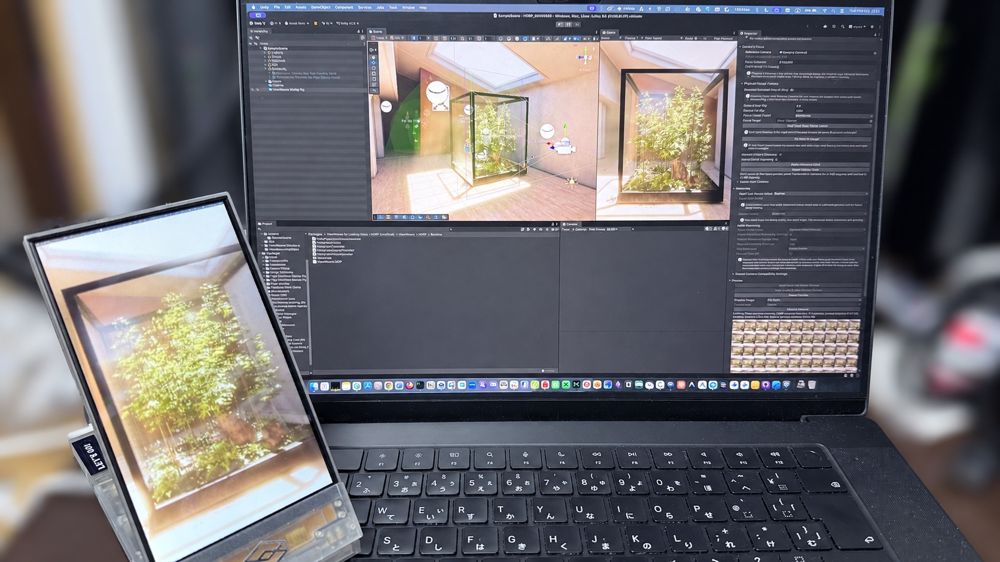

[English](README.md)

# ViewWeave

ViewWeaveは、通常のURPまたはHDRP sceneを多視点Quiltとして描画し、Looking Glassへ出力する非公式Unity SDKです。カメラ構図、Preview、Capture、出力をまとめて操作するRigを提供します。機器へ出力する場合は、公式Looking Glass Bridge runtimeと対応するdisplayを別途用意してください。

現在は実験的な開発版です。Unity 6000.6.4f1のURPまたはHDRPプロジェクトを使います。利用するパイプラインのpackageを一つ選び、**Package Manager > + > Install package from git URL**から追加してください。

- URP: `https://github.com/zabaglione/ViewWeave.git?path=/Distribution/urp#main`
- HDRP: `https://github.com/zabaglione/ViewWeave.git?path=/Distribution/hdrp#main`

## Quick Start

1. 上記からURPまたはHDRP packageを追加し、Package Managerの**Samples**から**URP Quick Start**または**HDRP Quick Start**をImportします。
2. Sample内の`QuickStart.unity`を開きます。
3. **ViewWeave Bridge Rig**を選び、**Preview > Start Looking Glass Device Preview**を開始します。displayがない場合は**Start Local Edit Mode Preview**を選びます。

画像付きの[導入手順](docs/ja/getting-started.md)、日常操作の[ユーザーガイド](docs/ja/user-guide.md)、目的別の[ドキュメント目次](docs/ja/index.md)を用意しています。OS・pipeline・Editor／Player・機器別の確認条件と既知の制限は[対応表](docs/ja/compatibility.md)を参照してください。

実装設計、試験手順、日付を限定した検証記録、調査資料は[技術者向けガイド](docs/ja/technical-guide.md)から辿れます。独自コードは[Apache-2.0](LICENSE)です。Unity PluginAPIなどの外部依存には別の条件があり、[第三者ライセンス表記](docs/ja/THIRD_PARTY_NOTICES.md)に記載しています。公式Looking Glass Bridge runtimeは、その利用条件に従って別途導入してください。
