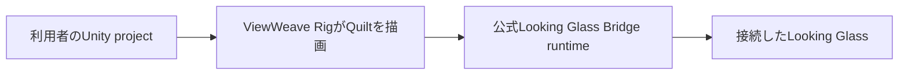

[English](README.md)

# ViewWeave

Looking Glass向けの非公式Unity SDKです。URPまたはHDRPの通常のシーンを複数視点で描画し、Windows上のLooking Glass Bridge runtimeへ送ります。

Looking Glassに表示するときは、利用者自身のUnity projectをEditor PlayするかPlayerとして起動します。UnityがQuiltを描画し、インストール済みで起動中の公式Looking Glass Bridge runtimeが機器へ届けます。SDK内のTests/Bridge Unityプロジェクトやデモアプリを別途起動する必要はありません。

通常runtime Sessionの対応環境はUnity 6000.6.4f1、Windows、URPまたはHDRPです。Bridge WorkerはEditor PlayとWindows PlayerからD3D11またはD3D12で出力し、Legacy DirectはD3D11のみです。Rigの制作向けに、ViewWeaveRigから明示的に開始する別のEdit Mode previewもあります。これはPlay ModeやRigの通常Bridge Sessionを開始しません。D3D11/D3D12 deviceのURP/HDRP fixtureでStart/Stop/Restartとpending 0を確認しました。手動の光学確認は保留中です。隔離Editor fixtureではDomain Reload後のpreview cleanupと手動restartを確認しました。3本のFile > Exit probeではhelperによる停止・回収後にgateのpending 0を確認しましたが、Editor正常終了は未確認です。詳細は[Graphics backends](docs/ja/graphics-backends.md)を参照してください。通常のmacOS Sessionは対象外です。Bridge runtimeとLooking Glass機器を別途用意してください。

macOS Metalは明示opt-inのbounded実験です。通常SessionはMetalを受け付けず、macOS native shimはUPMに含まれません。限定的な手順と未検証範囲は[Graphics backends](docs/ja/graphics-backends.md)を参照してください。

このprivate repositoryからPackage Managerで取得するにはGitHubのアクセス権が必要です。独自コードのライセンスは[Apache-2.0](LICENSE)です。機能別の手順、設計、検証履歴は[ドキュメント目次](docs/ja/index.md)から参照できます。

次図は標準Windows Sessionの概要です。macOS Metal実験、保存したQuiltの再生、別WAVの作成は独立した手順を参照してください。

標準経路は既存のsceneとCameraを使い、再生とBridge接続の手順は[Getting started](docs/ja/getting-started.md)に記載しています。

## 使い始める

1. Unity HubでUnity 6000.6.4f1のURPまたはHDRPテンプレートからプロジェクトを作り、Unity Editorで開きます。
2. `Window > Package Management > Package Manager`の`+ > Install package from git URL`を選び、利用するpipelineのURLを追加します。
   - URP: `https://github.com/zabaglione/ViewWeave.git?path=/Distribution/urp#main`
   - HDRP: `https://github.com/zabaglione/ViewWeave.git?path=/Distribution/hdrp#main`
3. 配布packageにはCore、Bridge、選択したpipelineが含まれます。追加のViewWeave packageは不要です。Package ManagerのSamplesは任意で、ImportするまでAssetsへ入りません。標準Cubeから試す場合はImport不要です。
4. WindowsへLooking Glass Bridge runtimeをインストールして、対象機器を接続します。
5. シーンに通常のCubeまたはBoxを置き、必要なmaterialとlightを設定します。特別なobject scriptやgeneratorは不要です。
6. Hierarchyで使用中Camera、またはCameraを祖先に持つGameObjectを右クリックして`ViewWeave > Bridge Rig`を選びます。対象Cameraのposeと基本設定はRig作成時にコピーされます。`MainCamera`タグは不要です。
7. CubeをCameraの前に置きます。InspectorをロックせずにRigを編集するには`Window > ViewWeave > Rig Authoring`を開くか、ViewWeaveRig Inspectorを使います。Focus Targetを割り当て、必要なら`Set Focus From Target Center`を明示的に実行します。手順は[Quiltカメラの調整](docs/ja/quilt-authoring.md#edit-mode-authoring-preview)を参照してください。
8. HDRPではPlay前に`Window > Rendering > HDRP Wizard`を開き、HDRP/Global checksの`Lightmap Encoding`が赤い場合は`Fix All Platforms`を実行して`High Quality`にします。`Color Space`も`Linear`であることを確認し、必要ならWizardの`Fix`を実行してください。`Default Render Pipeline`、`Volume`、`Diffusion Profile`、`SRP Batcher`など他の項目が赤い場合も`Fix All`または各項目の`Fix`で設定を整えます。HDRP標準テンプレートでは通常これらの設定は済んでいます。Unityの[HDRP Wizard](https://docs.unity3d.com/Packages/com.unity.render-pipelines.high-definition@17.6/manual/Render-Pipeline-Wizard.html)の手順を参照してください。ViewWeaveは利用者projectのこれらの設定を変更しません。HDRP設定の詳細は[Getting started](docs/ja/getting-started.md)を参照してください。
9. Unity EditorでPlayを押します。

Git packageを更新した後はUnity Editorを正常終了して起動し直し、選択したGraphics APIでPlayします。新しいmanaged assemblyとnative pluginを読み込むために必要です。

Windowsでは、Play中のStop/再開とEditor終了は別の処理です。Editor終了時はBridgeの終了処理を待ち、完了すれば最初の終了操作でUnityを閉じます。完了できない場合は終了をキャンセルして資源を保持します。終了確認をCancelした後は、Bridgeを再び使う前にEditorを再起動してください。Windows D3D12 Editorでは、一度のFile > Exitで正常終了を確認しました。保存確認のCancel動作と過去のaccess violationの原因は未検証です。詳細は[Shutdown validation](docs/shutdown-validation-20261008.md)を参照してください。

Windows Playerで使う場合は、Windows Graphics APIsでD3D11またはD3D12を有効にしてBuild and Runします。Legacy Direct経路を明示的に使う場合はD3D11が必要です。Bridge runtimeが自動検出されない場合だけ、RigのSessionにRuntime Pathを設定します。

## 視点描画数を調整する

Hierarchyで`ViewWeave Bridge Rig`を選び、Inspectorの`QuiltRenderer > View Render Mode`で`Full`、`Half`、`Quarter`を選べます。Fullが既定です。48視点の機器では、どのモードも48タイルのQuiltを出力し、実際に描画する視点数はFullが48、Halfが24、Quarterが12です。描画しないtileには最も近い描画済み視点の画像を使います。視点間の補間は行わないため、HalfとQuarterでは視点角度方向の滑らかさが下がることがあります。この設定はQuilt解像度やPreview/Balanced/Native profileとは別です。速度向上はシーンやGPUで変わるため、数値を保証しません。限定HDRP fixtureの測定と制約は[DX12 HDRP performance investigation](docs/dx12-performance-investigation.md)を参照してください。

## Quiltの保存と再生

Play中に`Window > ViewWeave > Quilt Capture`を開き、完成QuiltのPNG、JSON sidecar、中央view PNGを保存できます。連番を作る場合は出力先とFPSを指定して記録を開始し、必要ならPause/Resumeを使って停止します。生成済みの完成Quilt PNGまたは記録済み連番は`Window > ViewWeave > Quilt Playback`から選び、再生・一時停止・再開できます。再生には、Play中の既存ViewWeave Bridge Rigが正常に映像を出力できる状態である必要があります。PlaybackはBridge sessionを作成しません。D3D11またはD3D12のWindows Editor Playで使います。

音声を含める場合はQuilt Captureの`Start PNG Sequence + Audio`を明示的に選びます。対応するのはWindows Editor Play中の現在のMono音声設定です。SDKはUnityやOSの音声設定を自動変更せず、録音中は通常の音声出力がミュートされることがあります。音声はPNG連番と別のWAVファイルに保存され、MP4書き出しには含まれません。詳しい条件は[Quilt Capture](docs/ja/quilt-capture.md)と[Quilt recording audio](docs/ja/quilt-recording-audio.md)を参照してください。

記録を完了したPNG連番から無音MP4を作るには、`Window > ViewWeave > Quilt Video Export`を使います。FFmpegとffprobe 7.0.2を別途用意してください。SDKはそれらを同梱またはダウンロードしません。詳しくは[Quilt Video Export](docs/quilt-video-export.md)を参照してください。

## カメラの構図調整

ViewWeaveRig Inspectorまたは`Window > ViewWeave > Rig Authoring`を使うと、Rigを固定したままFocus Targetを選べます。紫の面はzero-parallax/focus plane、青緑と橙はNear/Farです。`Set Focus From Target Center`とorbit操作は明示的に行うEdit Modeの制作操作です。CinemachineやanimationはPlay中にReference Cameraのposeを上書きすることがあります。詳しくは[Quiltカメラの調整](docs/ja/quilt-authoring.md#edit-mode-authoring-preview)と[QuiltRenderer低レベル操作](docs/ja/quilt-authoring.md#明示的なカメラ制作操作)を参照してください。

## Edit ModeでRigを制作・プレビューする

Rigの`Preview`カテゴリには`Start Local Edit Mode Preview`と`Start Looking Glass Device Preview`があります。どちらも明示的に開始します。Local previewはEditor内にQuiltを表示し、device previewはWindows D3D11/D3D12のBridge Worker経路でQuiltを送ります。Unity Play ModeやRigの通常Bridge Sessionは開始しません。`Stop Preview`で停止できます。Authoring windowで別Rigへ切り替えた場合と、preview対象Rigを表示中のwindowを閉じた場合も停止を要求します。URP/HDRP local GPU fixtureは2/2 PASSし、layout再構築、旧textureのproof後retirement、Stop/readback proof、retention pending 0を確認しました。D3D11/D3D12 device fixtureもURP/HDRPで48 viewのStart/Stop/Restart後pending 0を確認しました。手動光学確認は保留中です。隔離hidden Editor fixtureでDomain Reload後のpreview cleanupと明示restartを確認しましたが、File > Exit quit gateの資源回収は3 probeで確認済みですが、全Editor processがteardown中に0xC0000005で終了し、正常終了は未確認です。詳細は[Graphics backends](graphics-backends.md)を参照してください。

PreviewにはRig設定を基にした別のEditor-owned producerを使います。開始・停止だけでpreview状態が保存sceneへ書き戻されることはありません。`Camera & Focus`や`Rendering`などで行った通常の編集は、各設定の保存先へ反映されます。詳しくは[制作フロー](docs/ja/quilt-authoring.md#edit-mode-authoring-preview)を参照してください。

対応条件と既知の制約は[Compatibility](docs/ja/compatibility.md)、Windows上の検証範囲は[Windows validation](docs/windows-validation.md)を参照してください。

## 任意のサンプル

付属の`Windows URP Lit`と`Windows HDRP Lit`はPackage ManagerのViewWeave package詳細にあるSamplesから明示的にImportできます。Import後、既存のBridge RigへURPなら`BridgeUrpLitSampleGenerator`、HDRPなら`BridgeHdrpLitSampleGenerator`をAdd Componentし、`Generate On Start`を有効にするかInspectorの`Generate Lit Scene`を実行します。詳しくは[サンプル手順](docs/ja/getting-started.md#任意のsamplesをimportする)を参照してください。packageを追加しただけではサンプルがAssetsへコピーされません。

## HDRPと色空間

HDRPとVFX GraphはLinear color spaceが必須です。HDRP Wizardの`Lightmap Encoding`はHDRPで`High Quality`を使うための設定です。HDRP adapterはquiltの描画中だけMotion Blur、SSR、SSGI、volumetric fog、volumetric cloudsを抑え、TAAを一時停止します。Auto Exposureは全quilt viewで同じFixed EV 12にし、元のVolume stackがFixedならそのEVを保ちます。通常のFog、Sky、Bloomなどは維持されます。HDRP adapterの詳細と制約は[Compatibility](docs/ja/compatibility.md)を参照してください。

## テストプロジェクト

テスト環境の準備は[テストプロジェクトのREADME](Tests/Pipelines/README.ja.md)、実行方法は[導入ガイドのテストプロジェクト](docs/ja/getting-started.md#テストプロジェクト)を参照してください。

## 検証資料

- [ドキュメント目次](docs/ja/index.md): 利用者向け、開発者向け、検証履歴の資料を目的別に案内します。

- [Getting started](docs/ja/getting-started.md): Editor PlayとPlayerの手順
- [Compatibility](docs/ja/compatibility.md): 対応条件と既知の制約
- [Windows validation](docs/windows-validation.md): 実行済み試験と結果
- [Shutdown validation](docs/shutdown-validation-20261008.md): Windows shutdown lifecycle、歴史的AV記録と現在の検証状態
- [残作業と受け入れ計画](docs/remaining-work-plan.md): 次に行う作業と完了条件
- [残作業の検証記録](docs/benchmarks/remaining-work-validation-20261007.md): 2026-10-07の限定DX12 captureと終了診断
- [DX12 HDRP performance investigation](docs/dx12-performance-investigation.md): Profiler調査と視点数削減の実測
- [Legacy render pipeline investigation](docs/legacy-render-pipeline-investigation.md): 旧Looking Glass専用pipelineの調査と採用した投影計算
- [公式SDK機能調査](docs/official-sdk-feature-research.md): Quilt保存、連番録画、カメラ操作の比較
- [Unity多視点最適化調査](docs/unity-multiview-research.md): Unityと研究での描画最適化
- [XR Display Provider調査](docs/xr-provider-investigation.md): 既存Cameraを使うXR連携方式の調査（採用・試作は保留）
- [Unity feature coverage](docs/unity-feature-coverage.md): Unity機能ごとの確認範囲
- [VFX Graph](docs/ja/vfx-graph.md): VFX Graph利用時の条件
- [Third-party notices](docs/ja/THIRD_PARTY_NOTICES.md): 外部ライセンス
