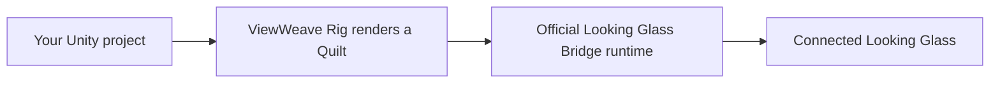

[日本語](README.ja.md)

# ViewWeave

An unofficial Unity SDK for Looking Glass. It renders a regular URP or HDRP scene from multiple views and sends the result to the Looking Glass Bridge runtime on Windows.

To display content on a Looking Glass, run your own Unity project in the Editor or as a Player. Unity renders the Quilt, and the installed, running official Looking Glass Bridge runtime sends it to the device. You do not need to launch the SDK's `Tests/Bridge` Unity project or a separate demo app.

The supported environment is Unity 6000.6.4f1 on Windows with URP or HDRP. The Bridge Worker path outputs from Unity Editor Play and Windows Players using D3D11 or D3D12. Legacy Direct supports D3D11 only. Edit Mode and regular macOS sessions are outside the supported scope. Provide the Bridge runtime and Looking Glass device separately.

macOS Metal is a bounded experiment that requires explicit opt-in. Regular sessions do not accept Metal, and the macOS native shim is not included in UPM. See [Graphics backends](docs/graphics-backends.md) for the limited procedure and unverified areas.

Access to this private repository is required to install its packages through the Package Manager. Original code is licensed under [Apache-2.0](LICENSE). See the [documentation index](docs/index.md) for feature guides, design notes, and validation records.

The diagram below shows a regular Windows session. See the separate guides for the macOS Metal experiment, playback of saved Quilts, and creation of a separate WAV file.

The regular path uses your existing scene and Camera. See [Getting started](docs/getting-started.md) for playback and Bridge connection steps.

## Get started

1. In Unity Hub, create a project from a Unity 6000.6.4f1 URP or HDRP template and open it in the Unity Editor.
2. Choose `Window > Package Management > Package Manager`, select `+ > Install package from git URL`, and add the URL for your pipeline:
   - URP: `https://github.com/zabaglione/ViewWeave.git?path=/Distribution/urp#main`
   - HDRP: `https://github.com/zabaglione/ViewWeave.git?path=/Distribution/hdrp#main`
3. The distribution package contains Core, Bridge, and the selected pipeline. No additional ViewWeave package is required. Package Manager Samples are optional and are not copied into Assets until imported. You can start with a standard Cube without importing a sample.
4. Install the Looking Glass Bridge runtime on Windows and connect the device.
5. Add a regular Cube or Box to the scene and assign materials and lights as needed. No special object script or generator is required.
6. In the Hierarchy, right-click the active Camera or a GameObject with a Camera ancestor and choose `ViewWeave > Bridge Rig`. The Rig copies the Camera pose and basic settings when it is created. The `MainCamera` tag is not required.
7. Place the Cube in front of the Camera. If needed, adjust `QuiltRenderer > Settings > Camera Distance` (`cameraDistance`) on the Rig. See [Getting started](docs/getting-started.md#display-an-existing-cube-or-box) for how the focus distance is chosen.
8. For HDRP, open `Window > Rendering > HDRP Wizard` before Play. If `Lightmap Encoding` under HDRP/Global checks is red, run `Fix All Platforms` and set it to `High Quality`. Confirm `Color Space` is `Linear`, and use the Wizard's `Fix` if needed. Fix other red items such as `Default Render Pipeline`, `Volume`, `Diffusion Profile`, or `SRP Batcher` as well. HDRP templates usually have these settings already. Follow Unity's [HDRP Wizard](https://docs.unity3d.com/Packages/com.unity.render-pipelines.high-definition@17.6/manual/Render-Pipeline-Wizard.html) guidance. ViewWeave does not change these settings in your project. See [Getting started](docs/getting-started.md) for HDRP details.
9. Press Play in the Unity Editor.

After updating the Git package, close the Unity Editor normally and reopen it, then Play with the selected Graphics API. This loads the updated managed assembly and native plugin.

On Windows, stopping or resuming Play and exiting the Editor are separate operations. On Editor exit, ViewWeave waits for Bridge shutdown and closes Unity on the first exit action when cleanup completes. If it cannot complete, it cancels the exit and retains resources. After canceling an exit confirmation, restart the Editor before using Bridge again. A single `File > Exit` was confirmed to shut down normally in Windows D3D12 Editor. Save-confirmation cancellation and the cause of historical access violations remain unverified. See [Shutdown validation](docs/shutdown-validation-20261008.md).

For a Windows Player, enable D3D11 or D3D12 under Windows Graphics APIs and use Build and Run. Set Runtime Path on the Rig's Session only if the Bridge runtime is not discovered automatically. The Legacy Direct path requires D3D11.

## Change the number of rendered views

Select `ViewWeave Bridge Rig` in the Hierarchy and choose `Full`, `Half`, or `Quarter` under `QuiltRenderer > View Render Mode` in the Inspector. Full is the default. On a 48-view device, every mode outputs a 48-tile Quilt; the number of views actually rendered is 48 for Full, 24 for Half, and 12 for Quarter. Unrendered tiles use the image from the nearest rendered view. There is no interpolation between views, so Half and Quarter may reduce angular smoothness. This setting is separate from Quilt resolution and the Preview/Balanced/Native quality profile. Speed gains depend on the scene and GPU and are not guaranteed. See [DX12 HDRP performance investigation](docs/dx12-performance-investigation.md) for measurements and limitations from a bounded HDRP fixture.

## Save and play back Quilts

During Play, open `Window > ViewWeave > Quilt Capture` to save a completed Quilt as PNG, a JSON sidecar, and a central-view PNG. To create a sequence, choose an output location and FPS, start recording, and use Pause/Resume if needed. Select a completed Quilt PNG or recorded sequence from `Window > ViewWeave > Quilt Playback` to play, pause, or resume it. Playback requires an existing ViewWeave Bridge Rig in Play that can output video. Playback does not create a Bridge session. Use Windows Editor Play with D3D11 or D3D12.

To include audio, explicitly choose `Start PNG Sequence + Audio` in Quilt Capture. This supports the current Mono audio configuration during Windows Editor Play. The SDK does not change Unity or OS audio settings, and normal audio output may be muted during recording. Audio is saved to a separate WAV file alongside the PNG sequence and is not included in MP4 export. See [Quilt Capture](docs/quilt-capture.md) and [Quilt recording audio](docs/quilt-recording-audio.md) for requirements.

To create a silent MP4 from a completed PNG sequence, use `Window > ViewWeave > Quilt Video Export`. Provide FFmpeg and ffprobe 7.0.2 separately. The SDK does not bundle or download them. See [Quilt Video Export](docs/quilt-video-export.md).

## Adjust camera framing

Use Camera Framing in the QuiltRenderer Inspector and the Scene View to inspect the rendered area. The purple plane is the zero-parallax/focus plane; teal and orange planes are Near and Far. For manual adjustments, use Camera Authoring in Edit Mode. Lock the Inspector, select a target object, and set the focus distance from the selected object or move the Scene View to the center of the focus plane. Horizontal and vertical orbit rotate camera position and orientation together around the focus point. The 3D focus cursor is toggled separately and is off by default. Check the Effective Camera in the Inspector. Cinemachine or animation may override the camera pose during Play. See [Quilt camera authoring](docs/quilt-authoring.md#explicit-camera-authoring-controls).

See [Compatibility](docs/compatibility.md) for support conditions and known limitations, and [Windows validation](docs/windows-validation.md) for tested Windows configurations.

## Optional samples

Import `Windows URP Lit` or `Windows HDRP Lit` from Samples on the ViewWeave package details in Package Manager. After import, add `BridgeUrpLitSampleGenerator` for URP or `BridgeHdrpLitSampleGenerator` for HDRP to an existing Bridge Rig. Enable `Generate On Start` or run `Generate Lit Scene` from the Inspector. See [Import optional samples](docs/getting-started.md#import-optional-samples). Adding the package alone does not copy Samples into Assets.

## HDRP and color space

HDRP and VFX Graph require Linear color space. `Lightmap Encoding` in HDRP Wizard must be set to `High Quality` for HDRP. During Quilt rendering, the HDRP adapter suppresses Motion Blur, SSR, SSGI, volumetric fog, and volumetric clouds, and temporarily pauses TAA. Auto Exposure uses a shared Fixed EV 12 across all Quilt views; if the original Volume stack is Fixed, its EV is preserved. Regular Fog, Sky, and Bloom remain enabled. See [Compatibility](docs/compatibility.md) for HDRP adapter details and limitations.

## Test projects

See [Tests/Pipelines/README.md](Tests/Pipelines/README.md) for test setup and [the test-project section in Getting started](docs/getting-started.md#test-projects) for execution steps.

## Validation documents

- [Documentation index](docs/index.md): guides for users, developers, and validation history.
- [Getting started](docs/getting-started.md): Editor Play and Player procedures.
- [Compatibility](docs/compatibility.md): supported configurations and known limitations.
- [Windows validation](docs/windows-validation.md): executed tests and results.
- [Shutdown validation](docs/shutdown-validation-20261008.md): Windows shutdown lifecycle, historical AV records, and current validation status.
- [Remaining work plan](docs/remaining-work-plan.md): next tasks and completion criteria.
- [Remaining-work validation record](docs/benchmarks/remaining-work-validation-20261007.md): bounded DX12 capture and shutdown diagnostics from 2026-10-07.
- [DX12 HDRP performance investigation](docs/dx12-performance-investigation.md): Profiler investigation and measured view-count reduction.
- [Legacy render pipeline investigation](docs/legacy-render-pipeline-investigation.md): investigation of the legacy Looking Glass pipeline and adopted projection calculation.
- [Official SDK feature research](docs/official-sdk-feature-research.md): comparison of Quilt saving, sequence recording, and camera controls.
- [Unity multiview optimization research](docs/unity-multiview-research.md): rendering optimization in Unity and research.
- [XR Display Provider investigation](docs/xr-provider-investigation.md): XR integration using an existing Camera (adoption and prototype deferred).
- [Unity feature coverage](docs/unity-feature-coverage.md): validation scope by Unity feature.
- [VFX Graph](docs/vfx-graph.md): conditions for using VFX Graph.
- [Third-party notices](docs/THIRD_PARTY_NOTICES.md): external licenses.
