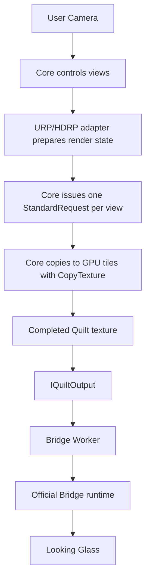

[日本語](ja/architecture.md)

# Architecture

ViewWeave is an unofficial Unity SDK developed independently of the official SDK. It separates Core, URP and HDRP adapters, and Bridge output. Its supported targets are URP and HDRP validated on Unity 6000.6.4f1. Built-in is unsupported, and Core requires the Standard RenderRequest path.

## Current data path

The diagram shows the regular Windows URP/HDRP Bridge Worker path. The adapter prepares render state, then Core issues StandardRequests and transfers tiles on the GPU. The Metal experiment and file playback use separate paths.

The adapter prepares view rendering before the Quilt is complete; `IQuiltOutput` passes the completed Quilt to the output path. The Bridge Worker sends it to the official Bridge runtime over GPU sharing. Core performs one render request per view.

Core temporarily controls one dedicated Camera and renders N times, once per view. It sets the view translation and off-axis frustum, then transfers the result to a GPU Quilt tile with `Graphics.CopyTexture`. Rendering is not shared between views, so one Camera still incurs N renders, culling operations, shadows, and post-processing passes. The regular path does not use CPU readback.

`IQuiltOutput` passes the public Quilt RenderTexture and `QuiltLayout` to the output path. Bridge input requires a Quilt, so the Quilt alone is not identified as a performance bottleneck. Core does not directly handle a native library, socket, or Bridge protocol; it remains replaceable with Bridge and test outputs.

URP/HDRP use a dedicated Guard and `RenderPipeline.StandardRequest`. The Guard reuses a `VolumeStack`, but does not guarantee separate temporal history or independent TAA per view. TAA is disabled only while rendering and restored afterward. Game simulation, Physics, and Animation do not repeat per view, but side effects in user render callbacks and sharing of temporal state still require separate validation.

## Output and Bridge

Session selects a device profile dynamically and uses auto-detection as its primary path. Regular use requires the official Bridge runtime separately. `BridgeQuiltOutput` and Legacy Direct support Windows D3D11 only. The standard `BridgeWorkerQuiltOutput` path supports Windows D3D11 and D3D12 in Editor Play and Players. On D3D12, the Quilt is GPU-shared from Unity's D3D12 device to a D3D11 worker on the same GPU, and the worker sends it to the official Bridge. This path does not use CPU image readback. Regular Bridge Sessions do not run in Edit Mode. For authoring, a separate, explicitly started `ViewWeaveRig` Editor preview is available on Windows D3D11/D3D12; it is distinct from regular Sessions and Playback. URP/HDRP local GPU fixtures confirmed layout rebuild and Stop/readback proof with zero pending retention. D3D11 and D3D12 device fixtures confirmed URP/HDRP Start/Stop/Restart at a 3840x2160 display profile and 7680x4320, 8x6/48-view Quilt, with one submission/completion for each Start and Restart and zero native/retention pending after Stop. Manual optical review remains pending. An isolated Editor fixture confirmed cleanup and explicit restart across Domain Reload; see [Graphics backends](graphics-backends.md) for File > Exit results; normal Editor exit remains unverified. Regular sessions target Windows only. `BridgeMetalExperimentalOutput` is an independent component limited to at most three Quilts; the macOS native shim is not included in UPM, and this is not supported for physical-device operation. See [Graphics backends](graphics-backends.md) for ABI, manual artifact, and lifetime-validation details.

The Worker separates Quilt copies on Unity's render thread from its owned D3D11 device, a three-slot shared-GPU ring, worker-side rendering, the WM message pump, and shutdown/reopen. A D3D11 baseline with 349 draw tests passed on RTX 3090 Ti, covering shared-resource handoff, ring reuse, typeless formats, timeouts, late completion, device-removal seams, and generations. Loader lifecycle tests using a fake Bridge runtime passed 100 cycles. Windows D3D12 Editor Play was checked for two cycles per URP/HDRP pipeline with Domain Reload enabled and disabled. In the fixed-fixture D3D12 Player matrix, URP/HDRP Development and Release runs completed Preview, Balanced, Native, then Preview; Native-quality Player execution is confirmed within that matrix. Development performed 10 Native restarts per pipeline; Release performed one. The user's HDRP VFX Learning Templates project at snapshot `8adda27c` also completed Native 7680x4320, 48-view Editor Play and stopped with Idle/Closed and zero pending work. This matrix did not toggle GRD. Optical quality for all 48 views in arbitrary user projects, WARP, and other GPUs remain unverified. Windows CI skips hardware D3D12.

On failure, the Worker enters `Fault` and retains GPU resource references until shutdown completes while submission state is uncertain. If a pending native shutdown does not resolve, recovery requires restarting the Unity Editor/Player. This is a technical recovery boundary, not part of normal setup. It does not cover physical hotplug or hangs with arbitrary device connections.

The Bridge path separates copies from the Unity render thread, Bridge Worker rendering, the WM message pump, asynchronous drain on exit, resize, and reopen. The shared GPU ring buffer has three slots. If the queue is full, a new submission is dropped while queued submissions are retained. Same-process Worker reconnect and zero pending work on shutdown have been measured. Manual optical review of all 48 views, hotplug, and acceptance with multiple devices remain incomplete.

## Verified and unverified scope

Basic Lit, Bloom, transparent Lit, uGUI, particles, and UI Toolkit have been tested on Unity 6000.6.4f1, Windows, and D3D11 with URP/HDRP. Results are limited to individual fixture conditions and do not imply support for every material or render path. HDRP requires Linear color space. During Quilt views, the HDRP adapter enables a dedicated Volume override that suppresses Motion Blur, SSR, SSGI, and volumetric fog/clouds; it sets one shared Fixed EV for all views. If the original stack is Fixed, its EV is preserved. Regular Fog, Sky, and Bloom remain enabled, and the user's MainCamera, original Volume, and Project Settings are not changed. Regular macOS sessions are unsupported. The Metal native experiment has not been tested on a physical Mac with Bridge. Long-duration behavior and general performance are also unverified.

The following items remain validation targets for defining support:

| Area | Status |
| --- | --- |
| Animator, SkinnedMeshRenderer, Terrain, LOD, shadows | Individual geometry fixtures checked. Support for general content including Animator remains undetermined. |
| Shader Graph, Renderer Feature, Decal, Reflection Probe, Light Probe | Limited Shader Graph and Renderer Feature fixtures. General use of Decal, Reflection Probe, and Light Probe is unverified. |
| HDRP SSR, SSGI, volumetric fog/clouds, Motion Blur | Temporarily suppressed by adapter override only during Quilt views. Regular rendering and original Volume settings are retained. |
| FXAA, SMAA, MSAA, color grading, TAA history, Auto Exposure | Limited FXAA/SMAA and some color-grading fixtures. URP MSAA 1/1 checked under one condition. Independent TAA histories, HDRP MSAA, and performance are unverified. HDRP Auto Exposure is temporarily converted to a shared Fixed EV during Quilt views. |
| UI using RenderTexture, input ray map, VideoTexture | Individual uGUI and UI Toolkit fixtures checked. Input ray maps and VideoTexture are unverified. |
| LineRenderer, TrailRenderer, VFX Graph, complex transparent sorting | Line/Trail checked in individual fixtures. URP Simple Burst checked in a Player for six stop conditions and four regular-play conditions. HDRP, general VFX, and complex sorting remain undetermined. |
| Multiple devices, hotplug, RGBD, Quilt layers | Unimplemented or unverified. |
| Quilt saving, sequence recording, silent MP4 | Capture PNG/sequence and silent MP4 export are implemented and checked in bounded fixtures. Mono audio is saved to a separate WAV. Bridge delivery, audio muxing, and physical-device quality are unverified. |

## How to interpret performance measurements

`LastCpuSubmissionTicks` times only the CPU render-submission interval and excludes `BridgeSubmit`. It does not represent GPU time, render-thread time, transfer time, or present latency. Reducing GPU load without reducing view count is not guaranteed; measure each scene on the same device with the same Quilt settings. Do not attribute overall slowness to Quilt tile transfer alone.

Performance optimization is deferred pending validation. Existing Scene View Gizmo camera authoring is retained; Gizmo overlays in the Quilt are out of scope. GPU Resident Drawer and reuse of work shared between views are independent validation items. No implementation has replaced the existing one-Camera, N-render path. Decide whether to adopt an optimization only after its results are checked.

## Implemented validation and remaining gates

The M1 regular-thread path completed implementation and API validation for call-stack, thread-ID, and device-context collection; Unity-render-thread-only copying; the Worker-owned device; the three-slot ring buffer; resize; and close/reopen. Measurements covered 120 draws per case including same-process reconnect, zero pending work at shutdown, and host-thread reuse. Quality, optics, distribution signing, hotplug, and multiple devices remain release gates. Do not conflate regular-thread results with the Direct path.

M2 Session, Registry, Locator, and Rig menu compile, and 18 Session tests passed. Session was checked in 48-view Player for the six individual combinations of URP/HDRP Preview, Balanced, Native, and GRD on/off. Under fixed URP/HDRP quality-switch conditions, four stages completed 122 times each; explicit Stop/Start was followed by 120 draws and zero pending work. General Registry operation, hotplug, multiple devices, and optical quality remain unverified. GRD is evaluated for MeshRenderer-focused cases; it does not reduce Core's one-Camera, N-render path or full render count. VolumeStack caching is applied and fixed-condition CPU submission comparisons exist, but GPU and render-thread times have not been collected.
