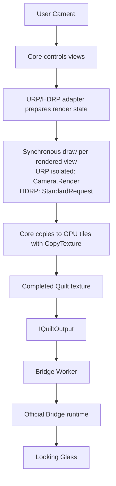

[日本語](ja/architecture.md)

# Architecture

> Audience: Unity, rendering, and package developers. This page covers the technical design, implementation, or procedure stated below. For user workflows, see the [User guide](user-guide.md); for the complete technical index, see the [Technical guide](technical-guide.md).

ViewWeave is an unofficial Unity SDK developed independently of the official SDK. It separates Core, URP and HDRP adapters, and Bridge output. Its supported targets are URP and HDRP validated on Unity 6000.6.4f1. Built-in is unsupported. SRP rendering normally uses Standard RenderRequests; URP isolated-history rendering uses a synchronous adapter executor so TAA can write per-view history.

## Current data path

The diagram shows the regular Windows URP/HDRP Bridge Worker path. The adapter prepares render state and selects the per-view draw path; Core transfers completed views to Quilt tiles on the GPU. The Metal experiment and file playback use separate paths.

The adapter prepares view rendering before the Quilt is complete; `IQuiltOutput` passes the completed Quilt to the output path. The Bridge Worker sends it to the official Bridge runtime over GPU sharing. Core renders each selected logical view synchronously before copying its image into the Quilt.

Core computes each logical view's translation and off-axis frustum, obtains its camera from the render session, and transfers each completed image to a GPU Quilt tile with `Graphics.CopyTexture`. HDRP's default `IsolatedViewHistories` mode owns one Camera and `HDAdditionalCameraData` per rendered logical view, copies HDRP camera settings from the Reference Camera, and sets `hasPersistentHistory = true` on each view camera. This isolates HDRP history but does not reduce view renders, culling operations, shadows, or post-processing passes. Quilt images stay on the GPU; HDRP exposure metering separately reads back one float asynchronously.

`IQuiltOutput` passes the public Quilt RenderTexture and `QuiltLayout` to the output path. Bridge input requires a Quilt, so the Quilt alone is not identified as a performance bottleneck. Core does not directly handle a native library, socket, or Bridge protocol; it remains replaceable with Bridge and test outputs.

URP/HDRP use a dedicated Guard and render session. In the default URP `IsolatedViewHistories` mode, every rendered logical view owns a disabled Camera, `UniversalAdditionalCameraData`, and persistent URP history. The adapter copies supported public rendering settings from the Reference Camera (or the Rig Source Camera when reference settings are not followed). Standard RenderRequests suppress URP TAA history writes, so this path uses the public `Camera.Render()` API through the synchronous `IQuiltViewRenderExecutor`. It copies authored TAA parameters without replacing the whole settings struct or resetting each view's history on every frame. URP TAA requires Post Processing, a single-sample target, a Universal Renderer, and no Camera Stack or dynamic resolution. With Post Processing enabled, active URP Volume Motion Blur is rejected because its Quilt behavior is unvalidated. In URP `SharedCameraCompatibility`, the existing shared-camera guard temporarily disables TAA and restores it after rendering. HDRP continues to use Standard RenderRequests; its default `IsolatedViewHistories` mode gives each rendered logical view its own persistent Camera history. Game simulation, Physics, and Animation do not repeat per view, but side effects in user render callbacks still require separate validation.

Core selects target samples before opening the render session. The optional `IQuiltMsaaSettingsProvider` receives Source and Reference Cameras so URP can use the effective renderer's MSAA support; Source `allowMSAA` remains authoritative. Providers implementing only `IQuiltMsaaProvider` keep their existing fallback. Deferred output remains single-sample, including its TAA path.

## Output and Bridge

Session selects a device profile dynamically and uses auto-detection as its primary path. Regular use requires the official Bridge runtime separately. `BridgeQuiltOutput` and Legacy Direct support Windows D3D11 only. The standard `BridgeWorkerQuiltOutput` path supports Windows D3D11 and D3D12 in Editor Play and Players. On D3D12, the Quilt is GPU-shared from Unity's D3D12 device to a D3D11 worker on the same GPU, and the worker sends it to the official Bridge. This path does not use CPU image readback. Regular Bridge Sessions do not run in Edit Mode. For authoring, a separate, explicitly started `ViewWeaveRig` Editor preview is available on Windows D3D11/D3D12; it is distinct from regular Sessions and Playback. URP/HDRP local GPU fixtures confirmed layout rebuild and Stop/readback proof with zero pending retention. D3D11 and D3D12 device fixtures confirmed URP/HDRP Start/Stop/Restart at a 3840x2160 display profile and 7680x4320, 8x6/48-view Quilt, with one submission/completion for each Start and Restart and zero native/retention pending after Stop. Manual optical review remains pending. An isolated Editor fixture confirmed cleanup and explicit restart across Domain Reload; see [Graphics backends](graphics-backends.md) for File > Exit results; normal Editor exit remains unverified. Regular Sessions target Windows only. macOS Looking Glass Go uses a separate `BridgeMetalQuiltOutput` path with the arm64 native shim included in the package. Bounded URP/HDRP template Edit Mode device previews were checked on Unity 6000.6.4f1, Apple M3 Max, and macOS 26.6.2; the user accepted orientation, depth, and brightness on the connected Go. This does not establish exhaustive view/color/scale quality or general performance. The older `BridgeMetalExperimentalOutput` is a separate finite diagnostic route. See [macOS Metal](macos-metal.md) and the [dated validation record](macos-metal-validation-20261010.md) for current conditions; [Graphics backends](graphics-backends.md) describes the earlier experiment's ABI and lifetime boundaries.

The Worker separates Quilt copies on Unity's render thread from its owned D3D11 device, a three-slot shared-GPU ring, worker-side rendering, the WM message pump, and shutdown/reopen. A D3D11 baseline with 349 draw tests passed on RTX 3090 Ti, covering shared-resource handoff, ring reuse, typeless formats, timeouts, late completion, device-removal seams, and generations. Loader lifecycle tests using a fake Bridge runtime passed 100 cycles. Windows D3D12 Editor Play was checked for two cycles per URP/HDRP pipeline with Domain Reload enabled and disabled. In the fixed-fixture D3D12 Player matrix, URP/HDRP Development and Release runs completed Preview, Balanced, Native, then Preview; Native-quality Player execution is confirmed within that matrix. Development performed 10 Native restarts per pipeline; Release performed one. The user's HDRP VFX Learning Templates project at snapshot `8adda27c` also completed Native 7680x4320, 48-view Editor Play and stopped with Idle/Closed and zero pending work. This matrix did not toggle GRD. Optical quality for all 48 views in arbitrary user projects, WARP, and other GPUs remain unverified. Windows CI skips hardware D3D12.

On failure, the Worker enters `Fault` and retains GPU resource references until shutdown completes while submission state is uncertain. If a pending native shutdown does not resolve, recovery requires restarting the Unity Editor/Player. This is a technical recovery boundary, not part of normal setup. It does not cover physical hotplug or hangs with arbitrary device connections.

The Bridge path separates copies from the Unity render thread, Bridge Worker rendering, the WM message pump, asynchronous drain on exit, resize, and reopen. The shared GPU ring buffer has three slots. If the queue is full, a new submission is dropped while queued submissions are retained. Same-process Worker reconnect and zero pending work on shutdown have been measured. Manual optical review of all 48 views, hotplug, and acceptance with multiple devices remain incomplete.

## Verified and unverified scope

Older Windows/D3D11 fixtures cover Basic Lit, Bloom, transparent Lit, uGUI, particles, and UI Toolkit with URP/HDRP; they do not validate every material/render path. A 2026-10-11 Unity 6000.6.4f1 Metal PlayMode `GraphicsCompatibility` run passed 58/58 with zero skips, including eight URP adapter tests for four-view history accumulation, separate targets and pixel comparisons, stable frame-version checks, pruning, resize/restart, budget cleanup, and scripted Volume preservation. Separate bounded Metal Edit Mode and rendering-only Development/Release Player runs also exercised TAA. These checks do not cover Windows, Bridge device output, or physical-device optical quality. See the [URP view-history validation](urp-view-history-validation-20261011.md) for the dated scope. HDRP requires Linear color space. Its default `FollowScene` exposure meters the central view on the GPU, includes exposure compensation, and shares the resulting Fixed exposure across the Quilt with compensation set to zero. An authored Fixed scene exposure uses `fixedExposure - compensation`; `ManualFixed` is an explicit choice. The initial neutral meter sample is discarded, so no Quilt is output while exposure history warms up. The default isolated-history path preserves authored HDRP effects, including TAA, SSR, SSGI, volumetric fog/clouds, and Motion Blur; effect-specific pixel correctness is not established. The explicit shared-camera compatibility mode retains the older adaptations. The controls are grouped under **Rig > Rendering**. The History Resource Budget defaults to 4096 MB and Maximum History Cameras to 256. The budget stops output when the larger of observed graphics-driver growth or estimated storage for new/grown RenderTextures exceeds the limit; it also enforces the camera-count ceiling. It includes shared allocations and omits unobservable buffers and driver overhead, so it is not a complete VRAM cap. See the [HDRP view-history validation](hdrp-view-history-validation-20261010.md) for the measured scope. Regular macOS Sessions remain unsupported. The separate Looking Glass Go Metal preview path was checked in bounded URP/HDRP template conditions on a Mac; the user accepted orientation, depth, and brightness, while exhaustive optical quality, colorimetry, long-duration behavior, and general performance remain unverified. See the [dated macOS validation](macos-metal-validation-20261010.md). The earlier finite `BridgeMetalExperimentalOutput` experiment is not the current Go route.

The following items remain validation targets for defining support:

| Area | Status |
| --- | --- |
| Animator, SkinnedMeshRenderer, Terrain, LOD, shadows | Individual geometry fixtures checked. Support for general content including Animator remains undetermined. |
| Shader Graph, Renderer Feature, Decal, Reflection Probe, Light Probe | Limited Shader Graph and Renderer Feature fixtures. General use of Decal, Reflection Probe, and Light Probe is unverified. |
| HDRP SSR, SSGI, volumetric fog/clouds, Motion Blur, TAA | The default isolated-history mode keeps authored settings. Only explicit `SharedCameraCompatibility` disables SSR, SSGI, clouds, and Motion Blur, disables TAA, and changes volumetric fog filtering to Gaussian. Per-effect pixel correctness is unverified. |
| URP TAA / temporal history | Default `IsolatedViewHistories` gives every rendered logical view an independent persistent history and uses the synchronous `Camera.Render()` executor. TAA requires Post Processing, a single-sample target, a Universal Renderer, and no Camera Stack or dynamic resolution. Active Volume Motion Blur is rejected when Post Processing is enabled. The Metal Editor PlayMode run passed 58/58 with zero skips, including eight URP adapter tests; Separate bounded Metal Edit Mode and rendering-only Player runs are covered by the dated record; Windows and physical-device optical validation remain unverified. See [the dated URP record](urp-view-history-validation-20261011.md). |
| FXAA, SMAA, MSAA, color grading, temporal history, Auto Exposure | Limited FXAA/SMAA and some color-grading fixtures. URP MSAA has four Metal lifecycle checks and a Source/Reference renderer-pair check. HDRP creates separate persistent histories per rendered logical view. HDRP exposure follows the scene by default; Windows URP TAA and per-effect visual correctness remain unverified. |
| UI using RenderTexture, input ray map, VideoTexture | Individual uGUI and UI Toolkit fixtures checked. Input ray maps and VideoTexture are unverified. |
| LineRenderer, TrailRenderer, VFX Graph, complex transparent sorting | Line/Trail checked in individual fixtures. URP Simple Burst checked in a Player for six stop conditions and four regular-play conditions. HDRP, general VFX, and complex sorting remain undetermined. |
| Multiple devices, hotplug, RGBD, Quilt layers | Unimplemented or unverified. |
| Quilt saving, sequence recording, silent MP4 | Capture PNG/sequence and silent MP4 export are implemented and checked in bounded fixtures. Mono audio is saved to a separate WAV. Bridge delivery, audio muxing, and physical-device quality are unverified. |

## How to interpret performance measurements

`LastCpuSubmissionTicks` times only the CPU render-submission interval and excludes `BridgeSubmit`. It does not represent GPU time, render-thread time, transfer time, or present latency. Reducing GPU load without reducing view count is not guaranteed; measure each scene on the same device with the same Quilt settings. Do not attribute overall slowness to Quilt tile transfer alone.

Performance optimization is deferred pending validation. Existing Scene View Gizmo camera authoring is retained; Gizmo overlays in the Quilt are out of scope. GPU Resident Drawer and reuse of work shared between views are independent validation items. HDRP's isolated histories add one persistent Camera per rendered logical view but still render each view separately. Decide whether to adopt an optimization only after its results are checked.

## Implemented validation and remaining gates

The M1 regular-thread path completed implementation and API validation for call-stack, thread-ID, and device-context collection; Unity-render-thread-only copying; the Worker-owned device; the three-slot ring buffer; resize; and close/reopen. Measurements covered 120 draws per case including same-process reconnect, zero pending work at shutdown, and host-thread reuse. Quality, optics, distribution signing, hotplug, and multiple devices remain release gates. Do not conflate regular-thread results with the Direct path.

M2 Session, Registry, Locator, and Rig menu compile, and 18 Session tests passed. Session was checked in 48-view Player for the six individual combinations of URP/HDRP Preview, Balanced, Native, and GRD on/off. Under fixed URP/HDRP quality-switch conditions, four stages completed 122 times each; explicit Stop/Start was followed by 120 draws and zero pending work. General Registry operation, hotplug, multiple devices, and optical quality remain unverified. GRD is evaluated for MeshRenderer-focused cases; it does not reduce the number of rendered views or render requests. VolumeStack caching is applied and fixed-condition CPU submission comparisons exist, but GPU and render-thread times have not been collected.
