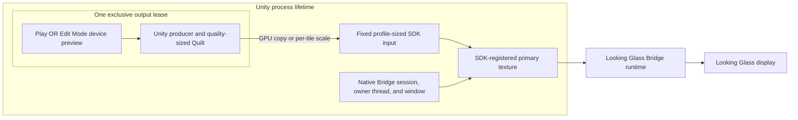
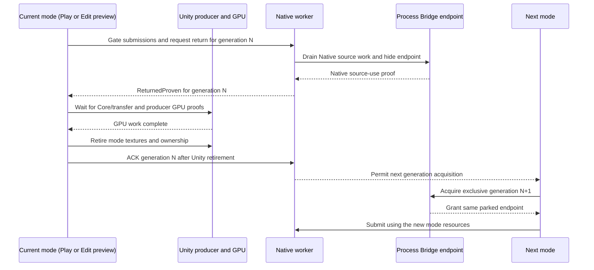

[日本語](ja/bridge-output-lifecycle.md)

# Bridge output lifecycle

The Edit Mode device preview and Play output use one process-level Looking Glass Bridge endpoint. They take turns owning an exclusive output lease. Closing one mode starts a proof-and-ACK return sequence; it does not destroy the process endpoint. The shared-endpoint implementation is present in the reviewed source candidate. Full physical Close/Start and Edit/Play handoff validation is still pending, so the diagrams describe the contract and do not guarantee that the reported black-output cases are fixed.

## Process owner and mode lease

The process owner keeps the Native Bridge SDK session, owner thread and window, the SDK-registered primary texture, and the fixed-size SDK-facing input alive. The endpoint is hidden while no output lease is active. One mode lease at a time owns its Unity producer, camera state, variable-size Quilt/transfer textures, and GPU work for that generation.

The registered primary texture and the Native input keep the same identities across mode leases. A producer Quilt can have different dimensions as quality changes, but its logical grid must remain the same as the fixed device profile. Full process shutdown is the boundary that destroys the endpoint, releases its registered textures, and uninitializes the SDK.

## Pause, resume, close, and handoff

| Action | Mode producer and Unity textures | Output lease | Process Bridge endpoint |
| --- | --- | --- | --- |
| Pause Preview | Retained after submissions drain | Retained with the same generation | Hidden and parked; SDK session stays initialized |
| Resume Preview | Reused | Same generation resumes | Shown again through the same endpoint |
| Close Preview | Retired after native return proof and Core/transfer/producer GPU proofs | Native reports return proof; managed ACK follows texture retirement | Hidden and parked; next lease is blocked until ACK |
| Play/Edit handoff | Old mode is stopped and its textures are retired after both proof stages | Old generation is acknowledged before a new exclusive generation is acquired | Same endpoint remains parked between owners |
| Process shutdown | Retired after required Unity GPU proof | Lease acquisition closes; verified final teardown replaces the normal handoff ACK | Release after matching Native module/registry final-cleanup proof |

Closing a mode gates new submissions and asks Native to return the current generation. Native drains its queued source work, hides the endpoint, and reports `ReturnedProven` once it no longer references that mode's Unity source textures. This notification is not the managed ACK. After receiving it, managed code waits for Core/transfer and producer GPU completion, retires the old Unity textures and mode ownership, then sends `ACK` to Native. Native blocks acquisition of the next generation until that ACK arrives. A later Start can then acquire a new generation over the same process endpoint.

The managed ACK confirms that Unity-side resources for the returned generation have been retired. It does not claim that a frame has reached the display scanout. Unity reload and normal Stop return the active mode lease through the same proof-then-ACK order; they do not perform final SDK uninitialization. Only process shutdown performs that final cleanup.

The same order applies to `Close Preview` → Start, Edit Preview → Play, and Play → Edit Preview. A device/profile change that changes the adapter, Native grid, or output format beyond the supported RGBA8 typeless/UNORM/SRGB family is incompatible with the existing endpoint; close output and restart the Unity Editor before reconnecting or using that profile. No live Native profile or device hot-swap is promised.

## Quality and rendered view density

`Preview`, `Balanced`, and `Native` quality profiles can change the producer Quilt dimensions after earlier GPU work has drained. `Full`, `Half`, and `Quarter` view density can change how many views are rendered while preserving the completed Quilt grid. The Native helper copies a same-size source or performs a GPU per-tile scale into the fixed profile-sized SDK input. Each tile clamps its sampling inside that view, so resampling does not read pixels from a neighboring view. The SDK input and registered primary texture remain stable across these quality changes.

The fixed input can add GPU copy or scaling cost. Fewer rendered views or smaller source Quilts do not promise a proportional increase in transport frame rate, and performance has not been measured for this path. A change to the logical grid, an incompatible output format, adapter, device, or Native profile is outside the live quality-change path and can require an Editor restart.

These controls use the existing Rig and Session settings. The generation lease is an internal lifetime mechanism; it does not add a public SDK component or a new public control API.

## Validation status and limits

The latest reviewed Native release candidate has SHA-256 `A6A062343710AF2362DAF7B923A9BB98BDD5D381D896C68AE3190CA55655FBC7`. Its Native fake/WARP CTest suite passed 12/12, and the managed Editor/Player code compiled against seven Unity assemblies with Roslyn. Unity licensing-dependent tests were not run. These checks do not load the official Bridge SDK or verify device presentation.

The only reported physical-device observation is historical: on the URP sample's earlier 6a297a8 package with Native DLL SHA-256 `4E5E1FF81C7C1C227D45E5D38E23FB84F1AAB8A8444EF327D639E1AEB619532B`, the user confirmed one Pause/Resume cycle; the image returned, and a moved object plus Undo were reflected. This does not validate the current Native candidate. The user also reported black output after `Close Preview` followed by Start and after switching between Play and Edit Mode device preview in the reverse direction. Those cases remain pending physical validation.

A source-DLL candidate has been reviewed and adopted, but the URP sample still uses its older 6a297a8 package until Package Manager updates it and Unity restarts. The 12/12 fake/WARP Native suite and managed compilation do not verify lease handoffs with the official Bridge SDK. Actual-device Close/Start and Play/Edit handoff cycles, HDRP hardware output, device hot-plug, physical size, optical image quality, and runtime performance remain unverified.
