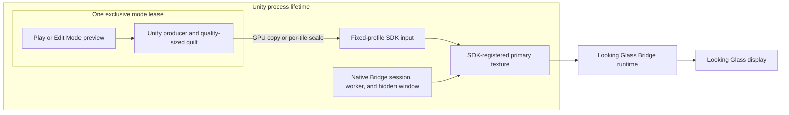
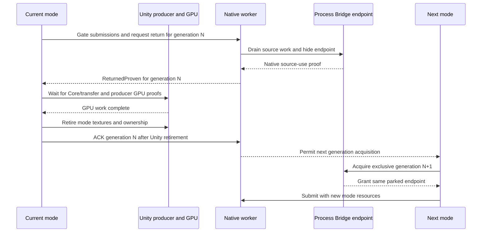
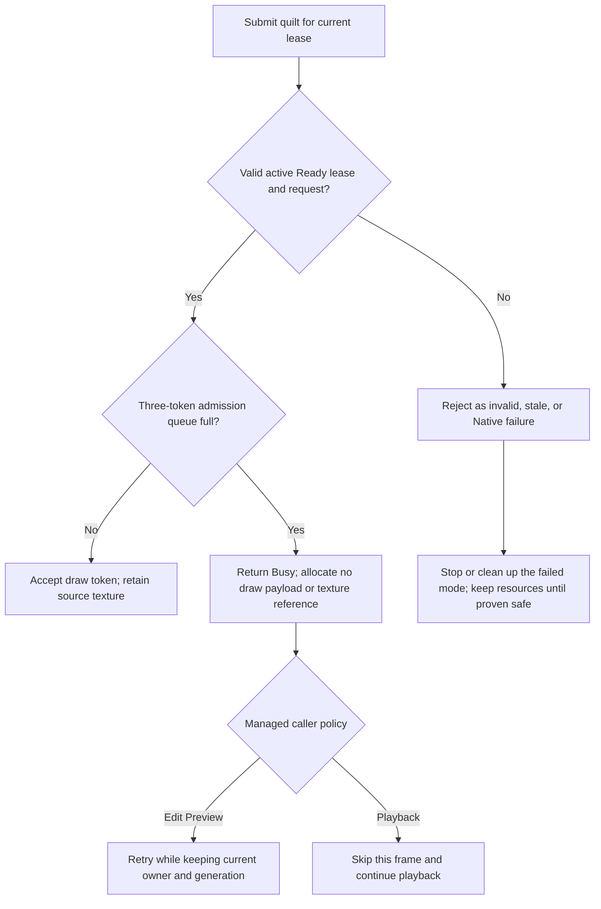

[日本語](ja/bridge-output-lifecycle.md)

# Bridge output lifecycle

Edit Mode device preview and Play output share one process-level Looking Glass Bridge endpoint. Each mode gets an exclusive, generation-scoped lease to submit quilts. Closing a mode returns its lease; it does not normally destroy the process-level SDK session, registered primary texture, or hidden Bridge endpoint.

This page distinguishes the current Native artifact/source implementation from the sample projects and from verified device behavior. The current source implements an explicit Busy admission result and is included in the generated distribution packages. The reverse Play-to-Edit black/delayed output issue remains unresolved.

## Process ownership and mode leases

The process owner keeps the Native Bridge session, worker thread/window, SDK-registered primary texture, and fixed-profile SDK input alive between mode owners. The endpoint is hidden and parked when no lease owns output. An Edit Preview or Play lease owns that generation's Unity producer, camera state, variable-size quilt/transfer resources, and their GPU work. Only one mode owns the endpoint at a time.

The registered primary texture and SDK-facing input retain stable identities across lease generations. Producer quilt dimensions may change with quality while the logical device grid remains fixed. Full process shutdown is a separate boundary: it closes lease admission and permits final SDK/native cleanup only after the matching module/registry and Unity GPU cleanup proofs are available.

## Pause, resume, close, and handoff

In the Inspector, `Close Preview` is in the `Advanced` section, collapsed by default. Start, Pause, and Resume are the ordinary preview controls.

| Action | Mode producer and Unity textures | Lease | Process Bridge endpoint |
| --- | --- | --- | --- |
| Pause Preview | Retained after submissions drain | Same generation retained | Hidden and parked |
| Resume Preview | Reused | Same generation resumes | Shown through the same endpoint |
| Close Preview | Retired after native source-use and managed/Core GPU proofs | Return proof, resource retirement, then ACK | Hidden and parked; next lease waits for return/ACK |
| Edit/Play handoff | Old producer and textures are retired before the next mode owns them | New exclusive generation after old-generation handoff | Same endpoint remains parked between owners |
| Process shutdown | Retired after required Unity GPU proof | Admission closes; final teardown proof can replace normal handoff ACK | SDK endpoint, registered textures, and worker are released only at final cleanup |

Normal return order is strict. Native first reports `ReturnedProven` for the old source textures. Managed code then waits for Core/transfer and producer GPU completion, retires the old mode textures and ownership, and sends the generation ACK. Native allows the next lease only after that ACK. A Native status query is historical metadata; it is not the managed ACK and does not prove a current output owner or visible frame. A producer/GPU completion count also does not prove Bridge scanout.

Unity reload and normal Stop return an active mode lease through this path; they do not uninitialize the process SDK session. For process shutdown, admission closes. Final cleanup may release resources only after the matching Native module/registry teardown and required Unity GPU proof are established. Normal handoff ACK is not required once final teardown itself is proven.

## Native admission outcomes

The current Native source candidate adds a lease-only draw-data admission call. It validates the lease identity, lifecycle state, quilt descriptor, and fixed logical grid before reporting an outcome.

`Accepted` means the Native queue accepted a draw token; it does not prove GPU completion or display presentation. `Busy` is reserved for a valid, ready, running lease whose three-token admission queue is full. It does not AddRef the submitted texture or allocate a draw payload. Managed Edit Preview retries while retaining its current producer, endpoint, and generation. Quilt playback skips only that frame and continues. Invalid arguments, stale generations, lifecycle conflicts, and Native faults remain errors; they do not follow the retry path.

The current source candidate also resets Native worker submission/completion/drop statistics when a new lease generation is acquired. These values are diagnostic counters, not source-retirement, Unity GPU-release, ACK, or display-scanout proofs. Managed submission attempts, Native accepted submissions, and completed worker work are different events and should not be compared as if they were one counter. In particular, the older A6A DLL loaded by the samples exposed process-scope counters; those observations are not per-generation evidence.

An incompatible adapter, device, logical quilt grid, output format outside the supported RGBA8 typeless/UNORM/SRGB family, or Native profile may require closing output and restarting the Unity Editor. This path does not promise Native profile/device hot-swap.

## Quality and rendered view density

`Preview`, `Balanced`, and `Native` quality profiles can change producer quilt dimensions after prior GPU work drains. `Full`, `Half`, and `Quarter` view density change the number of rendered views while preserving the completed quilt grid. Native copies same-size inputs or performs GPU per-tile scaling into the fixed-profile SDK input. Each tile clamps sampling to its own view, preventing pixels from adjacent views from bleeding into it.

The fixed input can add GPU copy/scaling cost. Fewer rendered views or smaller source quilts do not promise a proportional increase in transport frame rate. The latest Native copy/scale tests are fake/WARP tests, not a performance benchmark. The internal mode lease does not add a public SDK component or a new public control API.

## Candidate and installed build identity

On 2026-10-09, both sample projects were cold-verified with package commit `eb527e1ec126ec99d35e9990d8dce0119b855b4d` and Native DLL SHA-256 `A6A062343710AF2362DAF7B923A9BB98BDD5D381D896C68AE3190CA55655FBC7`. Later that day, both samples were updated and cold-verified with package commit `5234b834381afd91a896714ad6d8f9dcbd9f6f95` and Native DLL SHA-256 `655FDB898CF7B9F9733A1880828B740B62FB74E0C3ECDF9D825C07794F6388CD` (208,896 bytes, 51 exports). These are dated identities, not claims about sample contents after subsequent updates. The current Native artifact/source implementation passed 12/12 Windows fake/WARP CTests and source review; its managed runtime Editor/Player configurations, `Bridge.Editor`, and focused playback-safety test source compiled. Unity Test Runner was not run. Native tests use fake/WARP resources and do not load the official Looking Glass Bridge SDK.

## Bounded URP device observations

The following bounded observations used Windows Unity 6000.6.4f1, URP package commit `5234b834381afd91a896714ad6d8f9dcbd9f6f95`, and Native DLL SHA-256 `655FDB898CF7B9F9733A1880828B740B62FB74E0C3ECDF9D825C07794F6388CD`. HDRP hardware output was not tested.

| Transition | Device observation | Managed/lease observation | Result boundary |
| --- | --- | --- | --- |
| Edit Preview Close/Start | Human confirmed the image and fresh move/Undo after the restarted preview | Same process endpoint; new lease generation | One successful URP cycle on this dated candidate |
| Active Edit Preview → Play | Human confirmed the image and fresh move/Undo in Play | Same endpoint; a new generation became Ready | One successful URP handoff on this dated candidate |
| Active Play → Edit Preview | Initially black; the human later reported that an image and fresh move/Undo were visible | Before managed verification, the preview owner had disappeared and the worker was Idle/stopped with an error | Live recovery was not verified; reverse handoff remains unresolved |

The 655F artifact has therefore had limited URP hardware exercise, but the reverse handoff remains unresolved. Intermittent black output has also been reported during manual Start/Pause/Close and Play cycles. A related diagnostic change preserves the first stop reason and suppresses a secondary Core callback; the Inspector Advanced section is collapsed by default. These diagnostic/UI changes do not establish a black-output fix. No output-counter or GPU-completion value proves display scanout. HDRP hardware handoffs, device hot-plug, physical size, optical image quality, and runtime performance remain unverified. A prior image appearing during a different dated A6A test after a producer readback is not evidence about the 655F candidate or the cause of the black interval.

## Native trace and presentation limits

Set `LKG_NATIVE_TRACE` in the Unity process environment before starting the Editor to collect Native trace records. A trace can help correlate lifecycle and draw calls, but accepted submissions, worker completion counters, and producer GPU completion do not confirm Bridge display presentation or scanout. Trace writes occur on diagnostic paths and can affect timing. A later image by itself does not establish which operation restored output or prove a live owner.
