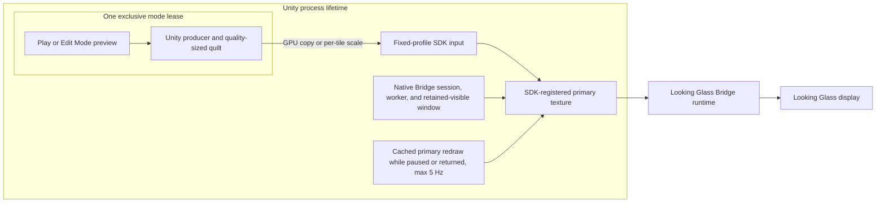
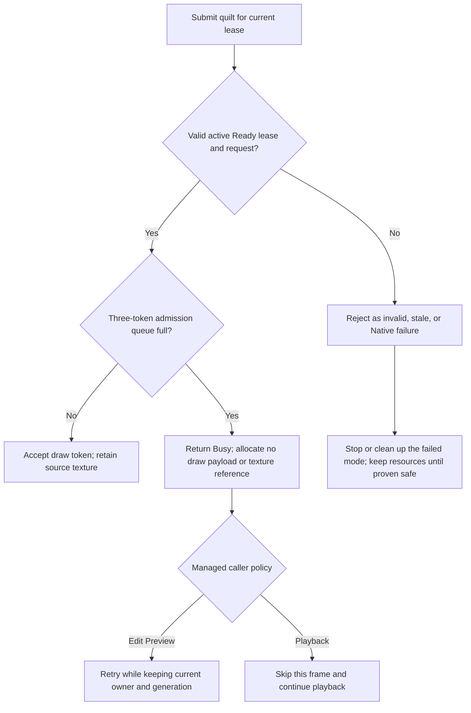

[日本語](ja/bridge-output-lifecycle.md)

# Bridge output lifecycle

> Audience: Unity, rendering, and package developers. This page covers the technical design, implementation, or procedure stated below. For user workflows, see the [User guide](../user-guide.md); for the complete technical index, see the [Technical guide](../technical-guide.md).

This page describes the Windows Bridge Worker lifecycle. macOS Looking Glass Go uses a separate `BridgeMetalQuiltOutput` route; see [macOS Metal](../macos-metal.md) and the [2026-10-10 validation record](macos-metal-validation-20261010.md) for its current conditions and evidence. On Windows, Edit Mode device preview and Play output share one process-level Looking Glass Bridge endpoint. Each mode gets an exclusive, generation-scoped lease to submit quilts. Closing a mode returns its lease; it does not normally destroy the process-level SDK session, registered primary texture, or endpoint. For persistent preview endpoints, Pause and lease return retain the last SDK primary visible; Native may redraw that same primary from cached geometry at no more than 5 Hz after producer work drains. That static-redraw path makes no additional source-texture copy or SDK texture-copy API call and does not change registration or SDK visibility; this describes plugin behavior only, not internal vendor implementation.

This page distinguishes the published Native artifact from a private static-present comparison candidate and from verified device behavior. The current source implements an explicit Busy admission result and is included in the generated distribution packages. A private URP comparison candidate exercised static redraw while paused or between owners; results are bounded to the dated run below and do not establish broad lifecycle reliability or a general fix.

## Process ownership and mode leases

The process owner keeps the Native Bridge session, worker thread/window, SDK-registered primary texture, and fixed-profile SDK input alive between mode owners. When a persistent preview lease is paused or returned, the endpoint remains visible with its last successful primary image; the owner thread can redraw that cached primary at most 5 Hz after producer work has drained. An Edit Preview or Play lease owns that generation's Unity producer, camera state, variable-size quilt/transfer resources, and their GPU work. Only one mode owns the endpoint at a time.



The registered primary texture and SDK-facing input retain stable identities across lease generations. Producer quilt dimensions may change with quality while the logical device grid remains fixed. Full process shutdown is a separate boundary: it closes lease admission and permits final SDK/native cleanup only after the matching module/registry and Unity GPU cleanup proofs are available.

## Pause, resume, close, and handoff

In the Inspector, `Close Preview` is in the `Advanced` section, collapsed by default. Start, Pause, and Resume are the ordinary preview controls.

| Action | Mode producer and Unity textures | Lease | Process Bridge endpoint |
| --- | --- | --- | --- |
| Pause Preview | Retained after submissions drain | Same generation retained | Last image remains visible; cached primary may be redrawn at most 5 Hz |
| Resume Preview | Reused | Same generation resumes | Static redraw stops and live producer submissions resume |
| Close Preview | Retired after native source-use and managed/Core GPU proofs | Return proof, resource retirement, then ACK | Last image remains visible while parked; next lease waits for return/ACK |
| Edit/Play handoff | Old producer and textures are retired before the next mode owns them | New exclusive generation after old-generation handoff | Same endpoint and last image remain visible until the new producer updates it |
| Process shutdown | Retired after required Unity GPU proof | Admission closes; final teardown proof can replace normal handoff ACK | SDK endpoint, registered textures, and worker are released only at final cleanup |

Normal return order is strict. Native first reports `ReturnedProven` for the old source textures. Managed code then waits for Core/transfer and producer GPU completion, retires the old mode textures and ownership, and sends the generation ACK. Native allows the next lease only after that ACK. A Native status query is historical metadata; it is not the managed ACK and does not prove a current output owner or visible frame. A producer/GPU completion count also does not prove Bridge scanout.

```mermaid
sequenceDiagram
    participant Old as Current mode
    participant Unity as Unity producer and GPU
    participant Worker as Native worker
    participant Endpoint as Process Bridge endpoint
    participant Next as Next mode
    Old->>Worker: Gate submissions and request return for generation N
    Worker->>Endpoint: Drain source work; retain primary visible
    Endpoint-->>Worker: Native source-use proof
    Worker-->>Old: ReturnedProven for generation N
    Endpoint->>Endpoint: Redraw cached primary while parked, at most 5 Hz
    Old->>Unity: Wait for Core/transfer and producer GPU proofs
    Unity-->>Old: GPU work complete
    Old->>Unity: Retire mode textures and ownership
    Old->>Worker: ACK generation N after Unity retirement
    Worker-->>Next: Permit next generation acquisition
    Next->>Endpoint: Acquire exclusive generation N+1
    Endpoint-->>Next: Grant same visible endpoint
    Next->>Worker: Submit with new mode resources
```

Unity reload and normal Stop return an active mode lease through this path; they do not uninitialize the process SDK session or hide the retained primary image. The static redraw runs only while a persistent endpoint is paused or has returned its lease, and stops when the next lease resumes or acquires output. For process shutdown, admission closes. Final cleanup may release resources only after the matching Native module/registry teardown and required Unity GPU proof are established; process exit is the boundary that releases the SDK endpoint and retained image. Normal handoff ACK is not required once final teardown itself is proven.

## Native admission outcomes

The current Native source candidate adds a lease-only draw-data admission call. It validates the lease identity, lifecycle state, quilt descriptor, and fixed logical grid before reporting an outcome.



`Accepted` means the Native queue accepted a draw token; it does not prove GPU completion or display presentation. `Busy` is reserved for a valid, ready, running lease whose three-token admission queue is full. It does not AddRef the submitted texture or allocate a draw payload. Managed Edit Preview retries while retaining its current producer, endpoint, and generation. Quilt playback skips only that frame and continues. Invalid arguments, stale generations, lifecycle conflicts, and Native faults remain errors; they do not follow the retry path.

The current source candidate also resets Native worker submission/completion/drop statistics when a new lease generation is acquired. These values are diagnostic counters, not source-retirement, Unity GPU-release, ACK, or display-scanout proofs. Managed submission attempts, Native accepted submissions, and completed worker work are different events and should not be compared as if they were one counter. In particular, the older A6A DLL loaded by the samples exposed process-scope counters; those observations are not per-generation evidence.

An incompatible adapter, device, logical quilt grid, output format outside the supported RGBA8 typeless/UNORM/SRGB family, or Native profile may require closing output and restarting the Unity Editor. This path does not promise Native profile/device hot-swap.

## Quality and rendered view density

`Preview`, `Balanced`, and `Native` quality profiles can change producer quilt dimensions after prior GPU work drains. `Full`, `Half`, and `Quarter` view density change the number of rendered views while preserving the completed quilt grid. Native copies same-size inputs or performs GPU per-tile scaling into the fixed-profile SDK input. Each tile clamps sampling to its own view, preventing pixels from adjacent views from bleeding into it.

The fixed input can add GPU copy/scaling cost. Fewer rendered views or smaller source quilts do not promise a proportional increase in transport frame rate. The latest Native copy/scale tests are fake/WARP tests, not a performance benchmark. The internal mode lease does not add a public SDK component or a new public control API.

## Candidate and installed build identity

On 2026-10-09, both sample projects were cold-verified with package commit `eb527e1ec126ec99d35e9990d8dce0119b855b4d` and Native DLL SHA-256 `A6A062343710AF2362DAF7B923A9BB98BDD5D381D896C68AE3190CA55655FBC7`. Later that day, both samples were updated and cold-verified with package commit `5234b834381afd91a896714ad6d8f9dcbd9f6f95` and Native DLL SHA-256 `655FDB898CF7B9F9733A1880828B740B62FB74E0C3ECDF9D825C07794F6388CD` (208,896 bytes, 51 exports). These are dated identities, not claims about sample contents after subsequent updates. The current Native artifact is SHA-256 `F1B06893404D75582FF600BA733AE3C531ED0C0A7EA40E29CE56DD7A91B0A000` (214,016 bytes, 51 exports); its reviewed Windows x64 Release build passed six focused Native fake/WARP tests. On 2026-10-10, both official samples were updated to package commit `c09fdcce30e77d95f3aa451c3642b00522edc255` and cold-verified with this DLL: URP cache `496c1dc45e56`, HDRP cache `e04b2f9bb328`. Each fresh owned Editor compile/load verification found one matching module and native pending count zero; protected `Assets` and `ProjectSettings` inventories had zero changed, missing, or added files. A single bounded URP device observation is listed below; no repeated device matrix or Unity Test Runner run was performed for F1B. Native tests use fake/WARP resources and do not load the official Looking Glass Bridge SDK.

## Historical 655F URP device observations

The following bounded observations used Windows Unity 6000.6.4f1, URP package commit `5234b834381afd91a896714ad6d8f9dcbd9f6f95`, and Native DLL SHA-256 `655FDB898CF7B9F9733A1880828B740B62FB74E0C3ECDF9D825C07794F6388CD`. HDRP hardware output was not tested.

| Transition | Device observation | Managed/lease observation | Result boundary |
| --- | --- | --- | --- |
| Edit Preview Close/Start | Human confirmed the image and fresh move/Undo after the restarted preview | Same process endpoint; new lease generation | One successful URP cycle on this dated candidate |
| Active Edit Preview → Play | Human confirmed the image and fresh move/Undo in Play | Same endpoint; a new generation became Ready | One successful URP handoff on this dated candidate |
| Active Play → Edit Preview | Initially black; the human later reported that an image and fresh move/Undo were visible | Before managed verification, the preview owner had disappeared and the worker was Idle/stopped with an error | Live recovery was not verified; reverse handoff remains unresolved |

The 655F artifact had limited URP hardware exercise, and reverse handoff remained unresolved in that dated run. Intermittent black output was also reported during manual Start/Pause/Close and Play cycles. These observations apply to the 655F artifact and do not characterize the later private static-present comparison below. No output-counter or GPU-completion value proves display scanout. HDRP hardware handoffs, device hot-plug, physical size, optical image quality, and runtime performance remain unverified. A prior image appearing during a different dated A6A test after a producer readback is not evidence about 655F or the cause of a black interval.

## F1B production URP observations

On 2026-10-10, the official F1B package commit `c09fdcce30e77d95f3aa451c3642b00522edc255` was exercised in one normal URP Editor session (Unity 6000.6.4f1, D3D12, `Assets/test.unity`). The user confirmed immediate visible output and fresh movement/Undo during ordinary Play, then during Stop-to-Edit Device Preview. They also confirmed that Pause retained the image and ignored scene-object movement, and Resume applied the moved position and Undo. Each transition was observed once in this production session; this is not a repeated reliability matrix.

The observed pause snapshots retained the same renderer, quilt texture, and output identities; the completed counters and revision were stable across consecutive paused reads. Resume retained those identities and resumed fresh completed frames. The Editor loaded-module inspection confirmed one matching F1B module and hash. Native trace identified SDK session/window 1. No image readback or capture was performed. These are bounded user-observed URP results; they do not establish detailed HDRP modes or handoffs, Player, other graphics APIs, optical quality, performance, or broad repeatability. The separate private 00CE comparison below remains a different build and test run.

## F1B production HDRP confirmation

On 2026-10-10, after updating the official HDRP sample to package commit `c09fdcce30e77d95f3aa451c3642b00522edc255`, the user confirmed that HDRP worked. The specific mode, transition, graphics API, repeat count, and trace evidence were not provided, so this general confirmation does not establish particular HDRP lifecycle paths or repeatability. The detailed HDRP mode and handoff behavior remains unverified.

## Private static-present URP comparison

On 2026-10-10, a private Windows x64 candidate (DLL SHA-256 `00CEFDA953D695202F195E43F32D2C8EB260E18356F147643E441CCEE50208C2`, 241,152 bytes) was installed in the URP sample pinned to package commit `d913f9912ad2c983fcdbbdc7ed319b97d5d07354`. This was a candidate DLL comparison, not a published package release. Six focused Native tests passed; Engine tests were not run, and HDRP/Player validation was not performed.

The operator confirmed visible output and fresh move/Undo in four normal Play observations, initial Edit Device Preview, Resume, Close/Start, paused Preview to Play, and Play Stop to Edit Preview. During two Pause observations, the operator confirmed that the last image remained visible; during the first, moving the scene target was ignored. The second Pause had no scene edits. One normal Stop-to-Edit transition and a later Play-to-Edit transition reused the same process endpoint, SDK session/window, and registered primary texture without additional create/register or SDK visibility calls. After producer drain, the private candidate emitted static-present calls against that primary at approximately 200 ms intervals (at most 5 Hz). The static-present path did not read back or capture images.

These are bounded operator observations in one URP project, one Unity version, and one D3D12 setup. They do not establish HDRP, Player, other graphics APIs, optical image quality, or broad reliability. The candidate's tests and draw counters do not prove scanout; physical statements above are limited to the operator's direct confirmations. The published 655F artifact's earlier reverse-handoff result remains a separate historical observation.

## Native trace and presentation limits

Set `LKG_NATIVE_TRACE` in the Unity process environment before starting the Editor to collect Native trace records. A trace can help correlate lifecycle and draw calls, but accepted submissions, worker completion counters, and producer GPU completion do not confirm Bridge display presentation or scanout. Trace writes occur on diagnostic paths and can affect timing. A later image by itself does not establish which operation restored output or prove a live owner.
