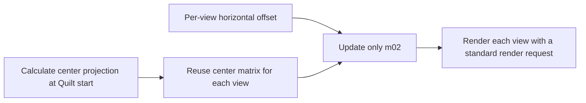

[Japanese](ja/legacy-render-pipeline-investigation.md)

# Investigation of the Legacy Looking Glass Render Pipeline

> Audience: Unity and rendering developers. This is a dated research or validation record limited to the revision, platform, and conditions stated here; it does not establish support for other configurations. For current support and setup, see [Compatibility](../compatibility.md) and [Getting started](../getting-started.md). Browse the [Technical guide](../technical-guide.md) or [User guide](../user-guide.md).

The subject is [wotakuro/LookingGlassRenderPipeline](https://github.com/wotakuro/LookingGlassRenderPipeline), an older public Unity implementation that is now archived. There is information that the author granted permission to use it, but this repository does not include its implementation code or license document. This page records an inspection of the public code structure and the independent implementation in ViewWeave.

## Structures That May Explain High Rendering Speed

The implementation of that period did more than move a regular Camera once per view. It had paths that shared culling and light/shadow preparation across views, then rendered multiple views in a single pass with dedicated shaders. Sharing work that would otherwise start CPU and render-pipeline processing for each view is a structure that could explain a high FPS. However, neither the old implementation nor ViewWeave has been benchmarked here; no speed difference or improvement percentage is claimed.

The old implementation processes view data and clip positions supplied to shaders, then combines output through a dedicated rendering path. This requires dedicated shaders and corresponding rendering preparation. Applying only part of it to ordinary URP/HDRP Camera rendering does not reproduce the same effect.

The main implementation points are [DefaultRendererSetup](https://github.com/wotakuro/LookingGlassRenderPipeline/blob/master/Assets/RenderPipeline/render-pipelines.looking/Runtime/DefaultRendererSetup.cs), [LookingGlassInstancingRenderPass](https://github.com/wotakuro/LookingGlassRenderPipeline/blob/master/Assets/RenderPipeline/render-pipelines.looking/Runtime/Passes/LookingGlassInstancingRenderPass.cs), [LookingGlassMultiTextureRenderer](https://github.com/wotakuro/LookingGlassRenderPipeline/blob/master/Assets/RenderPipeline/render-pipelines.looking/Runtime/Passes/LookingGlassMultiTextureRenderer.cs), [LookingGlassUtil](https://github.com/wotakuro/LookingGlassRenderPipeline/blob/master/Assets/RenderPipeline/render-pipelines.looking/Runtime/Passes/Util/LookingGlassUtil.cs), and [LitForwardPass.hlsl](https://github.com/wotakuro/LookingGlassRenderPipeline/blob/master/Assets/RenderPipeline/render-pipelines.looking/Shaders/LitForwardPass.hlsl).

## Why It Cannot Be Ported Directly to a General-Purpose SDK

Fixed camera positions are not inherently required by the single-pass approach; the old implementation makes that choice by overwriting camera data in `SetupCameraInfo`. Its instancing pass is also limited to submesh 0 and material 0, and approximates tile clipping by clamping clip positions and discarding fragments. To apply dedicated shaders or shared culling to a general-purpose SDK, the supported behavior for standard Unity materials, transparent-object sorting, skinning, VFX, Sky, and post-processing must be defined and kept consistent across rendering paths. Shared culling also requires constructing bounds that cover all views. Applying it without checking feature differences can cause missing objects, changes in draw order, or differences in effects.

ViewWeave did not adopt every acceleration feature from the old approach. Instead, it reduced only CPU projection-matrix calculation while retaining standard Camera and existing render-pipeline behavior.

## Projection Matrix Calculation Used in ViewWeave

This diagram covers Core CPU projection calculation. It does not change the number of view render requests or GPU-side processing.



The implementation reuses a base matrix and updates the horizontal off-axis component for each view. Full mode with 48 views still issues 48 render requests.

Instead of rebuilding the Frustum's top, bottom, left, and right bounds and the full matrix for each translated view, it calculates a base projection matrix once at the Quilt's center view. It then updates only the horizontal off-axis component based on each view's horizontal offset. Given center projection `P`, horizontal view offset `eyeOffset`, and focal distance `distance`, the update is:

```text
Pview.m02 = Pcenter.m02 + (-eyeOffset / distance) * Pcenter.m00
```

This avoids trigonometric calculations and Frustum matrix generation for each view. Each view's Camera position and rotation are still set from the source Camera transform captured at Quilt start, so Camera movement and rotation are reflected. Existing Full/Half/Quarter sampling, SRP render requests, and restoration of Camera state are retained.

The old implementation calculates offsets from evenly spaced view angles. ViewWeave retains its existing sampling results and uses evenly spaced eye offsets. The sampling method was not changed because that would change view placement.

This optimization is limited to CPU projection calculation and does not reduce the number of render requests. Full mode still needs 48 render requests. It does not establish a GPU rendering-cost or high-FPS improvement; actual speed depends on the scene, render pipeline, and GPU.

## Validation

The projection-change test record describes Core batch tests that compare the matrix derived from the center projection with the previous Frustum formula across FOV, aspect, near/far clip, distance, cone, and 1, 2, odd, and 48 views. It also checks focal-plane projection positions after translation and rotation. After the projection change, URP/HDRP distribution checks and repository validation were run; the record reports matching distribution files and no validation errors.

### Post-Integration Checks on 2026-10-08

Static formula checks confirmed that updating `m02` from center projection `m00` and the view offset matches the former Frustum horizontal-shift formula. The same calculation is reflected in Core, URP, and HDRP sources. `python tools/build_upm_distribution.py all --check` succeeded for both URP and HDRP, and `python tools/validate_repository.py` completed with 0 errors and 0 warnings. The Python validator suite passed 5/5. These are static, distribution, and Python checks, separate from Unity execution results.

In the earlier sandbox Unity Core batch attempt, the Unity CLI could not connect to LicenseClient IPC. After a 60-second initialization timeout and connection loss, the Editor exited with code `-536870911`. The independent Core project Editor log had no pass marker for `QuiltCoreBatchTests.Run`; the test method did not run in that attempt.

In an unsandboxed retry on 2026-10-08, Unity `6000.6.4f1`, the independent Core project, and `QuiltCoreBatchTests.Run` were run with the Unity CLI `run` command. The record confirms a LicenseClient IPC connection, a pass marker from the test method, and Editor/CLI exit code 0. Logs are in `.local/core-validation/Logs/Editor-unsandboxed.log` and `.local/core-validation/result-unsandboxed.txt`. This result is limited to the checks in that Core batch run; it does not validate the past Native playback access violation, recording synchronization, continuous Metal rendering, all 48-view image quality, or FPS.
