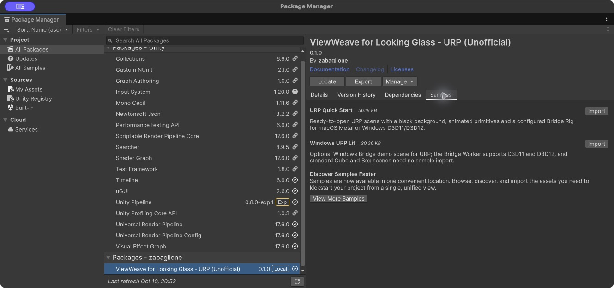
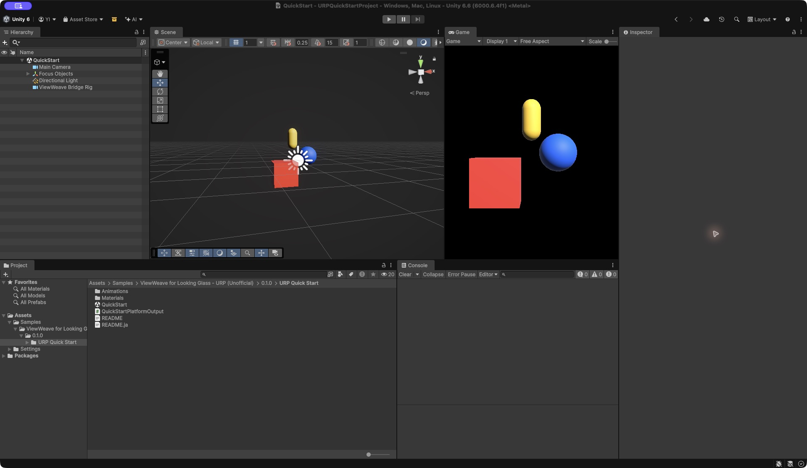
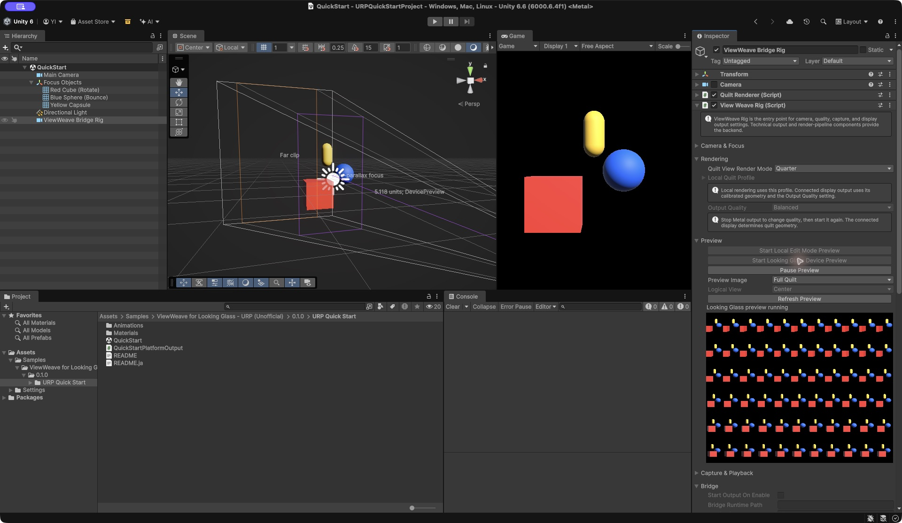
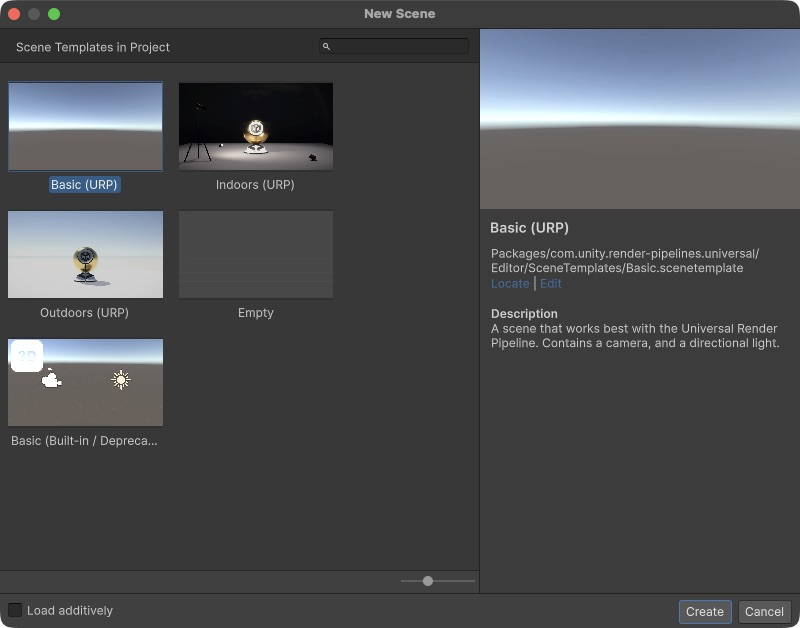
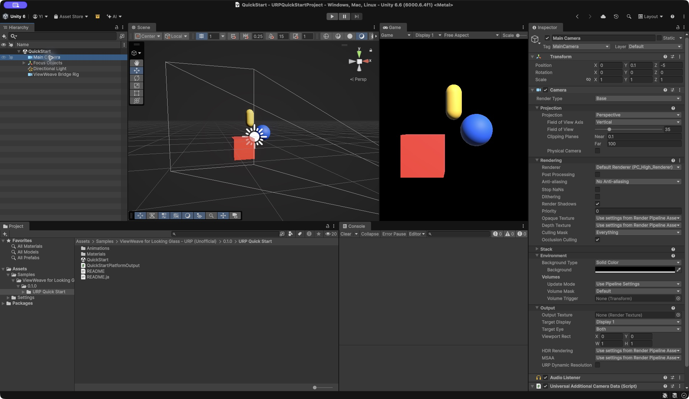
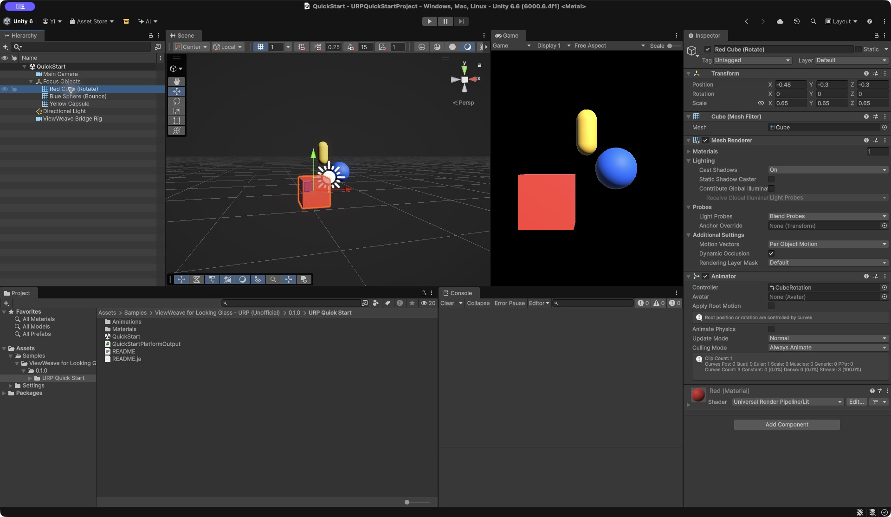
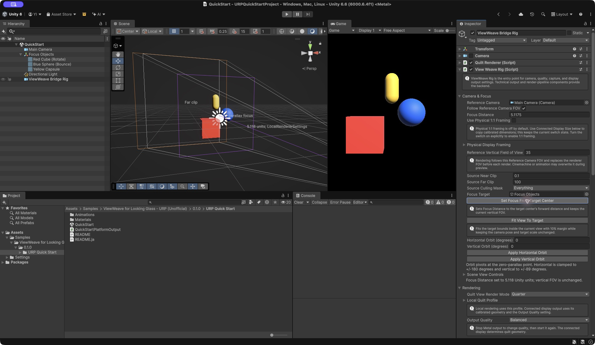
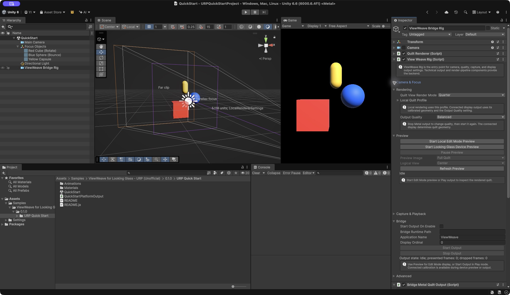

[日本語](ja/getting-started.md) · [User guide](user-guide.md) · [Technical guide](technical-guide.md)

# Quick Start and scene setup

Use a URP or HDRP project with Unity **6000.6.4f1**. Device output requires the official Looking Glass Bridge runtime installed and running, plus a connected display. Use Metal on macOS or D3D11/D3D12 on Windows. Check [Compatibility](compatibility.md) for device support and limitations.

## Quick Start: open the configured Sample

With the SDK installed, follow these three steps:

1. Select ViewWeave in **Package Manager**. Under **Samples**, **Import** either **URP Quick Start** or **HDRP Quick Start**.
2. Double-click **QuickStart.unity** in the imported folder. Save any changes to your current scene first.
3. Select **ViewWeave Bridge Rig** in the Hierarchy, then click **View Weave Rig > Preview > Start Looking Glass Device Preview**. Without a display, use **Start Local Edit Mode Preview** to inspect the Quilt in the Editor.

Samples import into `Assets/Samples/<package display name>/<version>/<sample name>/`. Each pipeline has **one scene**, shared between macOS and Windows. A sample helper selects the output for the active graphics API. Use the Rig to configure and control it.

The scene includes a black background, red Cube, blue Sphere, yellow Capsule, camera and configured Rig. Edit Mode Preview is static. For animation, enter **Play** and click **Bridge > Start Output** on the Rig. The Cube rotates and the Sphere bounces. The Sample does not start output automatically. Finish with **Stop Output**, then exit Play.

## Install from Package Manager

1. Create and open a URP or HDRP project in Unity Hub.
2. Open **Window > Package Management > Package Manager**, then choose **+ > Install package from git URL**.
3. Add **one** URL for your pipeline.

| Pipeline | Git URL |
| --- | --- |
| URP | `https://github.com/zabaglione/ViewWeave.git?path=/Distribution/urp#main` |
| HDRP | `https://github.com/zabaglione/ViewWeave.git?path=/Distribution/hdrp#main` |

Each distribution includes Core, Bridge and its pipeline adapter. Do not install both distributions in one project. A public GitHub repository can be installed without GitHub authentication. An access-restricted copy requires repository access and Git authentication; never embed authentication tokens in the URL.

After an update, quit and reopen the Editor to reload native plugins. `#main` follows development; pin a commit hash or tag for a fixed revision. See [Package updates](development/bridge-package-update-safety.md) and [Native plugin update troubleshooting](development/native-plugin-update-troubleshooting.md).

## Build your own scene: eight steps

The following steps reproduce the Sample in a new scene. Screenshots show the actual Unity UI in dedicated projects, mainly URP. HDRP uses the same Rig controls.

### 1. Create a new scene

Open **File > New Scene** and choose **Basic (URP)** for URP. Leave **Load additively** unchecked, click **Create**, and save the scene with a name. Use an HDRP scene template for HDRP.

### 2. Set a black background

Select **Main Camera**. In URP, set **Camera > Environment > Background Type** to **Solid Color**, then set **Background** to black. This makes object silhouettes easier to inspect.

For HDRP, select a **Color** background under the Camera's **Environment** section and set it to black. See **Black Sky and Fixed Exposure** in the HDRP Sample: its Volume disables Sky and Clouds and uses Fixed Exposure. With this simple lighting, surfaces outside direct light appear dark.

### 3. Add objects and a simple animation

Use **GameObject > 3D Object** to add a Cube, Sphere and Capsule. Assign differently colored Lit materials. Parent them to an empty object named **Focus Objects** so you can later focus on the whole group.

The Sample uses these local positions and scales:

| Object | Position (X, Y, Z) | Scale (X, Y, Z) |
| --- | --- | --- |
| Red Cube | (-0.48, -0.30, -0.30) | (0.65, 0.65, 0.65) |
| Blue Sphere | (0.42, 0.10, 0.35) | (0.60, 0.60, 0.60) |
| Yellow Capsule | (0, 0.65, 0.70) | (0.32, 0.35, 0.32) |

For a quick animation, drag the imported **Animations/CubeRotation.controller** onto the Cube and **SphereBounce.controller** onto the Sphere. This adds an Animator; the clips run in Play. To make your own, open **Window > Animation > Animation**, create a clip, keyframe the Cube's Y rotation or Sphere's Y position, and enable looping.

### 4. Adjust the camera

Set **Main Camera** Position to **(0, 0.1, -5)**, Rotation to **(0, 0, 0)**, and **Field of View** to **35** for the example above. Check the composition in the **Game** view. Adjust position and FOV for your objects. The screenshot in step 2 shows these values and the result.

### 5. Add a Bridge Rig

Select Main Camera, then choose **GameObject > ViewWeave > Bridge Rig**. Select the new **ViewWeave Bridge Rig**. Its **View Weave Rig** component provides the user controls for camera, focus, Rendering, Preview, Capture and Bridge output.

Check that **Camera & Focus > Reference Camera** points to Main Camera. Rendering follows its position and orientation. The Rig's dedicated Camera is disabled for ordinary display rendering and is used for Quilt rendering. Do not add another Audio Listener to the Rig.

### 6. Set focus

Drag your object into **Camera & Focus > Focus Target**, or use the picker at the right of the field. Here, select **Focus Objects** and click **Set Focus From Target Center**. The purple plane in the Scene view marks the focus distance.

Focus Target is a temporary Editor selection. The target reference is not saved, but the applied **Focus Distance** is saved in the scene. **Fit View To Target** can also fit the group into view. See [Camera framing and focus](quilt-authoring.md).

### 7. Preview on Looking Glass

Without entering Play, click **Preview > Start Looking Glass Device Preview**. Inspect the Quilt in the Editor and the result on the display. Main Camera's Game view remains a regular single-camera image.

Use **Pause Preview** and **Resume Preview** for temporary pauses. Use **Advanced > Close Preview** to release the connection and rendering resources. For animated device output, enter Play and inspect the **Bridge** section. In the Sample, click **Start Output**. Rigs newly created from the menu enable automatic Play output by default.

### 8. Adjust rendering quality

Start with **Quilt View Render Mode = Quarter** and **Output Quality = Balanced**. Close Preview or stop output before changing settings. On Metal, restart output after changing Output Quality.

| Setting | What changes | Choice |
| --- | --- | --- |
| Quilt View Render Mode | Number of views actually rendered | Full renders all views; Half renders roughly half; Quarter roughly one quarter, reducing GPU load. |
| Output Quality | Render resolution per view | Preview, Balanced and Native increase resolution and GPU load in that order. |

Changing Full to Quarter can improve frame rate in demanding scenes. Unrendered tiles use a nearby rendered view without interpolation, so changes can look stepped as you move sideways. **Quarter does not increase resolution.** Use Full for smoother view transitions and Output Quality to adjust resolution.

## Import optional Samples

**URP Quick Start / HDRP Quick Start** include saved introductory scenes. The existing **Windows URP Lit / Windows HDRP Lit** Samples provide optional test-object generators. See their [URP Lit](../Packages/com.zabaglione.lookingglass.viewweave.bridge/Samples~/WindowsUrpLit/README.md) and [HDRP Lit](../Packages/com.zabaglione.lookingglass.viewweave.bridge/Samples~/WindowsHdrpLit/README.md) guides.

## Build a Player

Save the scene and add it to **File > Build Profiles**. Build with Metal on macOS or D3D11/D3D12 on Windows. The Sample disables automatic output: enable **Bridge > Start Output On Enable** for Metal or **Start Session On Enable** for Windows before saving and building. When switching OS, check the selected output's start preference and Output Quality.

These are build instructions, not a verified Player result for the Quick Start Samples. Limited local-package import and Editor checks do not establish device output or Player support. Consult the feature/platform matrix linked from Compatibility for the checked OS/API and sample conditions. Anonymous Git installation after public access is enabled has not been tested. See [Compatibility](compatibility.md#current-development-version-validation) for the current validation boundaries, including native signing and physical-device limits.

For output problems, see [Compatibility](compatibility.md) and the [macOS Metal guide](macos-metal.md). Architecture, performance measurements, test projects and validation records are in the [Technical guide](technical-guide.md).
