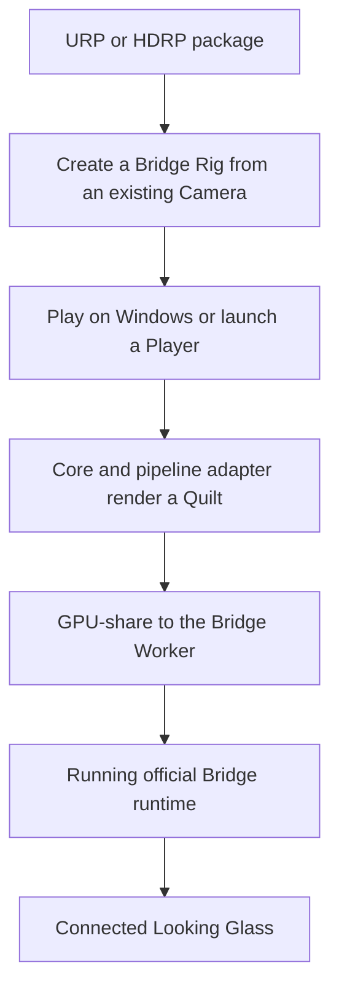
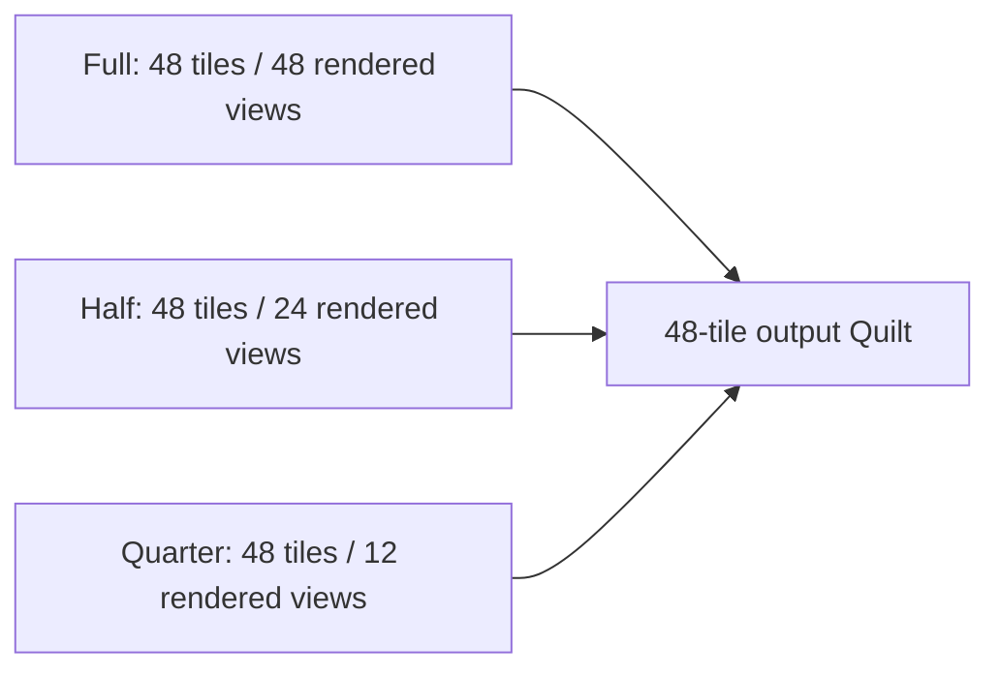

[日本語](ja/getting-started.md)

# Getting started

This guide targets Unity 6000.6.4f1 on Windows with URP or HDRP. The regular Bridge Rig/Worker Session runs in Editor Play and Windows Players on D3D11 and D3D12. A separate Editor-only preview can be started explicitly from a `ViewWeaveRig` while stopped in Edit Mode; it does not start the regular Session. Output to a Looking Glass requires the official Looking Glass Bridge runtime and a connected device. macOS Metal is not part of regular Sessions; it is a separate experiment requiring explicit opt-in.

The diagram shows the shortest path from an existing Camera to Bridge display. It does not cover detailed Quality profile settings or the optional Metal experiment.

For regular setup, run only your Unity project in the Editor or as a Player, and start the official Bridge runtime separately.

To display content, run your own Unity project. Unity Editor Play or a built Player generates a Quilt from the scene, and the official Looking Glass Bridge runtime sends it to the connected device. Install and start the Bridge runtime. You do not need to launch the SDK's `Tests/Bridge` Unity project or a separate demo app.

The regular Bridge Rig/Worker path uses the selected D3D11 or D3D12 Graphics API. See [Compatibility](compatibility.md) for support conditions.

## Install from Package Manager

1. In Unity Hub, create a project from a URP or HDRP template and open it in the Unity Editor.
2. Configure Git Credential Manager or SSH so you can access the private GitHub repository. Do not embed an authentication token in a Git URL.
3. Open `Window > Package Management > Package Manager` and choose `+ > Install package from git URL`.
4. Add one of these URLs:
   - URP: `https://github.com/zabaglione/ViewWeave.git?path=/Distribution/urp#main`
   - HDRP: `https://github.com/zabaglione/ViewWeave.git?path=/Distribution/hdrp#main`
5. The distribution package includes Core, Bridge, and the selected pipeline, so do not add another ViewWeave package. Samples are optional and are not copied into Assets until imported.

Do not add the URP and HDRP packages to the same project. If the Package Manager retains a cache when updating the `#main` Git URL, remove and re-add the same URL or use a specific commit hash as the ref.
After Package Manager completes the update, close the Unity Editor normally and reopen it. This loads the updated managed assembly and native plugin. Then select the Graphics API to use.

## Display an existing Cube or Box

1. Start Unity on Windows with D3D11 or D3D12. The regular Bridge Worker path can output in Editor Play with either API. Use the standard Graphics API selection, or specify `-force-d3d11` or `-force-d3d12` at startup if needed. Check the active API with `SystemInfo.graphicsDeviceType`.
2. Install the Looking Glass Bridge runtime on Windows and connect the device.
3. Add a regular Cube or Box to the scene and use standard URP/HDRP materials and lights. You do not need to add a ViewWeave component to the Cube.
4. In the Hierarchy, right-click the active Camera or a GameObject with a Camera ancestor and choose `ViewWeave > Bridge Rig`. The Rig is created as a child of the clicked GameObject. A Camera on the clicked object or one of its ancestors takes precedence; if none exists, the selected GameObject and its ancestors are checked, then `Camera.main`. The `MainCamera` tag is not required. The resolved Camera is also assigned to the Rig's `Reference Camera`; the original Camera stays enabled, and a dedicated Rig Camera renders the Quilt. See [Create a Rig from an existing Camera](#create-a-rig-from-an-existing-camera).
5. Place a Cube or Box with a Renderer in front of the Camera. If you right-clicked Main Camera in the menu, the default zero-parallax distance starts at 10 Unity units. The Rig's `Camera & Focus` controls edit `Focus Distance` to fit the subject; see [Quilt camera authoring](quilt-authoring.md).
6. Save the scene containing the Rig and press Play in the Unity Editor. The Editor renders the scene, and after connecting to the Bridge runtime, a Quilt based on the Bridge profile is sent to the Looking Glass. The Editor Game view remains the regular MainCamera view.

When creating a Rig while a Renderer is selected, its bounds center is used to set `Camera Distance` if it is in front of the resolved framing Camera and between its near and far clip planes. If there is no Renderer, it is disabled or out of range, or it is behind the Camera, the distance is 10 units. If no framing Camera can be resolved, the Rig uses its default position and 3 units. The Camera near/far planes and culling mask are copied as initial values when the Rig is created. As described above, pose and the enabled-by-default FOV following are synchronized from the reference Camera during runtime.

The regular Session does not output during Edit Mode. The separate Edit Mode preview is described below. D3D11/D3D12 device fixtures validated URP/HDRP Start/Stop/Restart; manual optical review remains pending. A targeted hidden-Editor fixture confirmed preview cleanup and explicit restart across Domain Reload; see [Graphics backends](graphics-backends.md) for File > Exit results; normal Editor exit remains unverified. macOS regular Sessions do not output to Bridge. Metal is a separate experiment requiring explicit opt-in, documented in [Graphics backends](graphics-backends.md). To test a Windows Player, select D3D11 or D3D12 under Windows Graphics APIs and use Build and Run. Select D3D11 if using Legacy Direct.

## Optional Edit Mode authoring preview

Select a `ViewWeaveRig` and open `Window > ViewWeave > Rig Authoring`, or use the Rig's integrated Inspector. The Authoring window keeps its assigned Rig while Editor selection changes, so the Inspector does not need to be locked. Its `Camera & Focus`, `Rendering`, `Preview`, `Capture & Playback`, `Bridge`, and `Advanced` sections gather the common operations on that Rig.

In `Camera & Focus`, assign a `Focus Target` or use `Use Selection`; press `Set Focus From Target Center` to change zero-parallax distance. Orbit controls act on the effective framing Camera. With `Follow Reference Camera FOV` enabled, `Reference Vertical Field Of View` edits the assigned Reference Camera itself. Cinemachine or animation can later overwrite that value. `Source Near Clip`, `Source Far Clip`, and `Source Culling Mask` edit the Rig's dedicated source Camera.

`Start Local Edit Mode Preview` displays a Quilt in the Editor; `Start Looking Glass Device Preview` sends it through the Windows D3D11/D3D12 Bridge Worker route. Both are explicit actions, use a separate Editor-owned producer, and do not start Unity Play Mode or the Rig's regular Bridge Session. Stop any active regular Session first. Starting or stopping the preview does not write preview state back into the saved scene. URP/HDRP local GPU fixtures passed 2/2 for layout rebuild and proof-based Stop/readback with zero pending retention. D3D11/D3D12 device fixtures passed URP/HDRP Start/Stop/Restart at 48 views with pending counters at zero. Manual optical review remains pending. A targeted hidden-Editor fixture confirmed preview cleanup and explicit restart across Domain Reload; see [Graphics backends](graphics-backends.md) for File > Exit results; normal Editor exit remains unverified. Use `Stop Preview` to stop; switching the Authoring window to another Rig or closing a window that displays the preview target Rig also requests stop.

The `Capture & Playback` section opens the existing Quilt Capture, Quilt Playback, and Quilt Video Export tools for the Rig's renderer or Session. It does not reimplement those tools or silently replace an active recording, playback, or export. See [Quilt camera authoring](quilt-authoring.md#edit-mode-authoring-preview) for the workflow diagram and details.

## Change the number of rendered views

Select the ViewWeave Rig and choose `Full`, `Half`, or `Quarter` under `Rendering > Quilt View Render Mode` in its Inspector or Rig Authoring window. In this 48-view profile example, the output Quilt always has 48 tiles; the mode determines how many views are actually rendered.

Unrendered tiles use the nearest rendered view. `View Render Mode` does not change output resolution and does not interpolate between views. It is separate from `Quality` (Preview/Balanced/Native).

## Change Quality

`Session Quality` under `Rendering` selects the render resolution for each view. `Preview` uses one quarter of the profile resolution, `Balanced` uses one half, and `Native` uses the profile's full resolution. Changing Quality does not change the profile's view count or `View Render Mode`.

1. Select the Rig and open its Inspector or `Window > ViewWeave > Rig Authoring`.
2. Under `Rendering`, change `Session Quality` to `Balanced` or `Native`. In Play Mode, the control uses the Session's quality-change path to reconfigure the active worker.
3. Inspect the updated output sent to Bridge.

For example, if the connected device profile is 7680x4320 with 8x6 views, each view is 240x180 in Preview, 480x360 in Balanced, and 960x720 in Native. These values are an example for that profile, not a common specification for all devices. With 48 views, Native renders four times the width and height per view compared with Preview, or 16 times the total pixel count, so GPU load increases.

At startup, Session applies Quilt resolution and grid from the selected Quality. Editing `QuiltSettings` directly is overwritten by the Session profile, so use `Quality` on `ViewWeaveBridgeSession` to change display resolution.

## Create a Rig from an existing Camera

Right-click an existing Camera GameObject and choose `ViewWeave > Bridge Rig`. Cameras without the `MainCamera` tag are also eligible. Before creating the Rig, the menu checks the clicked GameObject and its ancestors and resolves the first Camera found as the framing source. When using a menu without Hierarchy context, it checks the selected GameObject and its ancestors, then uses `Camera.main` if none is found.

The Camera's world pose, FOV, near/far clip planes, and culling mask are copied as initial values to the Rig Camera, and the Camera is assigned to `Reference Camera`. The regular automatic Quilt renderer reads the reference Camera's world pose immediately before each render, so it follows the position and orientation of the Main Camera driven by Cinemachine Brain. `Follow Reference Field Of View` is enabled by default. In the Rig authoring UI, `Reference Vertical Field Of View` edits the Reference Camera's actual FOV because the renderer value is replaced from that camera before each render. Disable following to edit the renderer's stored FOV instead. Near/far clip planes, culling mask, view aspect, focus distance, and view cone are not synchronized. The `Source Near Clip`, `Source Far Clip`, and `Source Culling Mask` controls edit the Rig's dedicated source Camera. The original Camera settings are not changed by Rig creation or preview. The Rig is parented to the clicked GameObject, and its dedicated Camera is automatically disabled for Quilt rendering.

`Camera Distance` is measured in Unity units forward from the reference Camera's world position; the purple zero-parallax plane in the Scene View marks that distance. If the scene scale uses 1 unit per meter, the distance corresponds approximately to meters. Reference the actual Camera controlled by Cinemachine Brain, not the Cinemachine Virtual Camera itself. Manual `RenderQuilt()` uses the pose at the time of the call. See [Camera framing and focus](quilt-authoring.md) for automatic Quilt rendering and pose synchronization for the URP VFX Graph driver.

## HDRP template

HDRP requires Linear color space. Choose Linear under `Project Settings > Player > Other Settings > Color Space`. A dedicated adapter is used for HDRP Quilt rendering and temporarily suppresses some temporal effects that interfere with Quilt views. HDRP Auto Exposure is converted to a shared Fixed EV 12 across all views. If the original Exposure mode is Fixed, its value is retained. The original MainCamera, Volume Profile, and Project Settings are not changed. Regular Fog, Sky, and Bloom remain enabled.

Use Linear color space with VFX Graph as well. See [Compatibility](compatibility.md) for HDRP adapter limitations.

## Import optional Samples

Only if you want to generate test objects, select the ViewWeave package in Package Manager and import the Sample for your pipeline from the Samples section. This operation imports a generator and material resource, not a scene into Assets.

1. Create a `GameObject > ViewWeave > Bridge Rig` in the scene.
2. Add `BridgeUrpLitSampleGenerator` for URP or `BridgeHdrpLitSampleGenerator` for HDRP to the same Rig GameObject.
3. Enable `Generate On Start` and press Play to generate a test Cube, sphere, and light at startup. To generate these manually, use `Generate Lit Scene` in the generator Inspector menu.
4. To verify Bridge output, press Play on Windows D3D11 or D3D12. HDRP requires Linear color space. See [HDRP template](#hdrp-template) above for adapter and color-space details.

Samples and a generator are not required to display a standard Cube or your own scene.

## Build a Player

1. Save the scene.
2. Add it to a Windows profile in `File > Build Profiles`.
3. Enable Direct3D11 or Direct3D12 under Windows Graphics APIs. Both are supported by the regular Bridge Worker path.
4. Choose `Build and Run`. If the Bridge runtime is not discovered automatically, set the absolute path to `bridge_inproc.dll` in the Bridge Session's Runtime Path.

## Test projects

From the repository root, run `python tools/prepare_sample_tests.py`, then use `Add` in Unity Hub to open `Tests/Pipelines/Unity`. Some fixtures use the GPU. In the Editor, run the target tests from `Window > General > Test Runner`. See [Windows validation](windows-validation.md) for known non-passing conditions and test results.
