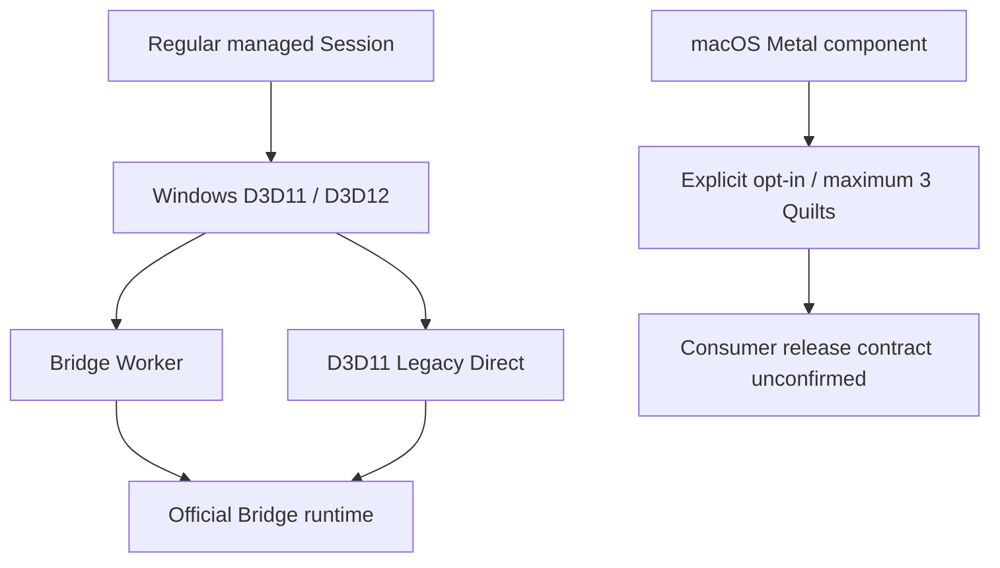

[日本語](ja/graphics-backends.md)

# Graphics backends

ViewWeave separates the producer that passes Unity-generated Quilts to native transport from the consumer that hands them to Looking Glass Bridge. The path selected by a regular managed Session is distinct from the experimental native path.

## Backend map

| Path | Producer | Consumer | Status |
| --- | --- | --- | --- |
| Legacy Direct | Windows D3D11 | Windows D3D11 / official Bridge | Existing Windows D3D11 path |
| Bridge Worker | Windows D3D11 | Worker-owned D3D11 / official Bridge | Regular Windows Editor Play and Player path |
| Bridge Worker on D3D12 | Windows D3D12 resource | D3D11 Worker on the same GPU / official Bridge | GPU-shared; no CPU image readback |
| Edit Mode Rig preview | Windows Editor D3D11/D3D12 | Editor UI for local preview, or Bridge Worker / official Bridge for device preview | Explicit Editor-only route; separate from a regular Session. Native pause/resume contract passed CTest 10/10; one live URP D3D12 pause/resume cycle was visually confirmed, broader device coverage remains unverified. |
| Metal experiment | Unity Metal texture | Official Bridge Metal API via IOSurface | Native experiment only; unsupported in regular sessions; macOS native artifact not distributed |
| Vulkan | None | None | Not implemented or supported |

The diagram distinguishes the supported regular Session from the independent Metal experiment. The Metal branch does not connect to a regular Session or enter the Windows shutdown gate.

Regular Session display uses the Windows Bridge Worker or D3D11 Legacy Direct. The Edit Mode Rig preview is an independent, explicitly started Editor route. Local mode displays the preview Quilt in the Editor; device mode uses the Windows Editor Bridge Worker path. Neither starts Play Mode or the selected Rig's regular Session. The Native Release DLL pause/resume protocol passed CTest 10/10, including drain-before-hide, same-session resource retention, and full close from paused. These fake-runtime/test-adapter results alone do not verify physical device visibility or optical appearance. Isolated URP/HDRP local-preview managed tests passed 2/2 for pause/resume, an FOV change while paused, and full Close. On 2026-10-09, a user confirmed one live Pause/Resume cycle on the URP `test.unity` scene using Windows D3D12: the scene was visible after resume, and moving the displayed object and Undo were reflected. This one scene and cycle does not establish repeated operation or HDRP device behavior; optical scale, image quality, and performance remain unverified. The Metal branch requires a manually downloaded artifact and an experiment-only component; it does not establish continuous operation or UPM distribution.

The Windows persistent Worker host reuses its D3D11 device and immediate context across render Sessions only when the producer adapter stays the same. Session Stop closes per-session resources but keeps the host device with the process-wide SDK owner. An adapter change or removed device is rejected with a restart-required error rather than silently creating a replacement. The host releases its device only after successful SDK uninitialization at Editor or Player process shutdown.

Regular managed policy targets the Windows D3D11/D3D12 Worker and D3D11 Legacy Direct. Common descriptor validation and Bridge path selection also cover D3D11/D3D12 producers to a D3D11 consumer. Windows backends are divided into D3D11, D3D12, and D3D11/D3D12 interop and are called by transport from shared Worker code. Unsupported platforms use a failure stub for transport.

## Explicit Edit Mode Rig preview

`Start Local Edit Mode Preview` and `Start Looking Glass Device Preview` create an Editor-owned producer only after the user requests them. The temporary producer uses the source Rig's settings but does not start or take ownership of the regular Bridge Session. The source Rig and saved Scene are not changed by preview start/stop. Device preview is limited to Windows Editor D3D11/D3D12 and requires the official Bridge runtime. Targeted device fixtures passed 1/1 for each URP/HDRP and D3D11/D3D12 combination. Each used a 3840x2160 display profile and a 7680x4320 native output Quilt with 8x6/48 views; start and restart each submitted and completed one frame, and each Stop reached zero native and retention-pending work. The D3D11 fixtures used ReadbackTail and the D3D12 fixtures used FenceAndReadback. All four test runs exited with code 0. After the final start-guard change, a representative D3D12 fixture also passed 1/1 using an actual D3D12 producer and D3D11 consumer; each Start/Restart submitted and completed once, and Stop reached zero pending in 0.4s/0.2s. Manual optical appearance review remains undone. Targeted URP and HDRP GPU fixtures also passed 2/2 for local preview: both source-controlled and hidden-producer modes rendered green geometry across eight views, handled a layout change by retiring the old RenderTexture after proof and rebuilding, then stopped with readback proof and zero retention-pending resources. The local MSAA fixture settings were URP view=4/resolve=1 and HDRP view=1/resolve=0. A targeted hidden-Editor reload fixture observed an active preview texture before Domain Reload, then inactive/zero-pending cleanup after reload and a successful explicit restart. Three File > Exit probes covered a URP control without a preview (using the same temporary URP asset setup), an active preview without reload, and a reload/restart followed by active preview. In each probe, the fixture helper explicitly called `Stop()` and synchronous `RequestStop(true)` before the `wantsToQuit` observation; the gate then reported `ready=true`, `pending=0`, and `nativePending=0`. This confirms helper-assisted proof and cleanup, not that the standard observer alone stopped the preview. All three Unity test processes then ended with `0xC0000005` during teardown after the final `Cleanup mono` / `CodeReloadManager destroyed` log sequence, so normal Editor exit code 0 was not confirmed. The no-preview control had the same process exit; the common teardown symptom is not attributed to the preview. These File > Exit probes do not establish a direct own-window-close test. Automatic refresh uses a 0.2-second render interval (a target cadence of 5 Hz); explicit refreshes and parameter edits can request an earlier render. This is a scheduling interval, not a measured performance result.

`Pause Preview` stops new submissions, drains in-flight work, then hides the device window while retaining the same producer, RenderTexture, Worker session, and ownership locks. `Resume Preview` shows that same session again; a local preview retains its last displayed image. Structural settings stay locked while paused. `Close Preview` performs a full proof-based drain and releases preview ownership. The process-wide SDK owner and loaded native image remain until Editor shutdown. Retargeting or closing the preview window, entering Play, reloading, and Editor shutdown also use full close rather than pause. Earlier full-stop fixtures (from before the Pause/Close button split) exercised resource retirement, not the new pause/resume path. A live URP Windows D3D12 observation on 2026-10-09 confirmed one acknowledged pause/resume cycle on `test.unity`: the same worker handle/generation was retained, counters remained unchanged while paused, and the user confirmed that the scene, a displayed-object move, and Undo were visible after resume. Submissions and completions advanced after resume without reported drops or errors. This is one scene and one cycle; repeated use and HDRP device behavior remain unverified, as do optical scale, image quality, and performance. The preview retains GPU resources until producer completion and required GPU/worker ownership proofs are available. A targeted Play/Edit transition fixture passed 1/1: entering Play left the preview inactive with zero pending work, and returning to Edit Mode did not restart it automatically. A targeted window retarget/close lifecycle-helper fixture passed 1/1 with preview inactive and pending zero; it does not prove the actual Authoring window close callback or the File > Exit path. The URP/HDRP local GPU fixtures confirmed retirement, rebuild, Stop/readback proof, and zero pending retention; D3D11/D3D12 device fixtures confirmed Stop/Restart and zero native/retention pending counters. Domain Reload cleanup and explicit restart passed in a hidden-Editor fixture. For three File > Exit probes, a fixture helper called `Stop()` and synchronous `RequestStop(true)` before `wantsToQuit` reported `ready=true`, `pending=0`, and `nativePending=0`; observer-only shutdown was not tested. All three test processes ended with `0xC0000005` during teardown, including a no-preview control, so normal Editor exit was not confirmed and the common process symptom is not attributed to the preview. These File > Exit probes do not establish a direct own-window-close test. These Editor-preview results are separate from regular Session shutdown evidence below.

## Windows shutdown and package updates

Regular Play Mode Stop and Session restart do not set the final shutdown latch. The SDK drains owned Workers/Sessions and releases references only after GPU completion and native release are confirmed. Process exit in a Windows Editor or Windows Player uses a separate final shutdown gate: it closes admission, stops active output, reclaims native contexts, and permits exit only after the persistent Worker host has joined. For Legacy D3D11 output, a per-Session close ledger must return `ClosedSafe` and its ACK must succeed before the transfer texture is released with GPU-fence/readback proof. Global SDK idle alone is not sufficient for release.

Inside the regular Windows Editor quit callback, a Bridge-specific synchronous gate runs. It uses a 10-second monotonic-clock polling budget, but individual Unity/native API calls cannot be interrupted, so this is not an absolute upper bound on exit time. The callback itself only runs Coordinator `PumpOnce`, updates issued GPU readbacks, and sleeps for 1 ms. It does not re-enter the full Unity Editor update or UI message pump. If native host join, closed-context reclamation, Reaper proof, or Playback GPU proof is missing, it cancels the quit, retains references, and keeps admission closed. It does not retry automatically; a later explicit quit request checks status again. After completion, it allows that same exit request and does not repost a window-close/menu command. If the user cancels the save confirmation, irreversible final admission is not reopened, so restart the Editor before using Bridge again. Exit paths that bypass the quit callback use a separate historical 5-second bounded fallback, but are not considered successful unless completion is proven. In the V6 single Windows D3D12 Editor fixture, one real GUI exit request was made while an owned texture existed before GPU proof; flush 1/1, native/managed completion, and natural Editor exit with code 0 were confirmed. This was one 8-view 512x256 fixture, not a save-confirmation-cancel test or a general performance/optical-quality test.

The final shutdown hook applies only to Windows Editor/Player, not asset-import worker processes. It does not affect the macOS Metal experiment or unsupported platforms. In V6, regular rendering continued after arming and one real GUI exit request led to natural shutdown. This does not prove that the historical access-violation cause was removed. Save-confirmation cancellation, 48-view optical quality, performance, and physical display remain unverified. Current native/managed test results and Editor fixture validation are recorded in [Shutdown validation](shutdown-validation-20261008.md).

Before updating a UPM package that changes the native DLL or exports, use `Close Preview` and stop regular Sessions to release ownership, update the package through Package Manager, then restart Unity so the managed assembly and native shim are loaded from the same version. See [Native shutdown trace](native-shutdown-trace.md) for shutdown-trace usage and native-test boundaries.

The Metal API wrapper, Unity Metal producer, and submission-lifetime management are isolated in separate native modules. The experiment is not included in regular Session policy or the support table for existing Bridge outputs. The presence of Metal source alone does not mean a usable runtime or distributable package exists.

## Metal experiment and lifetime boundary

Inspection of headers and exports in the official Looking Glass Bridge 2.6.3 ARM64 package confirmed the Metal entry points `initialize_bridge`, `instance_window_metal`, `create_metal_texture_with_iosurface`, and `draw_interop_quilt_texture_metal`. The wrapper passes an Objective-C object pointer equivalent to a texture descriptor and an IOSurface-backed texture to these ABIs. Unity uses `IUnityGraphicsMetalV2`; a completion handler on the Unity command buffer observes producer-side copy completion.

The current design retains at most three immutable texture slots. Unity command-buffer completion means the producer copy completed. Acceptance of an SDK draw does not mean the Bridge consumer has finished reading the texture. Bridge consumer acknowledgment, release/reuse timing, draw thread affinity, and window/runloop requirements are unconfirmed. Therefore, the experiment does not reuse slots, and a regular Session does not become Metal-ready.

The SDK's `copy_metal_texture` implementation commits Bridge's own command buffer and calls `waitUntilCompleted`, but that does not prove consumer-read completion after the plugin draw. The plugin also does not assume that this copy API is called. The existence of an ABI selector or export is not proof of a draw-completion or release contract.

Unity's official [IUnityGraphicsMetal.h](https://github.com/Unity-Technologies/NativeRenderingPlugin/blob/master/PluginSource/source/Unity/IUnityGraphicsMetal.h) documents render-thread constraints for the Metal interface. The plugin executes the Metal producer from a Unity render event. The Bridge API's thread contract is unknown. See [Looking Glass Bridge](https://lookingglassfactory.com/software/looking-glass-bridge) for official Bridge product information.

Two GitHub Actions workflow runs ([37705337066](https://github.com/zabaglione/ViewWeave/actions/runs/37705337066), [37705340768](https://github.com/zabaglione/ViewWeave/actions/runs/37705340768)) passed all 5/5 jobs each on commit `054fffeb817ac8daae6ff68ed567ec7e69fe4798`. The macOS job used CXX/ObjCXX with AppleClang 15.0.0.15000309 on `macos-14-arm64`, built/linked the shim, and passed three tests: common, Metal API contract, and submission lifetime. Because CMake did not set `CMAKE_BUILD_TYPE`, this is not recorded as Release-optimized. Windows fake regressions passed 4/4, transport 2/2, Linux portable/unsupported ABI 2/2, and the static job also passed.

CI artifact `native-macos-metal-shim` (artifact 11519112992) contains `liblookingglass_bridge_shim.dylib` at 179952 bytes. The downloaded file is Mach-O 64-bit ARM64 (CPU type `0x0100000c`), SHA-256 `C06464EEEBAA3D3B934437AD9242B6DFA4C5E37E26A3187D3BE131113213980B`, and exports `UnityPluginLoad` plus Metal provider query/begin/submit/pump functions. Dependencies are Metal/Foundation/IOSurface and macOS system libraries; the official Bridge dylib is not bundled. This artifact is not included in UPM and must be downloaded manually from CI.

The job covered only native build/link and fake contract tests. It did not start Unity, load the official SDK, or display a Quilt on a physical device. Physical display, the full provider flow, consumer release/thread/shutdown contracts remain unverified. Regular Metal Sessions remain unsupported.

## Managed finite experiment

`BridgeMetalExperimentalOutput` is an explicit opt-in component independent of regular Sessions. It will not start unless macOS Play Mode, a 64-bit process, a Metal graphics device, and the runtime ABI layout guard are satisfied. The ABI guard checks `ProviderStatusV1` at 64 bytes (`deviceGeneration` offset 32), `BeginRequestV1` at 56 bytes (`runtimePathUtf8` offset 8, `width` offset 28), and `RenderRequest` at 48 bytes (`sourceTexture` offset 8, `generation` offset 16, `columns` offset 24).

Use this bounded procedure:

1. Add the Metal experiment component to a scene object and assign an existing `ViewWeaveRig` to `rig`. Set `runtimePath` to `/Applications/Looking Glass Bridge 2.6.3.app/Contents/MacOS/libbridge_inproc.dylib`. Obtain the native shim manually; it is not included in UPM.
2. During macOS Editor Play, use the component Context Menu command `Begin Finite Metal Experiment From Rig Profile`. Wait for the provider to initialize the runtime and enter `RuntimeAvailable`.
3. After `RuntimeAvailable`, invoke `Start Finite Metal Quilt Rendering` once. Producer submissions stop automatically after at most three Quilts and do not continue beyond that.
4. Run `Close Finite Metal Experiment` to restore the managed Rig output/profile/Auto Render settings. Do not use this procedure to restart the experiment in the same process.

The experiment is one-shot per process, accepts at most three Quilts, and has no acknowledgment proving the Bridge consumer released them. Slots/textures remain retained. `Close` restores the managed Rig and closes provider admission, but safe SDK resource retirement, thread affinity, and clean process shutdown remain unconfirmed. Do not use it for continuous operation or repeated startup. Regular Session Metal `interopReady` remains false.

The first CI attempt used an old v5 pin and had Windows fake initializer/Metal include compile failures. After updating to v7 pin `522254181faf188efa8b50c3e3bf6fce720b26e4` and correcting the failures, the two runs above passed. CI does not validate Unity runtime, official SDK loading, Bridge display, physical display, or shader/format quality. The artifact is manually downloaded only and does not imply regular Metal support.

## Scope and known limits

Vulkan implementation is out of scope. Performance optimization is deferred. Scene View Gizmo camera authoring is included, but Gizmo overlays in the Quilt image are not.

Historical access violations on Windows Bridge shutdown remain unresolved. Corrected baseline 2 shut down naturally, but the old event has not been reproduced and a causal fix has not been proven. The Metal experiment remains unsupported by regular Sessions and is outside validation for this Windows shutdown change.
