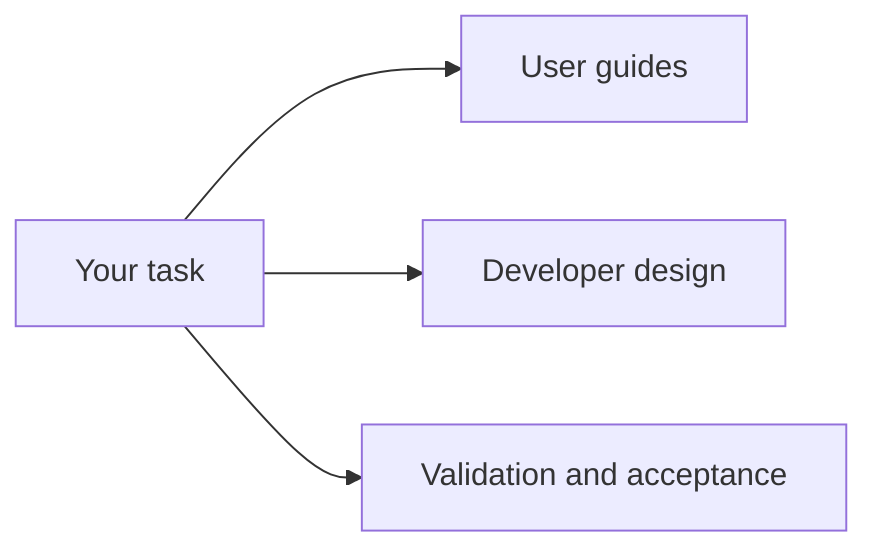

[日本語](ja/index.md)

# ViewWeave documentation

Choose a guide based on the task: usage procedures, implementation design, or validation history. Each validation record is limited to the Unity version, pipeline, API, and fixture stated in that document.

The links below are grouped by purpose.

## User guides

- [Getting started](getting-started.md): install a package, create a Rig, display a Cube, and run a Player.
- [Compatibility](compatibility.md): supported platforms, Graphics APIs, pipelines, and known limitations.
- [Quilt capture](quilt-capture.md): save a completed Quilt, record a PNG sequence, and pause or resume.
- [Quilt playback](quilt-playback.md): play saved Quilts through an existing Bridge session.
- [Quilt recording audio](quilt-recording-audio.md): save Mono audio to a separate WAV alongside a PNG sequence.
- [Quilt video export](quilt-video-export.md): create a silent MP4 from a completed PNG sequence.
- [Quilt camera authoring](quilt-authoring.md): focus distance, framing, and Scene View controls.
- [VFX Graph](vfx-graph.md): pipeline-specific VFX Graph conditions.

## Developer guides

- [Architecture](architecture.md): components from Core through pipeline adapters to Bridge output.
- [Graphics backends](graphics-backends.md): regular Windows paths and the bounded Metal experiment.
- [Performance](performance.md): past measurements under fixed conditions, limitations, and reproduction steps.
- [Legacy render pipeline investigation](legacy-render-pipeline-investigation.md): legacy implementation research and projection reuse.
- [Bridge package update safety](bridge-package-update-safety.md): consistency when updating managed/native packages.
- [Native shutdown trace](native-shutdown-trace.md): how to read shutdown traces and their boundaries.

## Validation history and acceptance

- [Windows validation](windows-validation.md): executed Windows Editor/Player tests and unverified conditions.
- [Shutdown validation](shutdown-validation-20261008.md): shutdown-gate validation and historical AV records as of 2026-10-08.
- [Remaining work plan](remaining-work-plan.md): current state, remaining tasks, and completion criteria.
- [DX12 HDRP performance investigation](dx12-performance-investigation.md): view-count comparison on an HDRP fixture.
- [Remaining-work validation record](benchmarks/remaining-work-validation-20261007.md): details of the bounded experiment captured on 2026-10-07.
- [SDK feature comparison](sdk-feature-comparison.md): feature comparison with the official SDK and validation scope.
- [Unity feature coverage](unity-feature-coverage.md): fixture status by Unity feature.
- [Third-party notices](THIRD_PARTY_NOTICES.md): third-party code and license notices.
