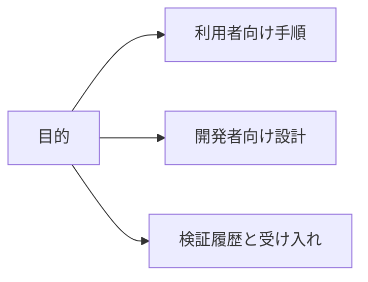

# ViewWeave ドキュメント

利用手順、開発設計、検証履歴から目的に合う資料を選べます。検証記録は記載したUnity・pipeline・API・fixtureの範囲に限られます。

必要な作業の種類から資料群を選べます。

各資料の説明とリンクは次の区分にまとめています。

## 利用者向け

- [Getting started](getting-started.md): package導入、Rig作成、Cube表示、Player実行。
- [Compatibility](compatibility.md): 対応platform、Graphics API、pipeline、既知の制約。
- [Quilt capture](quilt-capture.md): 完成Quilt保存、PNG連番、Pause/Resume。
- [Quilt playback](quilt-playback.md): 保存済みQuiltを既存Bridge sessionで再生。
- [Quilt recording audio](quilt-recording-audio.md): Mono音声をPNG連番と別のWAVへ保存。
- [Quilt video export](quilt-video-export.md): 完了したPNG連番から無音MP4を作成。
- [Quilt camera authoring](quilt-authoring.md): focus距離、Framing、Scene View操作。
- [VFX Graph](vfx-graph.md): VFX Graphのpipeline別条件。

## 開発者向け

- [Architecture](architecture.md): Coreからpipeline adapter、Bridge outputまでの構成。
- [Graphics backends](graphics-backends.md): Windows通常経路と限定Metal実験の違い。
- [Performance](performance.md): 固定条件の過去計測、限界、再現方法。
- [Legacy render pipeline investigation](legacy-render-pipeline-investigation.md): 旧実装の調査と投影計算の再利用。
- [Bridge package update safety](bridge-package-update-safety.md): managed/native package更新時の整合性。
- [Native shutdown trace](native-shutdown-trace.md): shutdown traceの読み方と境界。

## 検証履歴と受け入れ

- [Windows validation](windows-validation.md): Windows Editor/Playerの実行済み試験と未検証条件。
- [Shutdown validation](shutdown-validation-20261008.md): 2026-10-08時点の終了gate検証と歴史的AV記録。
- [Remaining work plan](remaining-work-plan.md): 現在の状態、残作業、完了条件。
- [DX12 HDRP performance investigation](dx12-performance-investigation.md): HDRP fixtureの視点数比較。
- [Remaining-work validation record](benchmarks/remaining-work-validation-20261007.md): 2026-10-07に採取した限定実験の詳細。
- [SDK feature comparison](sdk-feature-comparison.md): 公式SDKとの機能比較と確認範囲。
- [Unity feature coverage](unity-feature-coverage.md): Unity機能別のfixture状況。
- [Third-party notices](THIRD_PARTY_NOTICES.md): 外部コードとライセンス表記。
