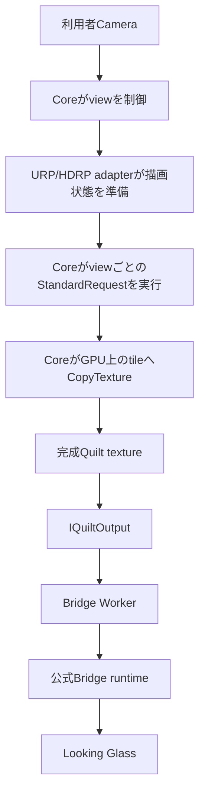

[English](../architecture.md)

# 構成

> 対象読者: Unity／描画基盤の技術者。このページは本文記載の技術的な設計・実装・手順を扱います。利用者向けの導入・運用手順は[ユーザーガイド](user-guide.md)、技術文書一覧は[技術者向けガイド](technical-guide.md)を参照してください。

ViewWeaveは公式SDKとは独立して開発している非公式のUnity SDKです。Core、URP adapter、HDRP adapter、Bridge outputを分離しています。正式な対象はUnity 6000.6.4f1で検証しているURP/HDRPです。Built-inはサポート対象外で、CoreはStandard RenderRequest経路を要求します。

## 現在のデータ経路

次図は通常のWindows URP/HDRP Bridge Worker経路を示します。adapterで描画状態を整え、CoreがStandardRequestとGPU上のtile転送を行います。Metal実験とファイル再生は別の経路です。

adapterはQuilt完成前のview描画を担当し、`IQuiltOutput`は完成したQuiltを出力経路へ渡します。Bridge WorkerはGPU共有経路で公式Bridge runtimeへ送ります。Core描画はview数分のrender requestを行います。

Coreは各論理viewの平行移動とオフ軸frustumを計算し、描画対象viewごとにrender requestを発行して、結果を`Graphics.CopyTexture`でGPU上のQuilt tileへ転送します。HDRP既定の`IsolatedViewHistories`は、描画する論理viewごとにCameraと`HDAdditionalCameraData`を持ち、Reference CameraのHDRP設定をコピーして、各view cameraで`hasPersistentHistory = true`にします。これでHDRP historyを分離しますが、view描画回数、culling、影、post processingは減りません。Quilt画像はGPU上に保ちます。HDRPの露出測光では、別途float値1個だけを非同期でCPUへ読み戻します。

`IQuiltOutput`は公開Quilt RenderTextureと`QuiltLayout`を出力経路へ渡す境界です。QuiltはBridge入力仕様上必須であり、Quilt単独を低速原因とは判断できません。Coreはnative library、socket、Bridge protocolを直接扱わず、Bridgeやテスト用出力を交換できる構成を維持します。

URP/HDRPでは専用Guardと`RenderPipeline.StandardRequest`を使います。URPは`VolumeStack`を再利用し、Quilt view描画中だけTAAを無効化して終了時に復元します。HDRPは既定で`IsolatedViewHistories`を使い、描画する論理viewごとにpersistent Camera historyを持ちます。`SharedCameraCompatibility`は旧方式を使う明示選択の互換modeで、temporal effectを調整します。Game simulation、Physics、Animationはviewごとに繰り返しませんが、利用者のrender callback副作用は別途確認が必要です。

## 出力とBridge

Sessionは機器のprofileを動的に選択し、自動検出を主経路とします。通常の利用では公式Bridge runtimeを別途用意します。`BridgeQuiltOutput`/Legacy DirectはWindows D3D11のみです。標準の`BridgeWorkerQuiltOutput`はWindows D3D11とD3D12のEditor PlayおよびPlayerで使う経路です。D3D12ではUnityのD3D12 deviceから同じGPU上のD3D11 workerへQuiltをGPU共有し、workerが公式Bridgeへ送ります。この経路はCPU画像readbackを使いません。通常のBridge SessionはEdit Modeでは動作しません。制作向けにはWindows D3D11/D3D12で明示的に開始する別系統の`ViewWeaveRig` Editor previewを利用できます。通常のSessionやPlaybackとは別の処理です。URP/HDRP local GPU fixtureでlayout再構築とStop/readback proof、retention pending 0を確認しました。D3D11/D3D12 device fixtureではURP/HDRPの3840x2160 display profile、7680x4320・8x6/48 view Quiltを使い、Start/Restart各1 submission/1 completion、Stop後native/retention pending 0を確認しました。手動光学確認は保留中です。隔離Editor fixtureではDomain Reload後のcleanupと手動restartを確認しました。3本のFile > Exit probeではhelperによる停止・回収後にgateのpending 0を確認しましたが、Editor正常終了は未確認です。own-window close callbackの直接確認も未実施です。通常SessionはWindowsのみです。macOS Looking Glass Goはarm64 native shimをpackageに含む独立した`BridgeMetalQuiltOutput`経路を使います。Unity 6000.6.4f1、Apple M3 Max、macOS 26.6.2でURP/HDRP templateのEdit Mode device previewを限定条件で確認し、接続Goでの向き・奥行き・明るさは利用者確認済みです。これは全視点・色・scaleの光学品質や一般性能を保証しません。従来の`BridgeMetalExperimentalOutput`は別の有限診断経路です。現行条件は[macOS Metal](macos-metal.md)と[日付付き検証記録](../macos-metal-validation-20261010.md)を、旧実験のABIと寿命境界は[Graphics backends](graphics-backends.md)を参照してください。

WorkerはUnity render thread側のQuilt copyとworker所有のD3D11 device、3 slot共有GPU ring、worker側の描画、WM message pump、shutdown/reopenを分離します。RTX 3090 Tiでshared-resource handoff、ring reuse、typeless format、timeout、late completion、device-removal seam、generationを含むD3D11 baseline込み349 draw testを通過し、fake Bridge runtimeを使ったloader lifecycle 100 cycleも通過しました。Unity D3D12 Editor PlayはURP/HDRPのDomain Reload enabled/disabledで各2 cycleを確認しました。固定fixtureのD3D12 Player matrixではURP/HDRPのDevelopment/Release各runがPreview、Balanced、Native、Previewを完了し、Native qualityのPlayer実行もこのmatrix内で確認済みです。Developmentは各pipelineでNative restartを10回、Releaseは1回行いました。ユーザーHDRP VFX Learning Templates projectもsnapshot 8adda27cでNative 7680x4320・48 viewsのEditor PlayとIdle/Closed・pending 0の停止を確認しました。このmatrixではGRD設定を切り替えていません。任意projectの全48 views光学品質、WARP、他GPUは未検証です。Windows CIではhardware D3D12をskipします。

失敗時はworkerを`Fault`にし、submission状態が確定しない間はGPU resource参照をshutdown完了まで保持します。保留中のnative shutdownが解決しない場合はUnity Editor/Playerを再起動して回復します。これは技術的なrecovery境界で、通常のセットアップ手順には不要です。物理hotplugや任意の実機接続hangをカバーしません。

Bridge経路ではUnity render threadからのcopy、Bridge workerの描画、WM message pump、終了時の非同期排出、resizeと再openを分離して扱います。共有GPU ring bufferは3スロットです。queueが満杯の場合は新しいsubmissionをdropし、投入済みsubmissionを保持します。Workerの同一プロセス再接続と終了保留0は実測済みです。全48 viewの人手による光学確認、hotplug、複数機器の受入は未完了です。

## 確認済み範囲と未検証範囲

以前のWindows/D3D11 fixtureでURP/HDRPの基本Lit、Bloom、透明Lit、uGUI、粒子、UI Toolkitを確認しましたが、現行HDRP isolated-history pathの検証ではありません。HDRPはLinear color space必須です。既定の`FollowScene` exposureは中央viewをGPU測光し、compensationを含むEVをquilt全viewにFixed exposureとして共有し、override側のcompensationを0にします。SceneがFixedなら`fixedExposure - compensation`を使います。初期の中立meter sampleは捨て、history準備中はQuiltを出力しません。`ManualFixed`は明示選択です。既定のisolated history modeではTAA、SSR、SSGI、volumetric fog/cloud、Motion Blurをscene設定のまま使います。個々のeffectの画素正確性は未検証です。旧設定への適応は`SharedCameraCompatibility`を選んだ場合だけです。HDRP設定UIはすべて**Rig > Rendering**内にあります。History Resource Budgetは既定4096 MB、Maximum History Camerasは256です。budgetはgraphics-driver growth実測と新規/拡大RenderTexture descriptor推定の大きい方を使い、camera数はEditor/全Player buildで個別制限します。Releaseではdriver counterが0で、未観測bufferやdriver overheadは含まないため、完全なVRAM上限ではありません。詳細は[HDRP view-history validation](../hdrp-view-history-validation-20261010.md)を参照してください。通常macOS Sessionは未対応です。別系統のLooking Glass Go Metal previewはURP/HDRP templateの限定条件で確認し、向き・奥行き・明るさの利用者確認を得ましたが、全視点の光学品質、色測定、長時間動作、一般性能は未検証です。[日付付きmacOS検証](../macos-metal-validation-20261010.md)を参照してください。従来の有限`BridgeMetalExperimentalOutput`実験は現在のGo経路とは別です。

次の項目は対応範囲を決めるための検証対象です。

| 分類 | 状態 |
| --- | --- |
| Animator、SkinnedMeshRenderer、Terrain、LOD、影 | Geometry fixtureを個別確認。Animatorを含む一般素材への対応は未確定 |
| Shader Graph、Renderer Feature、Decal、Reflection Probe、Light Probe | Shader GraphとRenderer Featureは限定fixture。Decal、Reflection Probe、Light Probeの一般利用は未検証 |
| HDRP SSR、SSGI、volumetric fog/cloud、Motion Blur、TAA | 既定のisolated history modeではscene設定を維持。明示選択の`SharedCameraCompatibility`だけがSSR/SSGI/cloud/Motion Blurを無効化し、TAAを停止、volumetric fogをGaussian filteringへ変更。個別effectの画素正確性は未検証 |
| FXAA、SMAA、MSAA、色調補正、temporal history、Auto Exposure | FXAA/SMAAと一部色調補正は限定fixture。URP MSAA 1/1の個別条件を確認し、URP TAAはview描画中に停止。HDRPは描画する論理viewごとにpersistent historyを作成。HDRP Windows history pathと個別effectのvisual correctnessは未検証 |
| RenderTextureを使うUI、入力ray map、VideoTexture | uGUIとUI Toolkitの個別fixtureを確認。入力ray mapとVideoTextureは未検証 |
| LineRenderer、TrailRenderer、VFX Graph、複雑な透明ソート | Line/Trailは個別fixtureで限定確認。URP Simple Burstは停止6条件と通常再生4条件をPlayerで確認。HDRP、一般VFX、複雑なsortは未確定 |
| 複数機器、hotplug、RGBD、quilt layer | 未実装または未検証 |
| Quilt保存・連番録画・無音MP4 | Capture PNG/連番とsilent MP4 exportは実装済みで、限定fixtureを確認。Mono音声は別WAVへ保存。Bridge delivery、音声mux、実機品質は未検証 |

## 性能計測の扱い

`LastCpuSubmissionTicks`はCPU描画依頼区間だけを計時し、`BridgeSubmit`を含みません。GPU時間、render thread時間、transfer時間、present latencyを表しません。視点数を減らさずにGPU負荷が下がるとは限らないため、同一機器、同一scene、同一Quilt設定で個別に計測します。Quiltのタイル転送だけを理由に全体の遅さを説明しません。

性能最適化は検証待ちのため保留しています。既存のScene View Gizmoによるcamera authoringは維持し、QuiltへのGizmo overlayは対象外です。GPU Resident Drawerや視点間共通処理の再利用は独立した検証項目です。HDRP isolated historyは描画viewごとにpersistent Cameraを追加しますが、各viewを個別描画します。結果を確認した後に採用可否を判断します。

## 実装済みの検証と残るゲート

M1の通常thread経路は、call stack、thread ID、device context、fenceの収集、Unity render threadだけのcopy、worker own device、3スロットring buffer、resize、close/reopenの実装とAPI検証まで完了しています。同一プロセス再接続を含む各120 draw、終了保留0、host thread再利用を実測しました。品質、光学、配布署名、hotplug、複数機器はrelease gateとして残ります。通常threadの実機結果をDirect経路の結果と混同しません。

M2のSession、Registry、Locator、Rig menuはコンパイルと18件のSession試験を確認しています。SessionはURP/HDRPのPreview、Balanced、NativeとGRD ON/OFFの単独6条件を48 view Playerで確認しました。固定条件のURP/HDRP品質切替で4段階を各122 completion、明示Stop/Start後120 draw、pending 0まで確認しましたが、Registryの一般運用、hotplug、複数機器、光学品質は未確認です。GRDはMeshRenderer中心の検証対象であり、描画view数やrender request数を削減しません。cached VolumeStackは適用済みで、固定条件のCPU submission比較もありますが、GPU時間とrender thread時間は未取得です。
