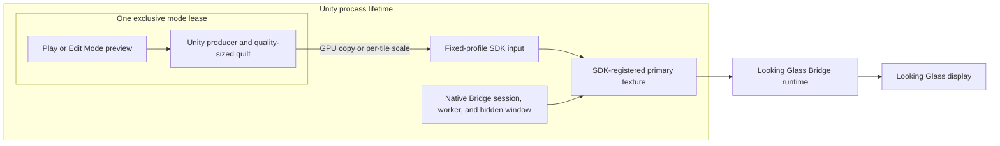
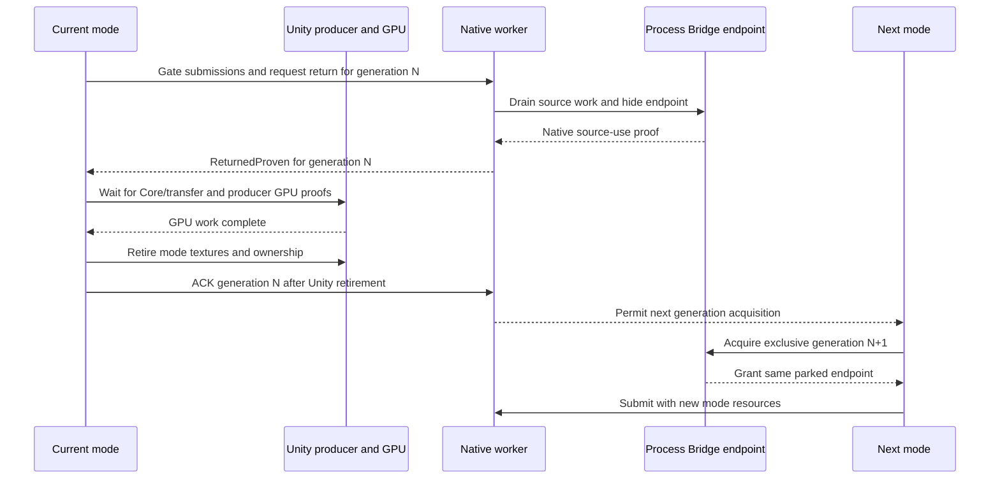
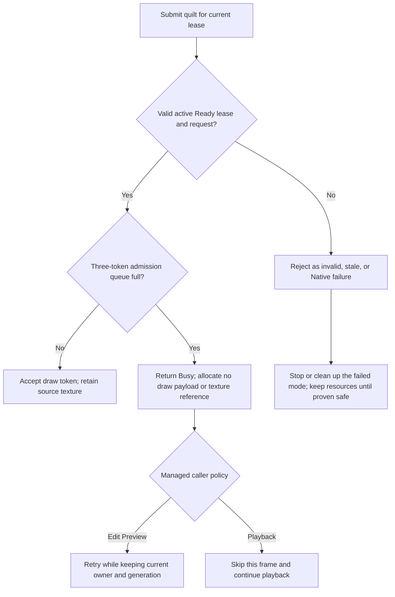

[English](../bridge-output-lifecycle.md)

# Bridge出力のライフサイクル

Edit Modeの実機previewとPlay出力は、process単位のLooking Glass Bridge endpointを共有します。各modeはquilt送信のため、generation単位で排他的なleaseを取得します。modeを閉じるとleaseを返しますが、通常はprocess単位のSDK session、登録済みprimary texture、非表示のBridge endpointを破棄しません。

このページでは現在のNative artifact/source implementation、sample project、実機で確認できた動作を区別します。現在のsourceには明示的なBusy admission結果が実装され、生成済みdistribution packageに含まれています。PlayからEditへ戻す際の黒画面・遅延表示は未解決です。

## Process ownershipとmode lease

Process ownerはNative Bridge session、worker thread/window、SDK登録済みprimary texture、固定profileのSDK inputをmode間で保持します。lease ownerがいないときendpointは非表示でparkします。Edit PreviewまたはPlayのleaseは、そのgenerationのUnity producer、camera状態、可変サイズのquilt/transfer resource、GPU処理を所有します。同時にendpointを所有できるmodeは一つです。

登録済みprimary textureとSDK向けinputはlease generation間で同じidentityを保ちます。producer quiltの寸法はqualityで変わる場合がありますが、logical device gridは固定です。process shutdownは別の境界です。一致するmodule/registryとUnity GPU cleanupのproofを確認した場合だけ、lease admissionを閉じてNative/SDKを最終cleanupします。

## Pause、Resume、Close、handoff

Inspectorの`Close Preview`は初期状態で閉じた`Advanced` section内にあります。通常のpreview操作はStart、Pause、Resumeです。

| 操作 | Mode producerとUnity texture | Lease | Process Bridge endpoint |
| --- | --- | --- | --- |
| Pause Preview | submit drain後も保持 | 同じgenerationを保持 | 非表示でpark |
| Resume Preview | 再利用 | 同じgenerationを再開 | 同じendpointで表示 |
| Close Preview | Native source使用終了とmanaged/Core GPU proof後に破棄 | return proof、resource破棄、その後ACK | 非表示でpark。返却/ACK後に次leaseを許可 |
| Edit/Play handoff | 次modeが所有する前に旧producerとtextureを破棄 | 旧generationのhandoff後に新しい排他的generation | owner間は同じendpointをpark |
| Process shutdown | 必要なUnity GPU proof後に破棄 | admissionを閉じる。証明済み最終teardownが通常handoff ACKの代わりになる | 最終cleanup時にSDK endpoint、登録texture、workerを解放 |

通常の返却順序は固定です。まずNativeが旧source textureの参照終了を`ReturnedProven`として通知します。managed側は次にCore/transferとproducer GPU完了を待ち、旧mode textureとownershipを破棄してからgeneration ACKを送ります。NativeはACK受信後にだけ次leaseを許可します。Native status queryは履歴metadataであり、managed ACKでも現在のoutput ownerや表示frameの証明でもありません。producer/GPU完了counterもBridge scanoutを証明しません。

Unity reloadと通常Stopはこの経路でactive mode leaseを返しますが、process SDK sessionはuninitializeしません。Process shutdownではadmissionを閉じます。一致するNative module/registry teardownと必要なUnity GPU proofを確認した後だけ最終cleanupします。最終teardown自体を証明できた場合、通常handoff ACKは不要です。

## Native admissionの結果

現在のNative source candidateはlease専用draw-data admission callを追加します。outcomeを返す前にlease identity、lifecycle状態、quilt descriptor、固定logical gridを検証します。

`Accepted`はNative queueがdraw tokenを受け取ったという意味です。GPU完了やdevice表示を証明しません。`Busy`は有効・Ready・running状態のleaseで、3 tokenのadmission queueが満杯のときに限って返します。このとき送信textureへのAddRefやdraw payloadの割り当てはありません。managed Edit Previewはproducer、endpoint、generationを保持したまま再試行します。Quilt playbackは該当frameだけをskipして続行します。invalid argument、stale generation、lifecycle conflict、Native faultはerrorであり、retry対象ではありません。

現在のsource candidateは新しいlease generationの取得時にNative workerのsubmitted/completed/dropped統計をresetします。これらは診断用counterであり、source retirement、Unity GPU release、ACK、display scanoutのproofではありません。managed submit試行、Nativeが受理したsubmit、worker処理完了は別々のeventなので、同じcounterのように比較できません。特にsampleに入っている旧A6A DLLのcounter観察はprocess scopeであり、generationごとの証拠ではありません。

互換性のないadapter/device、logical quilt grid、RGBA8 typeless/UNORM/SRGB family外のoutput format、Native profileに変更する場合、outputを閉じてUnity Editorを再起動する必要がある場合があります。Native profile/deviceのlive hot-swapは保証しません。

## Qualityと描画view密度

`Preview`、`Balanced`、`Native` quality profileは、以前のGPU処理をdrainした後にproducer quiltの寸法を変更できます。`Full`、`Half`、`Quarter` view densityは完成quiltのgridを保ったまま描画するview数を変更します。Nativeは同じ寸法ならcopyし、それ以外では固定profileのSDK inputへview単位でGPU scalingします。sampling範囲は各tile内にclampするため、隣のviewからpixelを読み込みません。

固定inputへのcopy/scalingでGPU負荷が増える場合があります。描画viewやsource quiltを減らしても、transport frame rateが同じ割合で向上するとは限りません。最新Nativeのcopy/scale試験はfake/WARPによるもので、性能benchmarkではありません。内部mode leaseはpublic SDK componentやpublic control APIを追加しません。

## Candidateと導入済みbuild

2026-10-09、両sample projectをpackage commit `eb527e1ec126ec99d35e9990d8dce0119b855b4d`、Native DLL SHA-256 `A6A062343710AF2362DAF7B923A9BB98BDD5D381D896C68AE3190CA55655FBC7`でcold verificationしました。同日後刻、両sampleをpackage commit `5234b834381afd91a896714ad6d8f9dcbd9f6f95`、Native DLL SHA-256 `655FDB898CF7B9F9733A1880828B740B62FB74E0C3ECDF9D825C07794F6388CD`（208,896 bytes、51 exports）でcold verificationしました。これは各日付時点のidentityであり、その後のpackage更新後も同一という意味ではありません。現行Native artifact/sourceはWindows fake/WARP CTest 12/12件とsource reviewに成功しました。managed runtimeのEditor/Player構成、`Bridge.Editor`、focused playback-safety test sourceもcompile済みです。Unity Test Runnerは未実行です。Native testはfake/WARP resourceを使用し、official Looking Glass Bridge SDKをloadしません。

## URP実機での限定観察

以下はWindows Unity 6000.6.4f1、URP package commit `5234b834381afd91a896714ad6d8f9dcbd9f6f95`、Native DLL SHA-256 `655FDB898CF7B9F9733A1880828B740B62FB74E0C3ECDF9D825C07794F6388CD`での限定観察です。HDRPの実機出力は試していません。

| 遷移 | 実機での観察 | managed/leaseでの観察 | 判定範囲 |
| --- | --- | --- | --- |
| Edit Preview Close/Start | 利用者が再開始後の映像と新たな移動/Undoを確認 | 同じprocess endpoint、新しいlease generation | 日付付き候補でURPの1 cycleを確認 |
| active Edit Preview → Play | 利用者がPlayで映像と新たな移動/Undoを確認 | 同じendpointで新generationがReady | 同日候補でURPの1 handoffを確認 |
| active Play → Edit Preview | 最初は黒。後に映像と新たな移動/Undoが見えたと利用者が報告 | managed verification前にpreview ownerが消え、workerはIdle/error停止 | live復帰は検証できず、逆handoffは未解決 |

655F artifactはURP実機で限定的に試しましたが、逆handoffは未解決です。手動のStart/Pause/CloseおよびPlay cycleでも断続的な黒画面が報告されています。関連するdiagnostic変更では最初のstop reasonを保持し、二次Core callbackを抑制します。InspectorのAdvanced sectionは初期状態で閉じています。これらのdiagnostic/UI変更は黒画面の修正を証明しません。output counterやGPU completion値はdisplay scanoutを証明しません。HDRP実機handoff、device hot-plug、物理寸法、光学画質、runtime性能は未検証です。別の日付のA6A試験でproducer readback後に映像が出た事象は、655F candidateや黒画面の原因の証拠ではありません。

## Native traceと表示確認の限界

Editor起動前にprocess環境変数`LKG_NATIVE_TRACE`を設定すると、Native trace recordを収集できます。traceはlifecycleやdraw callの相関に役立ちますが、submit受理、worker completion counter、producer GPU completionはBridge表示やscanoutを確認しません。trace記録はdiagnostic path上で行われるため、観測タイミングに影響することがあります。後から映像が見えたことだけでは、復帰させた操作やlive ownerを証明できません。
