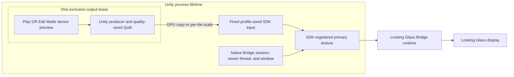
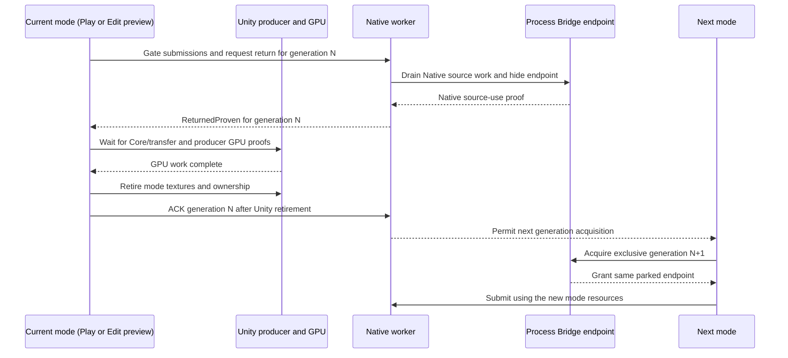

[English](../bridge-output-lifecycle.md)

# Bridge出力のライフサイクル

Edit Modeの実機previewとPlay出力は、process単位で一つのLooking Glass Bridge endpointを共有し、排他的なoutput leaseを交互に取得します。一方のmodeを閉じるとproofとACKを伴う返却sequenceを開始しますが、process endpointは破棄しません。共有endpoint実装はreview済みsource candidateに含まれています。実機でのClose/StartとEdit/Play handoff検証は未完了のため、図は設計上の契約を示し、報告済みの黒画面問題が解消したことを保証しません。

## Process ownerとmode lease

Process ownerはNative Bridge SDK session、owner threadとwindow、SDKへ登録したprimary texture、固定サイズのSDK向けinputを保持します。output leaseがなければendpointは非表示です。同時に一つだけ取得できるmode leaseが、そのgenerationのUnity producer、camera状態、可変サイズのQuilt/transfer texture、GPU処理を所有します。

登録済みprimary textureとNative inputは、mode lease間で同じidentityを保ちます。producer Quiltの寸法はquality変更で変わることがありますが、logical gridは接続device profileの固定gridに合わせます。endpointの破棄、登録textureの解放、SDK uninitializeはprocess終了時だけ行います。

## Pause、Resume、Close、handoff

| 操作 | Mode producerとUnity texture | Output lease | Process Bridge endpoint |
| --- | --- | --- | --- |
| Pause Preview | submitをdrainした後も保持 | 同じgenerationのleaseを保持 | 非表示でparkし、SDK sessionを維持 |
| Resume Preview | 再利用 | 同じgenerationを再開 | 同じendpointで再表示 |
| Close Preview | Native return proofとCore/transfer/producer GPU proof後に破棄 | Nativeの返却proof後、texture破棄を済ませてmanaged ACK | 非表示でparkし、ACKまで次のleaseを禁止 |
| Play/Edit handoff | 旧modeを止め、両段階のproof後にtextureを破棄 | 旧generationへのACK後に新generationを排他的に取得 | owner間は同じendpointをpark状態で維持 |
| Process shutdown | 必要なUnity GPU proof後にretire | lease取得を停止し、検証済みfinal teardownで通常handoff ACKを置き換え | 一致するNative module/registryの最終cleanup proof後に解放 |

modeを閉じると新規submitを止め、現在のgenerationをNativeへ返却要求します。Nativeはsource workをdrainしてendpointを隠し、旧modeのUnity textureを参照しなくなった時点で`ReturnedProven`を通知します。この通知はmanaged ACKではありません。managed側は通知後にCore/transferとproducerのGPU完了を待ち、旧Unity textureとmode所有権を破棄してからNativeへ`ACK`を送ります。NativeはACKを受け取るまで次generationの取得を許可しません。その後のStartは同じprocess endpointで新generationを取得できます。

managed ACKは返却generationのUnity-side resourceが破棄されたことを確認します。frameがdisplay scanoutまで到達したことを示すものではありません。Unity reloadと通常Stopも、同じproof後にACKを送る順序でactive mode leaseを返します。最終SDK uninitializeは行わず、process shutdownだけが最終cleanupを行います。

同じ順序を`Close Preview`→Start、Edit Preview→Play、Play→Edit Previewで使います。device/profile変更でadapter、Native grid、対応するRGBA8 typeless/UNORM/SRGB familyの範囲を超えるoutput formatが変わり、既存endpointとの互換性がなくなった場合は安全に再利用できません。outputを閉じ、Unity Editorを再起動してから再接続または非互換profileを使います。Native profileやdeviceのlive hot-swapは保証しません。

## Qualityと描画view密度

`Preview`、`Balanced`、`Native` quality profileは、先行GPU処理をdrainした後にproducer Quiltの寸法を変更できます。`Full`、`Half`、`Quarter` view densityは、完成Quiltのgridを保ったまま描画するview数を変更できます。Native helperは同一サイズのsourceをcopyし、それ以外はGPU上でfixed profile-sized SDK inputへviewごとにscaleします。各tile内でsampling範囲をclampするため、隣接viewのpixelを読み込みません。SDK inputと登録primary textureはquality変更後も安定します。

固定inputはGPU copyまたはscalingの負荷を追加します。描画view数やsource Quiltを減らしても、transport frame rateが同じ割合で向上するとは限りません。この経路の性能は未測定です。logical grid、非互換output format、adapter、device、Native profileの変更はlive quality経路の対象外で、Editor再起動が必要になることがあります。

これらの操作には既存のRigとSession設定を使います。generation leaseは内部のlifetime管理で、public SDK componentやpublic control APIを追加しません。

## 検証範囲と制約

最新のreview済みNative release candidateのSHA-256は`A6A062343710AF2362DAF7B923A9BB98BDD5D381D896C68AE3190CA55655FBC7`です。Native fake/WARP CTestは12/12件成功し、managed Editor/Player codeは7つのUnity assemblyを参照してRoslyn compileに成功しました。Unity licenseが必要なtestは未実施です。これらはofficial Bridge SDKをloadせず、実機表示も検証しません。

実機で確認された唯一の観察は過去のものです。URP sampleの旧6a297a8 packageとNative DLL SHA-256 `4E5E1FF81C7C1C227D45E5D38E23FB84F1AAB8A8444EF327D639E1AEB619532B`で、利用者は一度のPause/Resumeを確認し、映像が戻り、objectの移動とUndoも反映されました。これは現在のNative candidateを検証しません。利用者からは`Close Preview`後のStart、およびPlayとEdit Mode device previewを逆方向に切り替えた後に黒画面になる報告もあります。これらは実機での再検証待ちです。

source DLL candidateはreview・採用済みですが、URP sampleはPackage Managerによる更新とUnity再起動まで旧6a297a8 packageを使用しています。12/12件のfake/WARP Native suiteとmanaged compileは、official Bridge SDKを使ったlease handoffを検証しません。実機Close/StartとPlay/Edit handoff、HDRP実機出力、device hot-plug、物理寸法、光学的画質、runtime性能は未検証です。
