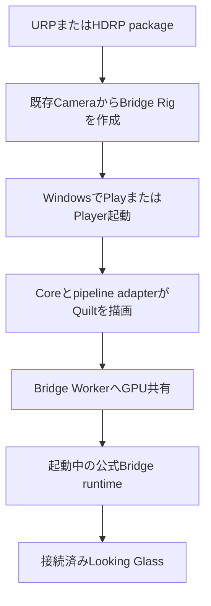
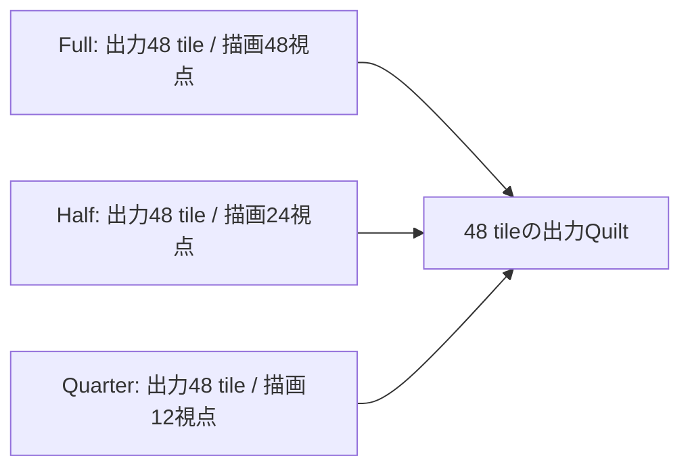

[English](../getting-started.md)

# 導入と使い方

この手順はUnity 6000.6.4f1、Windows、URPまたはHDRPを対象にします。標準Bridge Rig/Worker SessionはWindows D3D11/D3D12のEditor PlayおよびPlayerで使えます。停止中のEdit Modeでは、ViewWeaveRigから明示的に開始する別のEditor-only previewを使えます。通常SessionはEdit Modeでは動作しません。Looking Glassへの出力には公式Looking Glass Bridge runtimeと接続済みの機器が必要です。macOS Metalは通常Sessionに含まれず、別途明示opt-inの実験経路です。

この図は、既存CameraからBridge表示を始める最短経路です。Quality profileの詳細設定と任意のMetal実験は含みません。

通常の導入では、利用者projectのUnity EditorまたはPlayerだけを起動し、公式Bridge runtimeを別途起動します。

表示のために起動するのは、自分のUnity projectです。Unity EditorのPlay、またはビルドしたPlayerがsceneからQuiltを生成し、公式Looking Glass Bridge runtimeがそれを接続機器へ送ります。Bridge runtimeはインストールして起動しておきます。SDK内のTests/Bridge Unityプロジェクトやデモアプリを別途起動する必要はありません。

標準のBridge Rig/Worker経路では、選択中のD3D11またはD3D12 graphics APIを使います。対応条件は[Compatibility](compatibility.md)を参照してください。

## Package Managerから追加する

1. Unity HubでURPまたはHDRPテンプレートからプロジェクトを作成し、Unity Editorで開きます。
2. GitHub private repositoryへアクセスできるようGit Credential ManagerまたはSSHを設定します。認証tokenをGit URLに埋め込まないでください。
3. `Window > Package Management > Package Manager`を開き、`+ > Install package from git URL`を選びます。
4. 次のいずれか一つを追加します。
   - URP: `https://github.com/zabaglione/ViewWeave.git?path=/Distribution/urp#main`
   - HDRP: `https://github.com/zabaglione/ViewWeave.git?path=/Distribution/hdrp#main`
5. 配布packageにCore、Bridge、選択したpipelineが含まれるため、別のViewWeave packageは追加しません。Samplesは任意です。Package ManagerのSamplesからImportするまでAssetsへ入りません。

同じprojectにURP版とHDRP版を同時に追加しないでください。`#main`は開発中の最新commitを追従する指定です。再現性を優先するprojectではfull commit hashまたは正式release tagをrefに指定してください。これらのrefは、別のrefをインストールするまで固定されます。

commitやtagを固定したprojectを別revisionへ移す場合は、`Install package from git URL`から新しいrefを含むURLを再度追加します。`#main`の場合はPackage Managerの`Update`を使うか、同じGit URLを再追加して最新commitを要求します。通常のEditor再起動やrepositoryへのpushだけではpackage lockは更新されません。開発中はGit commitが変わっても表示上のpackage versionが`0.1.0`のままの場合があります。そのため表示versionだけでなく、`Packages/manifest.json`のGit ref、`Packages/packages-lock.json`のcommit hash、更新対象の機能を確認してください。これらが新revisionを示しているのにUnityの動作が変わらない場合はEditorを再起動します。package cacheの削除はcache不整合が疑われる場合の復旧手段とし、最初の更新方法にはしないでください。

詳しくはUnityの[Git依存関係とrevision指定](https://docs.unity3d.com/6000.6/Documentation/Manual/upm-git.html#revision)、[Git依存関係のlock](https://docs.unity3d.com/6000.6/Documentation/Manual/upm-git.html#git-locks)、[package manifestのversion field](https://docs.unity3d.com/6000.6/Documentation/Manual/upm-manifestPkg.html#version)を参照してください。

Package Managerが更新を完了したら、Unity Editorを正常終了して起動し直してください。更新したmanaged assemblyとnative pluginを読み込むために必要です。起動後は、使用するGraphics APIを選びます。

## 既存のCubeやBoxを表示する

1. UnityをWindows D3D11またはD3D12で起動します。標準のBridge Worker経路はどちらのAPIでもEditor Play出力できます。標準のGraphics API選択を使うか、必要な場合だけ起動引数`-force-d3d11`または`-force-d3d12`を指定します。実際のAPIは`SystemInfo.graphicsDeviceType`で確認してください。
2. WindowsへLooking Glass Bridge runtimeをインストールし、Looking Glassを接続します。
3. 通常のCubeやBoxをシーンに置き、標準のURP/HDRP materialとlightを使います。CubeへViewWeave componentを追加する必要はありません。
4. 使用中Camera、またはCameraを祖先に持つGameObjectをHierarchyで右クリックし、`ViewWeave > Bridge Rig`を選びます。Rigは右クリックしたGameObjectの子として作成されます。右クリック対象かその祖先にあるCameraが優先され、対象がない場合は選択中GameObjectとその祖先、最後に`Camera.main`が使われます。`MainCamera`タグは必須ではありません。解決したCameraはRigの`Reference Camera`にも設定され、元Cameraは有効なまま、専用Rig CameraがQuiltを描画します。詳しくは[既存CameraからRigを作る](#既存cameraからrigを作る)を参照してください。
5. RendererのあるCubeやBoxをCameraの前方に置きます。メニューでMain Cameraを右クリックした場合、zero-parallax距離は既定の10 Unity unitsから始まります。Rigの`Camera & Focus`でFocus Targetを設定し、`Set Focus From Target Center`でzero-parallax距離を合わせるか、`Fit View To Target`でtarget boundsに合わせて画角と距離を調整します。`Use Physical 1:1 Framing`は既定でoffです。`Use Connected Display Size`は寸法だけをcopyし、switchの状態を維持します。physical framingを使う場合はswitchを明示的にonにしてください。動作やactive previewの更新は[Quiltカメラの調整](quilt-authoring.md)を参照してください。
6. Rigのあるsceneを保存し、Unity EditorのPlayを押します。Unity Editorがsceneを描画し、Bridge runtime接続後にBridge profileに応じたQuiltがLooking Glassへ送られます。EditorのGame viewは通常のMainCamera表示のままです。

被写体Rendererを選択した状態でRigを作るときは、選択中Rendererのbounds centerが解決したframing Cameraの前方かつnear/far clipの間にある場合、そのforward距離を`Camera Distance`に設定します。Rendererがない、disabled、範囲外、背面なら10 unitsです。framing Cameraが見つからない場合はRigの既定位置と3 unitsを使います。Cameraのnear/farとculling maskはRig作成時に初期値としてコピーします。poseと既定で有効なFOV追従は前段の説明どおり、実行中も参照Cameraから同期されます。

通常SessionはEdit ModeではBridge出力しません。別機能のEdit Mode previewについては以下を参照してください。D3D11/D3D12 deviceのURP/HDRP fixtureではStart/Stop/Restartを確認しましたが、手動光学確認は未完了です。隔離hidden Editor fixtureでDomain Reload後のpreview cleanupと明示restartを確認しましたが、File > Exit quit gateの資源回収は3 probeで確認済みですが、全Editor processがteardown中に0xC0000005で終了し、正常終了は未確認です。詳細は[Graphics backends](graphics-backends.md)を参照してください。macOSの通常SessionもBridge出力しません。Metalは[Graphics backends](graphics-backends.md)に記載した明示opt-inの別実験です。Windows Playerで確認する場合はWindows Graphics APIsでD3D11またはD3D12を選び、Build and Runします。Legacy Direct経路を使う場合はD3D11を選んでください。

## 任意のEdit Mode authoring preview

`ViewWeaveRig`を選択して`Window > ViewWeave > Rig Authoring`を開くか、Rigの統合Inspectorを使います。Authoring windowはEditor selectionが変わっても設定対象Rigを維持するため、Inspector lockは不要です。`Camera & Focus`、`Rendering`、`Preview`、`Capture & Playback`、`Bridge`、`Advanced`の各sectionにそのRigの一般操作をまとめています。

`Camera & Focus`では`Focus Target`を直接指定するか、fieldへobjectをdragします。`Set Focus From Target Center`を実行するとzero-parallax距離を変更します。Orbit操作は実際のframing Cameraを対象にします。`Follow Reference Camera FOV`が有効な場合、`Reference Vertical Field Of View`は割り当て済みReference Camera本体のFOVを編集します。後からCinemachineやanimationに上書きされる場合があります。`Source Near Clip`、`Source Far Clip`、`Source Culling Mask`はRig専用source Cameraを編集します。

`Start Local Edit Mode Preview`はEditor内にQuiltを表示し、`Start Looking Glass Device Preview`はWindows D3D11/D3D12のBridge Worker経路で送信します。どちらも明示的に開始する別のEditor-owned producerで、Unity Play ModeやRigの通常Bridge Sessionは開始しません。先に通常Sessionを停止してください。preview開始・停止によってpreview状態がsceneへ書き戻されることはありません。URP/HDRP local GPU fixtureは2/2 PASSし、layout再構築とproofに基づくStop/readback、retention pending 0を確認しました。D3D11/D3D12 deviceのURP/HDRP fixtureも48 viewのStart/Stop/Restart後のpending 0を確認しました。手動光学確認は未完了です。隔離hidden Editor fixtureでDomain Reload後のpreview cleanupと明示restartを確認しましたが、File > Exit quit gateの資源回収は3 probeで確認済みですが、全Editor processがteardown中に0xC0000005で終了し、正常終了は未確認です。詳細は[Graphics backends](graphics-backends.md)を参照してください。`Stop Preview`で停止してください。Authoring windowで別Rigへ切り替えた場合とpreview対象Rigを表示中のwindowを閉じた場合も停止を要求します。

`Capture & Playback`は対象RigのrendererまたはSession向けに既存のQuilt Capture、Quilt Playback、Quilt Video Exportを開きます。既存処理を再実装せず、録画、再生、書き出しを実行中に対象を無断で差し替えません。詳しくは[Quiltカメラ制作フロー](quilt-authoring.md#edit-mode-authoring-preview)を参照してください。

## 視点描画数を変更する

ViewWeave Rigを選択し、InspectorまたはRig Authoring windowの`Rendering > Quilt View Render Mode`から`Full`、`Half`、`Quarter`を選びます。この48-view profile例では出力Quiltは常に48 tileで、modeが実際にrender requestを出す視点数を決めます。

未描画tileには最も近い描画済みviewを割り当てます。`View Render Mode`は表示解像度を変更せず、視点間の補間も行いません。`Quality`（Preview/Balanced/Native）とは別の設定です。

## Qualityを変更する

`Rendering`の`Output Quality`は各viewの描画解像度を選びます。`Preview`はprofile解像度の1/4、`Balanced`は1/2、`Native`はprofile本来の解像度です。Qualityを変えてもprofileのview数と`View Render Mode`は変わりません。

1. Rigを選択してInspectorまたは`Window > ViewWeave > Rig Authoring`を開きます。
2. `Rendering`の`Output Quality`を`Balanced`または`Native`へ変更します。WindowsではPlay中もSessionのquality変更経路でworkerを再設定します。Metalでは先にBridge欄のStop Outputで停止し、Qualityを変更してからStart Outputで再開します。
3. Bridgeへ送られる表示を確認します。

接続機器から取得したprofileが7680x4320、8x6 viewsなら、1 viewあたりはPreviewが240x180、Balancedが480x360、Nativeが960x720です。この数値はそのprofileの例で、他の機器に共通する仕様値ではありません。48 viewsの場合、NativeはPreviewと比べて1 viewあたり縦横4倍、総pixel数16倍を描画するため、GPU負荷が増えます。

Sessionは起動時に選択したQualityからquilt解像度とgridを適用します。`QuiltSettings`を直接編集してもSessionのprofileで上書きされるため、表示解像度を変える場合は`ViewWeaveBridgeSession`の`Quality`を使ってください。

## 既存CameraからRigを作る

既存CameraのGameObjectを右クリックして`ViewWeave > Bridge Rig`を選びます。`MainCamera`タグのないCameraも選択できます。メニューはRig作成前に右クリックしたGameObjectとその祖先を調べ、最初に見つけたCameraをframing sourceとして解決します。Hierarchyのcontextを持たないメニューを使う場合は、選択中GameObjectとその祖先を調べ、見つからなければ`Camera.main`を使います。

解決したCameraのworld pose、FOV、near/far clip、culling maskをRig Cameraへ初期値としてコピーし、`Reference Camera`にも設定します。標準の自動Quilt描画では各描画直前に参照Cameraのworld poseを読み取るため、Cinemachine Brainが出力するMain Cameraの位置・向きに追従します。`Follow Reference Field Of View`も既定で有効です。Rig UIの`Reference Vertical Field Of View`は参照Camera本体のFOVを編集します。renderer側FOVは描画時に上書きされるため、手入力値を使う場合は追従を無効にしてください。near/far clip、culling mask、view aspect、focus distance、view coneは追従しません。`Source Near Clip`、`Source Far Clip`、`Source Culling Mask`はRig専用source Cameraを編集します。Rig作成やpreviewは元Camera設定を変更しません。Rigは右クリックしたGameObjectの子になり、専用CameraはQuilt描画用に自動で無効になります。

`Camera Distance`は参照Cameraのworld位置から前方へ測るUnity unitsで、Sceneビューの紫のゼロ視差面がその位置を示します。1 unitを1mとするsceneなら距離をメートル相当として読めます。Cinemachine Virtual Camera自体ではなく、Brainが制御する実Cameraを参照してください。手動`RenderQuilt()`は呼び出し時の姿勢を使います。自動Quilt描画とURP VFX Graph用driverの姿勢同期については[Camera framingとFocus](quilt-authoring.md)を参照してください。

## HDRPテンプレート

HDRPはLinear color spaceが必須です。`Project Settings > Player > Other Settings > Color Space`でLinearを選んでください。HDRPのquilt描画には専用adapterが働き、既定でquilt viewを妨げる一部temporal効果を一時的に抑えます。HDRP Auto Exposureは全view共通のFixed EV 12に変換されます。元のExposureがFixedならその値を保ちます。元のMainCamera、Volume Profile、Project Settingsは変更しません。通常Fog、Sky、Bloomなどは維持されます。

VFX Graphを使う場合もLinear color spaceにします。HDRP adapterの制約は[Compatibility](compatibility.md)を参照してください。

## 任意のSamplesをImportする

確認用オブジェクトをgeneratorで作る場合だけ、Package ManagerでViewWeave packageを選び、Samples欄からpipelineに合うものをImportします。この操作はsceneをAssetsへコピーせず、generatorとmaterial resourceをImportします。

1. シーンに`GameObject > ViewWeave > Bridge Rig`を作成します。
2. RigにURPなら`BridgeUrpLitSampleGenerator`、HDRPなら`BridgeHdrpLitSampleGenerator`をAdd Componentします。
3. Inspectorの`Generate On Start`を有効にしてPlayすると、起動時に確認用のCube、sphere、lightが生成されます。手動で作成する場合は、generatorのInspectorメニューから`Generate Lit Scene`を実行します。
4. Bridge出力を確認するにはWindows D3D11またはD3D12でPlayします。HDRPはLinear color spaceが必要です。HDRP adapterと色空間の説明は上記[HDRPテンプレート](#hdrpテンプレート)を参照してください。

標準Cubeや自分のsceneを表示するときはSamplesのImportもgeneratorも必要ありません。

## Playerをbuildする

1. sceneを保存します。
2. `File > Build Profiles`でWindows profileにsceneを追加します。
3. Windows Graphics APIsでDirect3D11またはDirect3D12を有効にします。標準Bridge Worker経路はいずれも使えます。
4. `Build and Run`します。Bridge runtimeが自動検出されない場合だけ、Bridge SessionのRuntime Pathに`bridge_inproc.dll`の絶対パスを指定します。

## テストプロジェクト

repository rootで`python tools/prepare_sample_tests.py`を実行してから、Unity Hubの`Add`で`Tests/Pipelines/Unity`を開きます。GPUを使うfixtureが含まれます。Editorで`Window > General > Test Runner`から対象testを実行します。既知の未通過条件と試験結果は[Windows validation](../windows-validation.md)を参照してください。
