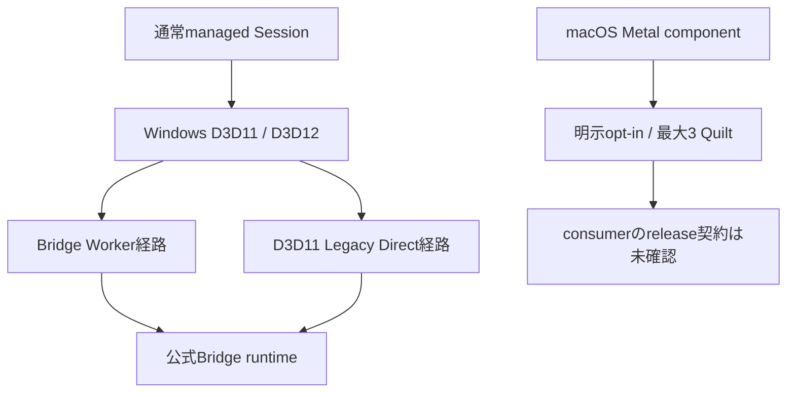

[English](../graphics-backends.md)

# 描画backend

ViewWeaveのgraphics backendは、Unityが生成したQuiltをnative transportへ渡すproducerと、Looking Glass Bridgeへ引き渡すconsumerを分離します。通常のmanaged Sessionが選ぶ経路と、実験中のnative経路は区別します。

## Backend一覧

| 経路 | Producer | Consumer | 状態 |
| --- | --- | --- | --- |
| Legacy Direct | Windows D3D11 | Windows D3D11 / official Bridge | 既存のWindows D3D11経路 |
| Bridge Worker | Windows D3D11 | worker所有D3D11 / official Bridge | Windows Editor PlayとPlayerの通常経路 |
| Bridge Worker on D3D12 | Windows D3D12 resource | 同じGPU上のD3D11 worker / official Bridge | GPU共有で渡す。画像CPU readbackなし |
| Edit Mode Rig preview | Windows Editor D3D11/D3D12 | LocalはEditor UI、deviceはBridge Worker / official Bridge | 明示開始するEditor専用経路。現在のNative artifact/source implementationはWindows fake/WARP CTestのfocused 6件に成功しました。両official sampleは2026-10-10にpackage commit `c09fdcce30e77d95f3aa451c3642b00522edc255`でcold verification済みです。限定的なURP実機確認を記録しています。広範なhardware検証は未実施です。PlayからEditへの黒画面・遅延出力は日付付き655F artifactで未解決 |
| Metal experiment | Unity Metal texture | official Bridge Metal API via IOSurface | native実験のみ。通常Sessionでは未対応、macOS native artifact未配布 |
| Vulkan | なし | なし | 実装・対応なし |

次図はサポート対象の通常Sessionと、独立したMetal実験を区別します。Metal枝は通常Sessionへ接続せず、Windowsのshutdown gateにも入りません。

通常Session表示はWindowsのBridge WorkerまたはD3D11 Legacy Directを使います。Edit Mode Rig previewは独立したEditor経路で、明示開始します。Local modeはpreview QuiltをEditor内へ表示し、device modeはWindows EditorのBridge Worker経路を使います。いずれもPlay Modeや対象Rigの通常Sessionを開始しません。2026-10-09、package `5234b834381afd91a896714ad6d8f9dcbd9f6f95`、Native DLL SHA-256 `655FDB898CF7B9F9733A1880828B740B62FB74E0C3ECDF9D825C07794F6388CD`のURP実機確認では、Close/Start一回とEditからPlayへの遷移一回で映像と新たな移動/Undoを確認しました。逆のPlayからEditでは最初黒くなり、後に映像と新たな移動/Undoが見えたとの報告がありましたが、確認前にguardされたownerが消えていました。これは日付付き655F artifactの結果です。F1B artifactは2026-10-10に両official sampleでcold verificationされました。別の一回ずつの通常URP Editor確認では、PlayとStopからEdit Device Previewで利用者が映像と移動/Undoを確認し、Pause中は最後の映像がscene移動に追従せず、Resume後に移動とUndoが反映されることを確認しました。これは反復hardware matrixではありません。さらに別のprivate static-present candidateでは2026-10-10のURP実機で限定的に試し、4回のPlayと試したEdit Preview遷移で映像と移動/Undo、2回のPauseで最後の映像が残ることを利用者が確認しました。persistent endpointの登録済みSDK primaryを、Pause/返却後にboundedなowner-thread static redrawで使用しました。各結果のartifactと制約は[Bridge output lifecycle](bridge-output-lifecycle.md)を参照してください。利用者から更新済みHDRP sampleが動作したとの確認がありますが、modeや遷移の詳細は不明です。HDRPの個別lifecycle、Player、光学品質、性能、広い反復性は未検証です。Metal枝は手動artifactと実験専用componentを要し、連続運用やUPM配布を示しません。

Windowsではprocess ownerが一つのBridge SDK endpointと登録済みoutput resourceをmode間で保持します。PlayとEdit Mode device previewはgeneration付きの排他的leaseを交互に取得します。lease返却では新規submitを止め、source workをdrainします。Nativeが旧mode textureを参照しなくなったことを通知した後、managed側がCore/transferとproducerのGPU完了を待ち、Unity textureを破棄してACKを送ります。NativeはACK受信後にだけ次generationを許可します。persistent preview endpointではPause中やlease owner間も登録済みprimaryと最後のimageを表示します。source workのdrain後、Nativeはcached primaryを最大5Hzで再描画できます。このstatic-redraw経路では追加のsource texture copyやSDK texture-copy API callを行わず、SDK visibilityも変更しません。これはplugin側の呼び出しを説明するもので、vendor内部の実装については断定しません。最終process shutdown時だけSDK resourceを解放します。現在のNative artifact/source implementationではtyped queue-full `Busy`を追加しています。以前のmode単位Start/Stop fixtureは現在のlease経路すべてを検証していません。adapter/deviceが既存endpointと非互換な場合は、二つ目のSDK endpointを暗黙に作らずUnity Editorの再起動を要求します。

### Lease admissionとBusyの扱い

Source candidateのlease専用draw-data callは、受理されたdrawには`Accepted`、有効なReady leaseで3 tokenのqueueが満杯の場合にだけ`Busy`を返し、invalid、stale、lifecycle conflict、Native faultはerrorにします。Busy時にdraw payloadは割り当てず、追加のsource texture referenceも保持しません。Editor previewは現在のowner/generationを維持して再試行します。Playbackはそのframeだけをskipします。他のfailureでは該当modeを停止し、通常のreturn/GPU proofで安全に解放できるまでresourceを保持します。Native submitted/completed/dropped値は進行状況の診断counterであり、texture解放、GPU完了、ACK、display scanoutのproofではありません。Candidateはgeneration取得時にNative status counterをresetしますが、導入済みA6A DLLのcounterはprocess scopeであり、generation単位の値として解釈できません。

通常のmanaged policyはWindows D3D11/D3D12のWorkerと、D3D11のLegacy Directを対象にします。共通descriptor validationとBridge path判定もD3D11/D3D12 producerからD3D11 consumerへの経路を扱います。Windows backendはD3D11、D3D12、D3D11/D3D12 interopに分かれ、共通worker codeからtransport単位で呼ばれます。非対応platformのtransportはfailure stubです。

## 明示的なEdit Mode Rig preview

`Start Local Edit Mode Preview`と`Start Looking Glass Device Preview`は、利用者が開始を要求した場合だけEditor-owned producerを作ります。`Close Preview`は初期状態で閉じた`Advanced`内にあり、通常のpreview操作はStart、Pause、Resumeです。一時producerはsource Rig設定を使いますが、通常Bridge Sessionを開始したり所有したりしません。開始・停止によってsource Rigや保存sceneを変更しません。device previewはWindows Editor D3D11/D3D12に限られ、公式Bridge runtimeが必要です。以前のmode単位device/GPU fixtureはStart、Stop、resource retirementを各構成で確認しましたが、共有endpoint lease導入前の試験であり、Close/Startやmode間handoffを示しません。自動更新は0.2秒間隔（5Hz）を目標にします。明示refreshとparameter編集はそれより早いrenderを要求することがあります。この値はschedule設定であり、性能測定結果ではありません。

`Pause Preview`は新しいsubmitを止め、処理をdrainし、同じpreview producer、Unity texture、lease generationを保持します。persistent endpointでは最後のSDK imageを表示したままにし、producer workのdrain後にowner threadがcached primaryを最大5Hzで再描画できます。`Resume Preview`はそのgenerationを続け、static redrawを止めてlive submitを再開します。Local previewは最後の画像を保持し、一時停止中は構造設定をlockします。`Close Preview`、Rig切替、Play handoff、reloadは完全なlease返却経路を使います。まずNativeがsource使用終了を通知し、その後managed側がCore/transferとproducerのGPU完了を待ってUnity mode resourceを破棄し、次generationを許可するACKを送ります。process endpointと最後のSDK imageは次のowner向けに保持され、SDK resourceは最終process shutdown時だけ解放されます。現在のNative artifactはSHA-256 `F1B06893404D75582FF600BA733AE3C531ED0C0A7EA40E29CE56DD7A91B0A000`（214,016 bytes、51 exports）で、Windows fake/WARP CTestのfocused 6件に成功しました。このartifactの両official sampleは2026-10-10にpackage commit `c09fdcce30e77d95f3aa451c3642b00522edc255`でcold verification済みです。限定的なURP実機確認を記録しています。広範なhardware検証は未実施です。current-source runtimeのEditor/Player構成、`Bridge.Editor`、focused playback-safety test sourceがcompile済みですが、Unity Test Runnerは未実行です。両sampleは2026-10-09にpackage `eb527e1`、DLL SHA-256 `A6A062343710AF2362DAF7B923A9BB98BDD5D381D896C68AE3190CA55655FBC7`でcold verificationされました。同日後刻、両sampleはpackage `5234b834381afd91a896714ad6d8f9dcbd9f6f95`、DLL SHA-256 `655FDB898CF7B9F9733A1880828B740B62FB74E0C3ECDF9D825C07794F6388CD`でcold verificationされました。これらは日付付きidentityであり、その後の更新内容を示すものではありません。655F artifactはURP実機で限定的に試しました。別のprivate static-present candidateはURPで限定検証し、4回のPlayと2回のPauseで利用者確認を得ました。[Bridge output lifecycle](bridge-output-lifecycle.md)にartifact identity、遷移、範囲を記録しています。利用者から更新済みHDRP sampleが動作したとの別確認もありますが、modeや遷移の詳細は不明です。HDRPの個別lifecycle、Player出力、実寸scale、画像品質、性能は未検証です。

## Windowsのshutdownとpackage更新

Play Modeの通常Stopとsession再起動はfinal shutdown latchを立てません。所有中のworker/sessionをdrainし、GPU完了とnative releaseを確認してから参照を解放します。Windows EditorまたはWindows Playerのprocess終了では別のfinal shutdown gateを使い、admissionを閉じ、active outputを停止し、native contextsの回収とpersistent worker hostのjoinを確認してから終了を許可します。Legacy D3D11 outputはsessionごとのclose ledgerが`ClosedSafe`を返し、ACKが成功してからGPU fence/readback proofと合わせてtransfer textureを解放します。global SDK idleだけでは解放しません。

Windows Editorの通常quit callback内で、Bridge専用の同期gateを実行します。単調時計の10秒polling予算を使いますが、個別のUnity/native API呼び出しは中断できず、絶対的な終了時間上限ではありません。callback自身はCoordinatorのPumpOnce、発行済みGPU readbackのUpdate、1ms sleepだけを行います。Unity全体のEditor updateやUI message pumpは再入しません。Native host join、閉じたcontextの回収、ReaperとPlaybackのGPU proofが揃わない場合はquitをキャンセルし、referencesを保持してadmissionを閉じたままにします。自動再試行はせず、後の明示的quit要求でstatusを再確認します。完了後は同じ終了要求を許可し、window close/menu commandは再発行しません。save確認をCancelした場合、irreversibleなfinal admissionは再開しないためBridge再利用前にEditor再起動が必要です。quit callbackを迂回する終了では従来の5秒bounded fallbackを別に試しますが、完了を証明できなければ成功扱いしません。V6の単一Windows D3D12 Editor fixtureで、作成済みかつGPU proof前のowned textureを持つ状態から実際のGUI終了要求一回を通し、flush 1/1、native/managed completion、Editor自然終了code 0を確認しました。これは一つの8-view 512x256 fixtureであり、save確認cancelや一般的な性能/光学品質の確認ではありません。

Final shutdown hookはWindows Editor/Playerだけに適用し、asset import worker processでは登録しません。macOS Metal実験とunsupported platformには触れません。V6ではarmed後も通常描画を続け、実GUI終了要求一回を通して自然終了しました。これは過去のaccess violation原因を除去した証明ではありません。save確認cancel、48-view optical quality、性能、physical displayは未検証です。現在のnative/managed test結果とEditor fixtureの検証状態は[Shutdown validation](../shutdown-validation-20261008.md)に記録しています。

Native DLLまたはexportが変わるUPM packageを更新する前に`Close Preview`を使い、通常Sessionも停止して所有権を解放してください。Package Managerでpackageを更新した後、managed assemblyとnative shimを同じversionで読み込むためUnityを再起動します。process単位のSDK ownerと読み込み済みnative imageはEditor終了まで保持されます。DLLが使用中でpackageを置き換えられない場合はUnityを終了・再起動してからBridgeを使います。shutdown traceの使い方とnative test境界は[Native shutdown trace](../native-shutdown-trace.md)を参照してください。

MetalのAPI wrapper、Unity Metal producer、submission lifetime管理は別のnative module群に隔離されています。この実験を通常のSession policyや既存Bridge outputの対応表へ含めません。Metal sourceの存在だけでは利用可能なruntimeや配布物を意味しません。

## Metal実験とresource lifetimeの境界

公式Looking Glass Bridge 2.6.3 ARM64 packageのheader/export調査で、`initialize_bridge`、`instance_window_metal`、`create_metal_texture_with_iosurface`、`draw_interop_quilt_texture_metal`のMetal entry pointsを確認しました。wrapperはこれらのABIへtexture descriptor相当のObjective-C object pointerとIOSurface-backed textureを渡します。Unity側は`IUnityGraphicsMetalV2`を使い、Unity command bufferのcompletion handlerでproducer側のcopy完了を観測します。

現設計は最大3枚のimmutable texture slotをboundedに保持します。Unity command-buffer completionはproducer copyの完了です。SDK drawの受理はBridge consumerがtextureの読み取りを終えた通知ではありません。Bridgeのconsumer acknowledgment、release/reuse時点、drawのthread affinity、window/runloop要件は確認できていません。そのため実験経路はslotを再利用せず、通常SessionはMetalをreadyにしません。

SDKの`copy_metal_texture`内にBridge自身のcommand bufferをcommit後`waitUntilCompleted`する実装はありますが、pluginのdraw後のconsumer read完了を示すものではありません。また、plugin実装がそのcopy APIを呼ぶことも前提にしません。ABIで確認したselectorやexportの存在を、draw完了・release契約の証明として扱いません。

Unityの公式[IUnityGraphicsMetal.h](https://github.com/Unity-Technologies/NativeRenderingPlugin/blob/master/PluginSource/source/Unity/IUnityGraphicsMetal.h)はMetal interfaceのrender-thread利用制約を記載しています。pluginはUnity render eventからMetal producerを実行します。Bridge API側のthread契約は不明です。公式Bridgeの製品情報は[Looking Glass Bridge](https://lookingglassfactory.com/software/looking-glass-bridge)を参照してください。

GitHub Actionsの2 workflow run ([37705337066](https://github.com/zabaglione/ViewWeave/actions/runs/37705337066), [37705340768](https://github.com/zabaglione/ViewWeave/actions/runs/37705340768))はcommit `054fffeb817ac8daae6ff68ed567ec7e69fe4798`で各5/5 jobs成功です。macOS jobは`macos-14-arm64`上でAppleClang 15.0.0.15000309のCXX/ObjCXXを使い、shimをbuild/linkし、common、Metal API contract、submission lifetimeの3 testsを通過しました。CMakeは`CMAKE_BUILD_TYPE`を指定していないため、Release最適化済みとは記録しません。Windows fake regressionsは4/4、transportは2/2、Linux portable/unsupported ABIは2/2、static jobも成功しました。

CI artifact `native-macos-metal-shim` (artifact 11519112992)は`liblookingglass_bridge_shim.dylib` 179952 bytesです。downloadしたfileはMach-O 64-bit ARM64 (CPU type `0x0100000c`)、SHA-256 `C06464EEEBAA3D3B934437AD9242B6DFA4C5E37E26A3187D3BE131113213980B`で、`UnityPluginLoad`とMetal provider query/begin/submit/pump exportsを含みます。依存はMetal/Foundation/IOSurfaceとmacOS system librariesで、official Bridge dylibは同梱されていません。artifactはUPMに含まれず、CIから手動取得する必要があります。

このjobはnative build/linkとfake contract testsだけを行いました。Unityを起動せず、official SDKをloadせず、実機へquiltを表示していません。物理display、provider full flow、consumer release/thread/shutdown契約も未検証です。normal Metal Sessionはunsupportedのままです。

## Managedによる有限実験

`BridgeMetalExperimentalOutput`は、通常Sessionから独立した明示opt-in用componentです。macOS Play mode、64-bit process、Metal graphics device、runtime ABI layout guardを満たさない場合は開始しません。ABI guardは`ProviderStatusV1` 64 bytes (`deviceGeneration` offset 32)、`BeginRequestV1` 56 bytes (`runtimePathUtf8` offset 8、`width` offset 28)、`RenderRequest` 48 bytes (`sourceTexture` offset 8、`generation` offset 16、`columns` offset 24)を確認します。

限定試験の手順は次のとおりです。

1. Metal実験用componentをscene objectへ追加し、`rig`に既存の`ViewWeaveRig`を割り当てます。`runtimePath`にはBridge 2.6.3の`/Applications/Looking Glass Bridge 2.6.3.app/Contents/MacOS/libbridge_inproc.dylib`を指定します。native shimは別途手動で入手する必要があり、UPMには含まれません。
2. macOS EditorのPlay中にcomponentのContext Menuから`Begin Finite Metal Experiment From Rig Profile`を実行します。providerがruntimeを初期化し`RuntimeAvailable`になるまで待ちます。
3. `RuntimeAvailable`になった後、`Start Finite Metal Quilt Rendering`を一度実行します。producer submissionは最大3枚で自動停止し、3枚を超えて継続描画しません。
4. `Close Finite Metal Experiment`を実行してmanaged rigのoutput/profile/Auto Render設定を戻します。同じprocessで実験を再開する用途には使わないでください。

この試験はprocessごとのone-shotで、最大3 quiltを受け付け、Bridge consumerが解放したことを示すacknowledgmentがありません。slot/textureはretainedのままです。`Close`はmanaged rigを復元しprovider admissionを閉じますが、SDK側resourceの安全なretire、thread affinity、正常なprocess shutdownは未確定です。継続運用や繰り返し起動に使わないでください。通常SessionのMetal `interopReady`はfalseのままです。

最初のCIでは古いv5 pinとWindows fake initializer/Metal includeのcompile failureがありました。v7対応pin`522254181faf188efa8b50c3e3bf6fce720b26e4`への更新と修正後、上記2 runが成功しました。ただしCI結果はUnity runtime、official SDK load、Bridge画面、physical display、shader/format品質を検証していません。artifactは手動取得のみで、通常Metal対応を意味しません。

## 対象範囲と既知の制約

Vulkan実装は今回の範囲外です。性能最適化は保留中です。既存のScene View Gizmoによるcamera authoringは対象に含みますが、Quilt imageへのGizmo overlayは対象外です。

過去のWindows Bridge終了時access violationは根本原因未確定のまま履歴として保持します。訂正済みbaseline2は自然終了しましたが、旧事象は再現されておらず、修正の因果的な解消も証明されていません。Metal実験は通常Sessionに未対応で、このWindows shutdown変更の検証には含みません。
