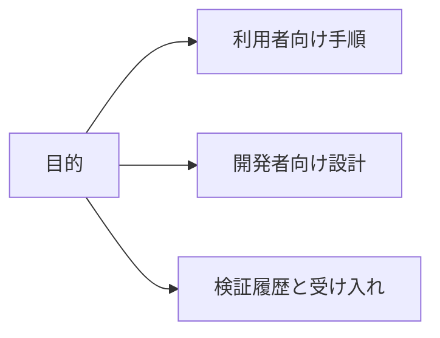

[English](../index.md)

# ViewWeave ドキュメント

利用手順、開発設計、検証履歴から目的に合う資料を選べます。各検証記録は、文書に記載されたUnity・pipeline・Graphics API・fixtureの範囲に限られます。

## 利用者向け

- [導入と使い方](getting-started.md): package導入、Rig作成、Cube表示、Player実行、明示的なEdit Mode preview。
- [対応条件](compatibility.md): 対応platform、Graphics API、pipeline、既知の制約。
- [Quiltの保存と録画](quilt-capture.md): 完成Quiltの保存、PNG連番、Pause/Resume。
- [Quiltの再生](../quilt-playback.md): 既存Bridge sessionから保存済みQuiltを再生。
- [音声録音](quilt-recording-audio.md): Mono音声をPNG連番と別のWAVへ保存。
- [動画書き出し](../quilt-video-export.md): 完成したPNG連番から無音MP4を作成。
- [Quiltカメラの調整](quilt-authoring.md): Rigからのfocus、framing、Scene View操作、独立したEdit Mode preview。
- [VFX Graph](vfx-graph.md): pipeline別のVFX Graph条件。

## 開発者向け

- [Architecture](architecture.md): Core、pipeline adapter、Bridge outputの構成。
- [Graphics backends](graphics-backends.md): Windows通常経路と限定Metal実験。
- [Performance](../performance.md): 固定条件での過去計測、制約、再現方法。
- [Legacy render pipeline investigation](../legacy-render-pipeline-investigation.md): 旧実装の調査と投影計算の再利用。
- [Bridge package update safety](../bridge-package-update-safety.md): managed/native package更新時の整合性。
- [Native shutdown trace](../native-shutdown-trace.md): shutdown traceの読み方と対象範囲。

## 検証履歴と受け入れ

- [Windows validation](../windows-validation.md): Windows Editor/Playerで実行した試験と未検証条件。
- [Shutdown validation](../shutdown-validation-20261008.md): 2026-10-08時点のshutdown gate検証と歴史的AV記録。
- [Remaining work plan](../remaining-work-plan.md): 現在の状態、残作業、完了条件。
- [DX12 HDRP performance investigation](../dx12-performance-investigation.md): HDRP fixtureでの視点数比較。
- [Remaining-work validation record](../benchmarks/remaining-work-validation-20261007.md): 2026-10-07に行った限定実験の詳細。
- [SDK feature comparison](../sdk-feature-comparison.md): 公式SDKとの機能比較と検証範囲。
- [Unity feature coverage](../unity-feature-coverage.md): Unity機能別のfixture状況。
- [Third-party notices](THIRD_PARTY_NOTICES.md): 外部コードとライセンス表記。
