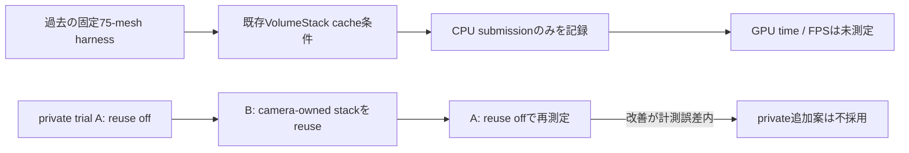

[English](../performance.md)

# 性能の実測と再現手順

以下の数値は過去の固定harnessで得た結果です。現行製品のFPSや今回の投影計算変更による改善量を表しません。計測条件はBridgeなしのWindows Development Player、Unity 6000.6.4f1、URP 17.6、Direct3D11、NVIDIA GeForce RTX 3090 Ti、graphics multi-threading有効、固定128x96 tile、共有Lit mesh約75個、120 frame warmup、1000 frameを3 runです。`QuiltRenderer.LastCpuSubmissionTicks`をCPU submission時間として記録し、GPU frame timeやpresent latencyは計測していません。

この図は、既存のVolumeStack cacheを含む固定harness測定と、別途行ったprivate Garden A/B/A trialを分けます。private trialでは計測誤差を超える改善がなく、採用していません。

図のA/B/Aはprivate trialの追加reuse案だけを示し、mainの既存VolumeStack cacheを変更した試験ではありません。以下のテーブルは固定harnessで測定したsnapshotです。

| GRD | Views | p50 CPU submission (ms) | p95 (ms) | GRD Renderers | Visible Instances | GC bytes/frame |
| --- | ---: | ---: | ---: | ---: | ---: | ---: |
| Off | 1 | 0.3592 | 0.4584 | 0 | 0 | 312 |
| On | 1 | 0.3174 | 0.3920 | 75 | 75 | 312 |
| Off | 8 | 2.7992 | 3.1957 | 0 | 0 | 1,656 |
| On | 8 | 2.4638 | 2.8579 | 75 | 600 | 1,656 |
| Off | 48 | 17.3311 | 19.6056 | 0 | 0 | 9,336 |
| On | 48 | 15.0732 | 16.6753 | 75 | 3,600 | 9,336 |

6条件のsummaryはすべて成功しています。今回の各条件は120 frame warmup後に1000 frameを3 run、合計3000 samplesを取得し、build GUID `e3ae196fd1af4b6583ee9b27ee28b557`で揃えています。48視点のCPU submission p50はGRD Onが15.0732 ms、Offが17.3311 msです。これは固定harnessの観測値であり、公式SDKやGPU実装の高速化を示す比較ではありません。GPU timingとCPU render-thread timingは欠測で、0を実測値として扱いません。GPU Resident Drawerは48 viewを1 drawへ変換せず、Bridgeのスレッド停止を修正する機能でもありません。

固定条件のGRD比較では、同じ75 mesh・128x96 tile・120 frame warmup・1000 frame x 3 run・Profiler instrumentation有効の条件で、既存VolumeStack cache変更前後を比較しました。この歴史的なharness比較と、後続のprivate Garden A/B/A追加trialは別の実験です。

| GRD | Views | cache前p50 (ms) | cache前p95 (ms) | cache前GC/frame | cache後p50 (ms) | cache後p95 (ms) | cache後GC/frame |
| --- | ---: | ---: | ---: | ---: | ---: | ---: | ---: |
| Off | 1 | 0.5766 | 1.4776 | 32,620 | 0.3592 | 0.4584 | 312 |
| On | 1 | 0.5461 | 1.4107 | 32,620 | 0.3174 | 0.3920 | 312 |
| Off | 8 | 5.3800 | 6.1491 | 260,120 | 2.7992 | 3.1957 | 1,656 |
| On | 8 | 5.2666 | 6.0726 | 260,120 | 2.4638 | 2.8579 | 1,656 |
| Off | 48 | 31.7737 | 34.4383 | 1,560,120 | 17.3311 | 19.6056 | 9,336 |
| On | 48 | 30.5441 | 33.4241 | 1,560,120 | 15.0732 | 16.6753 | 9,336 |

cache変更後の測定では48 viewのGRD OnがOffに対してCPU submission p50で約13.0%低くなりました。cache変更前GRD Onからcache変更後の新GRD Onへの差は約50.7%です。これはGRDの差とVolumeStack cache変更の差を分けた観測で、公式SDKやGPU高速化の保証ではありません。測定PlayerはBridgeへ接続せず、別のDirect Lit 48 view表示Playerを両条件の背景負荷として同時に動作させています。

再現時は同一の機器、scene、Quilt、native views、quality、postprocess、compiler、graphics mode、Bridge、VSync、GPU、Unity、render pipelineを固定してください。性能測定中はPNG保存、trace、CPU readbackを無効にし、画質確認やログ取得は別実行に分けます。GRD単体の適用確認と、独自multiviewや再投影の比較条件は [gpu-resident-drawer.md](gpu-resident-drawer.md) と [multiview-rendering.md](multiview-rendering.md) を参照してください。

このharnessの実測sceneは約75 meshの代表 workloadです。別scene、mesh数、display、resolutionへ一般化できません。cache変更後の測定はVolumeStack cache適用後の同条件で取得しています。異なるUnity/公式版との比較は条件差を明示した参考値に限り、直接のspeedup claimには使いません。

今回のCoreではStopwatchの計時方法を変更しましたが、この変更後のCPU、GPU、GCベンチは再取得していません。既存の性能数値から計時変更による改善を主張しません。

解像度のtradeoff例として、demo scale 0.25では1920x1080 Quilt、8x6、tile 240x180、profile 1.0では7680x4320、tile 960x720です。pixel数は16倍になり、RGBA32の7680x4320 Quiltは約126.56 MiBです。これはprofile例であり、全機種の固定値やfull-resolution実測結果ではありません。

生のJSONとplayer logは内部検証用として管理しています。表の数値は、記載した機器・scene・設定・harness条件に限定した測定結果です。公開APIや製品全体の性能保証、公式speed比較を示すものではありません。公式speed比較は未実施です。

## 共有culling試作の限定ベンチ

Unity 6000.6.4f1、URP 17.6、Windows D3D11、RTX 3090 Ti、MT有効、GRD無効のDevelopment Playerで、8視点、4x2、128x96 tile、Lit Cube 2個の固定sceneを測定しました。baselineは8 StandardRequest、shared cullingは1 StandardRequestと8 RendererListです。各条件はbaseline/featureを交互に3 run、各120 frame warmup後に1000 samples、1 frame 1 sample、同一品質で取得しました。CPU submission elapsedには同期待ちが含まれる場合があります。

| 経路 | p50 CPU submission (ms) | p95 (ms) | mean (ms) |
| --- | ---: | ---: | ---: |
| baseline 8 StandardRequest | 1.8023 | 2.0580 | 1.81632 |
| shared culling 1 request + 8 RendererList | 0.3198 | 0.3987 | 0.330339 |

これは2 Lit object、8視点のマイクロベンチです。GPU時間、render thread時間、48視点、影、透明、post processing、VFX、公式実装との比較は未計測です。GPU fpsや一般用途の速度向上を示す値ではなく、shared cullingは本体の量産経路へ採用していません。GC counterはこの測定では有効な値として扱っていません。
