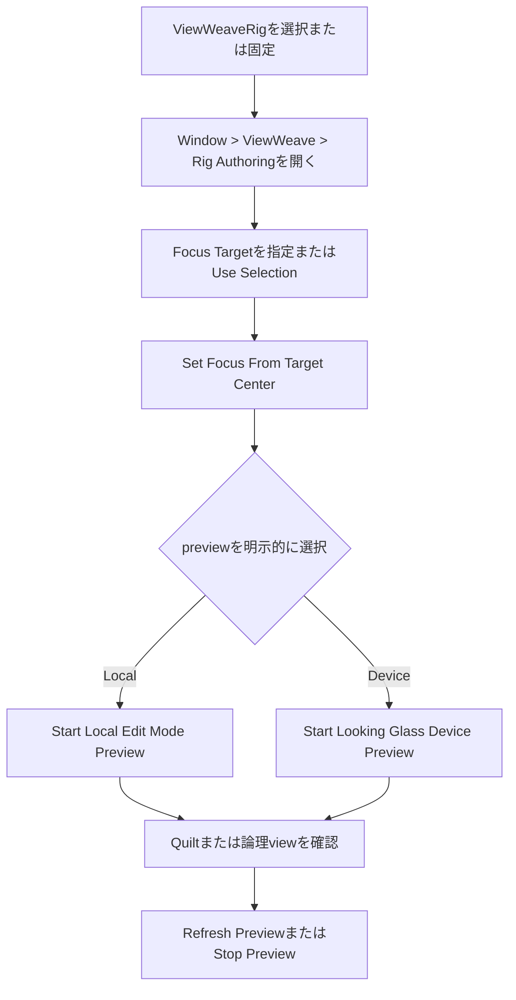
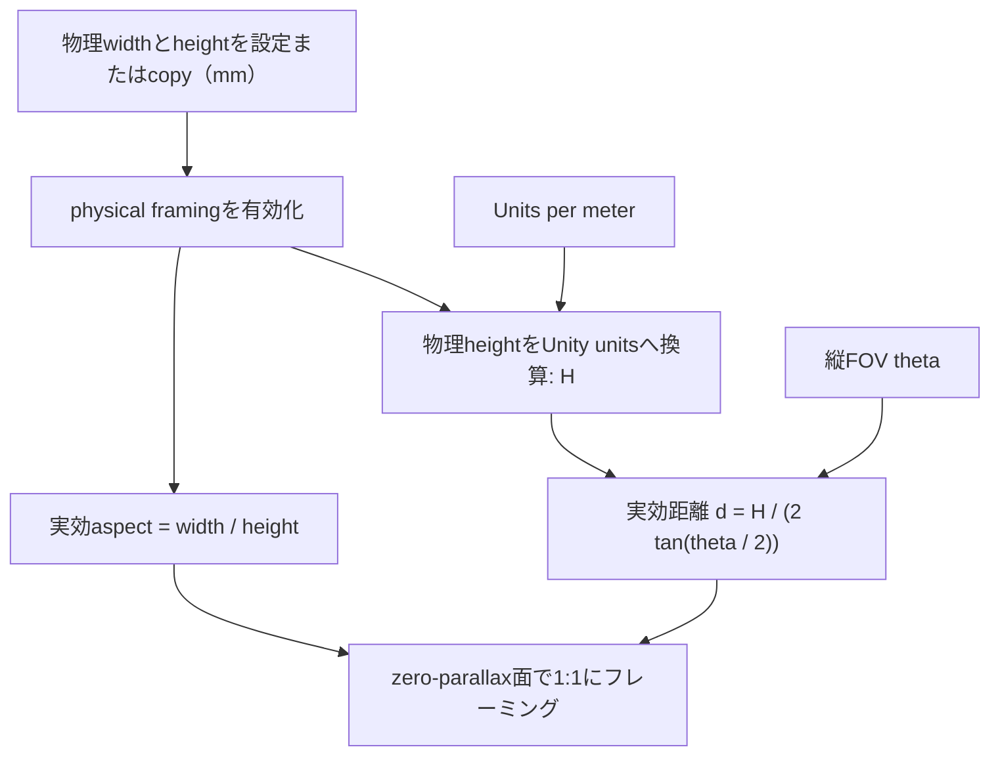

[English](../quilt-authoring.md)

# Quiltのカメラ範囲とフォーカスを調整する

Rigを使う場合は、統合された`ViewWeaveRig` Inspectorまたは対象を固定するAuthoring windowから操作します。`ViewWeaveRig`を選択または固定し、`Window > ViewWeave > Rig Authoring`を開きます。`Focus Target`を指定または現在の選択を使い、focus設定を明示するには`Set Focus From Target Center`を実行します。physical framingがoffなら`Focus Distance`を更新し、onなら保存済みbase focus distanceを保ってFOVを解きます。framingには`Camera & Focus`、previewには`Preview`を使います。Unityの選択を変更してもwindowのRigは維持されます。

Sceneビューの紫の面はゼロ視差面、青緑はNear Clip、橙色はFar Clipです。単体`QuiltRenderer`を編集する場合はGameObjectを選択し、技術用Inspectorの`Camera Framing`で`Focus Distance`、FOV、`Near Clip`、`Far Clip`を調整します。紫の面中央のハンドルをカメラの前後へドラッグして`Focus Distance`を調整することもできます。

ゼロ視差面は、その距離にある被写体が表示面に重なるようにする基準面です。`Focus Distance`（`Quilt Settings > Camera Distance`）は、実効フレーミングカメラのワールド位置からカメラ前方へ測るUnity unitsです。紫の面がその地点に置かれ、ギズモの線と距離ラベルで位置を確認できます。単位はUnity sceneのスケールに従うため、project側で1 unitを1mとしていない場合は実メートルとは一致しません。`Focus Distance`は立体視の視差を調整します。被写界深度（Depth of Field）、オートフォーカス、Volumeのフォーカス距離は変更しません。

単体`QuiltRenderer`の技術操作では、Near/Farの範囲は専用`sourceCamera`のクリップ距離を使います。`Reference Camera`が設定されている場合、実行時の位置と向きはそのCameraのworld poseをQuilt描画前に専用カメラへ反映します。`Follow Reference Field Of View`が有効なら、技術用Inspectorの`Vertical Field Of View`値は各Quilt描画前に参照カメラから同期されるため、保存値は次の描画で上書きされます。統合Rig UIの`Reference Vertical Field Of View`はReference Camera本体を編集します。FOV追従を無効にするとQuilt側で指定したFOVを編集できます。physical framing以外では`viewAspect`、`Camera Distance`、`viewCone`、Near/Farは自動同期しません。physical framingでは描画用の実効aspectとカメラ距離を算出しますが、baseの`viewAspect`と保存済み`Camera Distance`は上書きせず、clip距離と`viewCone`も既存値を保ちます。通常描画は元の参照カメラの設定やTransformを変更しません。

Bridge Rig作成メニューは、解決したframing Cameraを`Reference Camera`に設定します。CinemachineではVirtual Cameraではなく、Cinemachine Brainが出力する実Cameraを参照してください。標準の自動Quilt描画はscene rendering後に行われるため、通常はそのframeのBrain出力を読み取ります。録画は開始時にQuilt設定を固定し、録画中にFOVや他のQuilt設定が変わると停止します。動く参照カメラで連番録画する場合も、FOVとQuilt geometryは録画中固定にしてください。

## Edit Mode authoring preview

Rigでは統合された`ViewWeaveRig` Inspector、または`Window > ViewWeave > Rig Authoring`を使います。windowはUnityの選択対象が変わっても設定対象Rigを維持するため、Focus Targetを選ぶときにInspectorをlockする必要はありません。`Camera & Focus`、`Rendering`、`Preview`、`Capture & Playback`、`Bridge`、`Advanced`の6 sectionに一般操作をまとめます。`QuiltRenderer`、Bridge Session、pipeline adapterなどの低レベルcomponentは互換性と診断向けに従来どおり利用できます。

`Camera & Focus`には`Focus Target`、`Use Selection`、`Set Focus From Target Center`、水平・垂直Orbit操作があります。objectをfieldへdragして指定できます。`Set Focus From Target Center`は要求するfocusを設定する明示操作です。physical framingがoffなら保存済み`Focus Distance`を更新し、onなら保存済みbase focus distanceを変更せずFOVを解きます。対象を選ぶだけではRig設定を変更しません。FocusとCamera操作では、ロード済みMain Stageまたは同一Prefab Stage内のobjectを対象にします。persistent assetとisolated Preview Sceneは拒否します。同じMain Stageのロード済みadditive sceneは許可します。`Scene View Controls`には`Show Near / Far`、`Show Extreme Views`、`Show 3D Focus Cursor`があり、技術用`QuiltRenderer` Inspectorと同じEditor設定を共有します。`Frame Focus Plane Center in Scene View`はzero-parallax面の中心をScene Viewに表示します。

`Physical Display Framing` foldoutは既定で折りたたまれています。展開し、`Visible Aperture Width (mm)`、`Visible Aperture Height (mm)`、projectの`Unity Units per Meter`（既定値`1`）を設定してから`Use Physical 1:1 Framing`を有効にします。寸法が未設定または無効なら使用できません。有効にすると、実効view aspectは幅÷高さから、実効カメラ距離は縦FOVから算出され、zero-parallax面が設定した物理高さに1:1のscene scaleで収まります。source/base quality profileと保存済み`Focus Distance`は変更されません。有効中は保存済み距離のfieldが隠れ、入力が有効ならread-onlyの`Effective Focus Distance`が表示されます。算出したaspectと距離が実効Scene View gizmo、preview、runtime描画でbase値をoverrideします。FOV fieldは既存のFOV追従設定に従い、追従中のReference Cameraまたは保存済みQuilt FOVを編集します。FOVを変更すると算出距離も更新されます。このmodeでは`Set Focus From Target Center`は要求されたfocus距離に合うようFOVを解きますが、保存済みbase focus距離は変わりません。下のstatusにはgeometry source、実効aspect、aperture寸法、対角寸法が表示されます。

距離計算では、物理heightをUnity unitsへ換算した`H = height_mm / 1000 * units_per_meter`と縦FOV `theta`を使います: `d = H / (2 * tan(theta / 2))`。aspectは入力widthとheightから求めます。zero-parallax面での1:1 scaleは、設定した物理寸法にscene geometryをフレーミングすることを意味します。光学calibration、lens correction、知覚上の画質を証明するものではありません。

`Use Connected Display Size`は、有効なdevice calibrationの幅と高さをaperture fieldへコピーし、`Use Physical 1:1 Framing`も有効にするUndo対応の一操作です。`Unity Units per Meter`は変更しません。Bridgeの`get_calibration_for_display`はpixel width/heightとDPI値を返します。mmへの換算はそのcalibration値を用い、OSのdesktop scalingやQuilt tile寸法は使いません。[公式Bridge Native Function Reference](https://lfdocs.lookingglassfactory.com/software/looking-glass-bridge-sdk/native-function-reference#get_calibration_for_display)を参照してください。使用前にstatusに表示されるaperture寸法と機器の表示領域を照合してください。有効なdevice profileがない場合は手動寸法を入力できます。device previewでは物理aspectが接続機器のaspectと一致し、zoomが`1`である必要があります。不一致の設定は拒否されます。preview開始・停止ではscene値を書き換えません。

device previewまたはruntime Sessionがactiveの場合、実効Scene View gizmoは接続device profileのaspectとview coneを使います。どちらもactiveでない場合はlocal framing geometryを使います。physical framingが有効ならaspectは入力した物理寸法から求め、local profileからは取りません。gizmoは接続deviceまたはlocal geometryのどちらを表示しているか示します。local previewがdeviceの光学表示を再現することを意味しません。

`Follow Reference Camera FOV`が有効な場合、`Reference Vertical Field Of View`はReference Camera本体の値を編集します。`QuiltRenderer`に別のcopyを保存するものではありません。後からCinemachineやanimationに上書きされる場合があります。追従を無効にすると、UIは`QuiltRenderer`の保存FOVを編集します。`Source Near Clip`、`Source Far Clip`、`Source Culling Mask`はRig専用source Cameraを編集します。Orbit操作は実際のframing CameraのTransformを変更し、Undoに記録します。安全性を確認できないReference Cameraは理由を表示して編集不可にします。

`Rendering`にはlocal preview用のRig Quality Profileと、Bridge Sessionがある場合はruntime/device出力用の`Session Quality`を表示します。local previewはRig profileのgeometryを使い、device previewはSession Qualityと接続機器のprofileを使います。Sessionがない場合、device previewはPreview qualityを使います。`Preview`には明示開始する2つの操作があります。`Start Local Edit Mode Preview`はEditor内にQuiltを表示し、`Start Looking Glass Device Preview`はWindows D3D11/D3D12 Bridge Workerを通して接続機器へ送ります。device previewには公式Bridge runtimeが必要です。どちらも別のEditor-owned producerを使い、通常のSRP render callbackの外で描画します。Play Modeや選択したRigの通常Bridge Sessionは開始しません。先に通常Sessionを停止します。preview専用producerへ設定をコピーするため、previewの開始・停止で状態を保存sceneへ書き戻しません。`Stop Preview`を使ってください。Authoring windowで別Rigへ切り替えるとpreview停止を要求し、preview対象Rigを表示中のwindowを閉じた場合も停止を要求します。

preview開始・停止時は`Preview` sectionのstatusとerrorを確認してください。Local previewはUnity内に表示し、device previewはBridgeへ送信します。running状態や送信成功はsoftware側の進行を示すだけで、機器に画像が表示されたことや光学的な見え方を保証しません。機器出力を確認する場合はLooking Glass本体を直接確認してください。

Editor previewの自動更新は0.2秒周期（5Hz）を目標とします。明示的なrefreshやparameter編集は、より早いrenderを要求できます。実際の更新頻度・性能は測定していません。隔離Unity 6000.6.4f1 Core projectでauthoring/playback testとQuilt Capture GPU smokeがpassしました。URP/HDRPのsoftware preview testでは、800 x 450 mm、1 Unity unit/meterの設定でproducer、gizmo、render snapshotのgeometryが一致し、FOVを60度から45度へ変えた際に実効focus距離が更新され、base設定が維持されることを確認しました。これらのsoftware検証は接続機器のcalibration値や光学的な1:1表示を検証するものではありません。報告されたaperture寸法を機器の表示領域と照合し、実機でscaleを確認してください。検証範囲と制約は[Windows validation](../windows-validation.md)と[Graphics backends](graphics-backends.md)を参照してください。

`Advanced`では検証付き`Auto Render in Play Mode`操作と参照中のoutput/guard componentを表示し、HDRP guardの3つのfallback設定も必要に応じて編集できます。rendererやLegacy Directの詳細Inspectorは技術操作として残ります。

`Capture & Playback`はこのRigの既存Capture、Playback、Video Export windowを開きます。録画、再生lease、export稼働中に対象を無断で置き換えません。

Inspectorの`Show Near / Far`でクリップ面を表示／非表示にできます。クリップ距離が大きく、近くの範囲が見にくいときに切り替えてください。`Show Extreme Views`を有効にすると、左右端の視点のNear/Far面を表示します。これは設定した全視点範囲を示します。Half/Quarterの描画密度を選んだ場合も、ギズモは設定上の左右端を示します。

## 明示的なカメラ制作操作

`Camera Authoring`には、操作対象の`Effective Camera`と`Effective Camera Transform`が表示されます。`Reference Camera`が設定されていれば参照カメラが対象で、未設定なら`Source Camera`が対象です。参照カメラのTransformはQuilt描画前にSource Cameraへコピーされるため、手動操作も実際のフレーミングカメラに対して行います。

単体`QuiltRenderer`の技術操作として`Set Focus From Selected Object Center`も利用できます。QuiltRenderer Inspectorをlockしてからシーン内GameObjectを1つ選択してください。lockしたInspectorのbuttonを押すと、Renderer boundsの中心（RendererがなければCollider boundsの中心）をCamera前方軸へ投影し、その距離をzero-parallaxの`Focus Distance`に設定します。どちらのboundsもなければTransform位置を使います。Camera後方と無効値は拒否します。変更するのは設定だけで、Cameraの位置・向きは変えません。これは被写界深度のfocusではありません。`ViewWeaveRig`では上記`Focus Target`と明示的な`Set Focus From Target Center`を使い、Inspector lockは不要です。

`Frame Focus Plane Center in Scene View`は、Scene Viewの表示をzero-parallax面中央へ移動します。`Horizontal Orbit`または`Vertical Orbit`へ角度を入力し対応するApplyボタンを押すと、Effective Cameraの位置と向きをzero-parallax点をpivotとして一緒に回転します。pivot位置は維持され、水平角は±180度、垂直角は±89度に制限されます。これらの手動操作はUndoに記録され、Prefab instance上の変更も記録します。

`Show 3D Focus Cursor`は既定で無効です。有効にすると従来の前後スライダーの代わりにfocus面中央へPosition Handleを表示します。ドラッグ位置をカメラ前方へ投影して距離だけを更新するため、横方向の移動は適用されずfocus面中央へ戻ります。CameraのTransformは変更しません。

Camera authoring操作はPlay Mode中とPlay開始遷移中は無効です。CinemachineやAnimation previewが参照カメラを駆動している場合、後続更新で手動Transformを上書きすることがあるため、停止した状態で編集してください。複数の`QuiltRenderer`選択中はこれらの操作を表示・実行しません。

ギズモはSceneビュー上の調整補助です。参照カメラが設定されていれば、その現在のworld poseと追従FOVを使って面を表示します。Edit Modeの表示更新ではカメラや設定値を書き換えません。表示機器のレンズ補正や視点割り当て、Volume効果、合成後の見え方まではプレビューしません。通常の透視カメラと有効な有限値の設定で表示されます。QuiltRendererはOrthographicカメラに対応しません。
