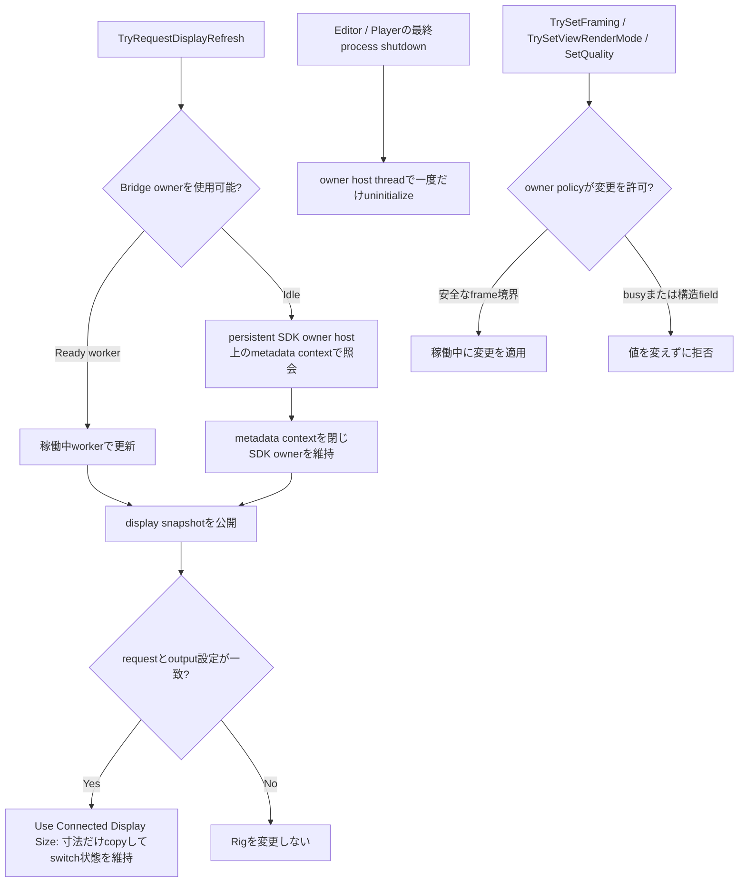
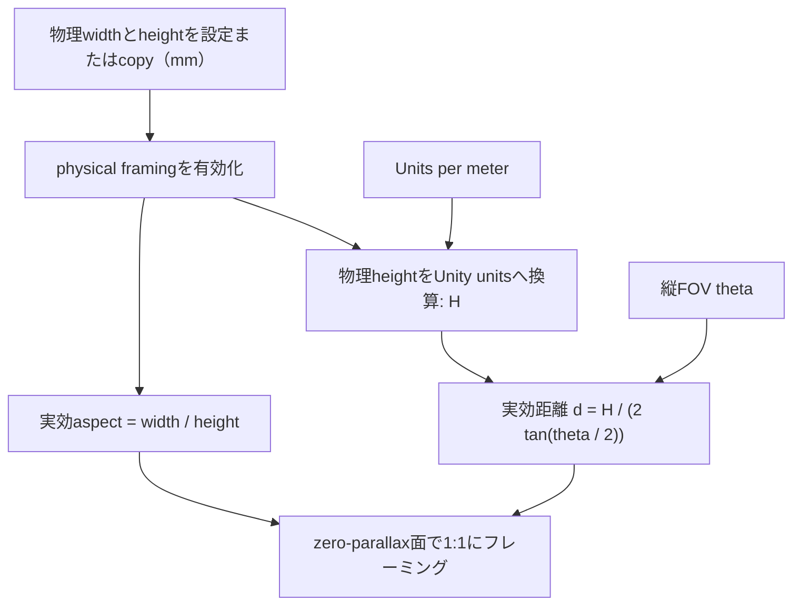
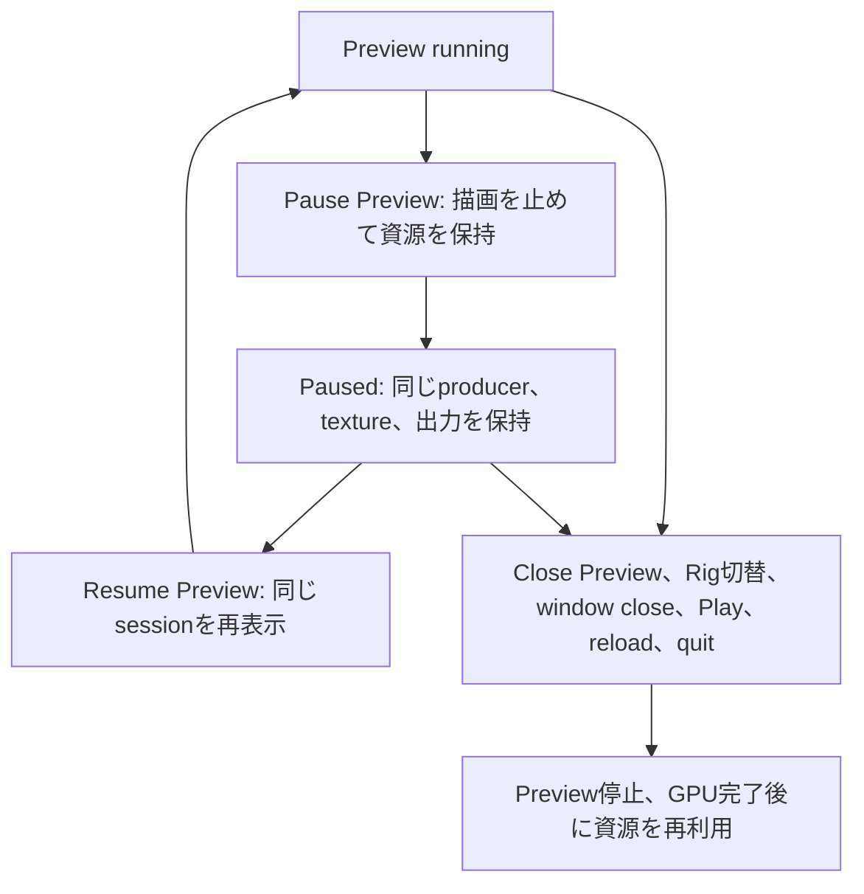

[English](../quilt-authoring.md)

# Quiltのカメラ範囲とフォーカスを調整する

[ユーザーガイド](user-guide.md) · [技術者向けガイド](technical-guide.md)

## ユーザー向けの操作

Rigを使う場合は、統合された`ViewWeaveRig` Inspectorまたは対象を固定するAuthoring windowから操作します。`ViewWeaveRig`を選択または固定し、`Window > ViewWeave > Rig Authoring`を開きます。`Focus Target`を直接指定するかfieldへdragし、focus設定を明示するには`Set Focus From Target Center`を実行します。physical framingがoffなら`Focus Distance`を更新し、onなら保存済みbase focus distanceを保ってFOVを解きます。framingには`Camera & Focus`、previewには`Preview`を使います。Unityの選択を変更してもwindowのRigは維持されます。

Sceneビューの紫の面はゼロ視差面、青緑はNear Clip、橙色はFar Clipです。単体`QuiltRenderer`を編集する場合はGameObjectを選択し、技術用Inspectorの`Camera Framing`で`Focus Distance`、FOV、`Near Clip`、`Far Clip`を調整します。紫の面中央のハンドルをカメラの前後へドラッグして`Focus Distance`を調整することもできます。

ゼロ視差面は、その距離にある被写体が表示面に重なるようにする基準面です。`Focus Distance`（`Quilt Settings > Camera Distance`）は、実効フレーミングカメラのワールド位置からカメラ前方へ測るUnity unitsです。紫の面がその地点に置かれ、ギズモの線と距離ラベルで位置を確認できます。単位はUnity sceneのスケールに従うため、project側で1 unitを1mとしていない場合は実メートルとは一致しません。`Focus Distance`は立体視の視差を調整します。被写界深度（Depth of Field）、オートフォーカス、Volumeのフォーカス距離は変更しません。

## Cameraの実行時挙動と実装メモ

単体`QuiltRenderer`の技術操作では、Near/Farの範囲は専用`sourceCamera`のクリップ距離を使います。`Reference Camera`が設定されている場合、実行時の位置と向きはそのCameraのworld poseをQuilt描画前に専用カメラへ反映します。`Follow Reference Field Of View`が有効なら、技術用Inspectorの`Vertical Field Of View`値は各Quilt描画前に参照カメラから同期されるため、保存値は次の描画で上書きされます。統合Rig UIの`Reference Vertical Field Of View`はReference Camera本体を編集します。FOV追従を無効にするとQuilt側で指定したFOVを編集できます。physical framing以外では`viewAspect`、`Camera Distance`、`viewCone`、Near/Farは自動同期しません。physical framingでは描画用の実効aspectとカメラ距離を算出しますが、baseの`viewAspect`と保存済み`Camera Distance`は上書きせず、clip距離と`viewCone`も既存値を保ちます。通常描画は元の参照カメラの設定やTransformを変更しません。

Bridge Rig作成メニューは、解決したframing Cameraを`Reference Camera`に設定します。CinemachineではVirtual Cameraではなく、Cinemachine Brainが出力する実Cameraを参照してください。標準の自動Quilt描画はscene rendering後に行われるため、通常はそのframeのBrain出力を読み取ります。録画は開始時にQuilt設定を固定し、録画中にFOVや他のQuilt設定が変わると停止します。動く参照カメラで連番録画する場合も、FOVとQuilt geometryは録画中固定にしてください。

## Edit Mode authoring preview

Rigでは統合された`ViewWeaveRig` Inspector、または`Window > ViewWeave > Rig Authoring`を使います。windowはUnityの選択対象が変わっても設定対象Rigを維持するため、Focus Targetを選ぶときにInspectorをlockする必要はありません。`Camera & Focus`、`Rendering`、`Preview`、`Capture & Playback`、`Bridge`、`Advanced`の6 sectionに一般操作をまとめます。`QuiltRenderer`、Bridge Session、pipeline adapterなどの低レベルcomponentは互換性と診断向けに従来どおり利用できます。


`Camera & Focus`には`Focus Target`、Focus/Fit操作、physical framingの切替、水平・垂直Orbit操作があります。objectをfieldへ直接指定するかdragして設定できます。physical framingがoffの場合、`Set Focus From Target Center`はtarget中心までの前方距離を保存済み`Focus Distance`へ設定し、FOVを維持します。onの場合は`Set Physical Focus From Target Center`と表示され、aperture寸法、units、保存済みbase distanceを維持したまま、target中心をzero-parallax面に置くよう縦FOVを調整します。成功statusにはphysical framing時の変更前後のFOVと実効focus距離が表示されます。

`Fit View To Target`は有効なRenderer bounds（ない場合は有効なCollider bounds）全体を10%の余白で現在のviewに収めるよう、縦FOVとfocus距離を調整します。Camera姿勢とtarget scaleは変えません。physical framing中は無効です。先に`Use Physical 1:1 Framing`をoffにしてください。boundsが空、設定が無効、またはboundsのcornerがsource Cameraのnear/far clip plane外なら変更しません。Focus/Fit操作とphysical framing切替に成功すると、active preview（device previewを含む）も更新されます。Focus Targetを設定しただけではRig設定を変更しません。FocusとCamera操作では、ロード済みMain Stageまたは同一Prefab Stage内のobjectを対象にします。persistent assetとisolated Preview Sceneは拒否します。同じMain Stageのロード済みadditive sceneは許可します。`Scene View Controls`には`Show Near / Far`、`Show Extreme Views`、`Show 3D Focus Cursor`があり、技術用`QuiltRenderer` Inspectorと同じEditor設定を共有します。`Frame Focus Plane Center in Scene View`はzero-parallax面の中心をScene Viewに表示します。

## Display更新とAPIの挙動

Bridge outputを接続している場合、機器変更後に`Refresh Connected Displays`を使い、display profileとphysical calibrationのsnapshotを更新します。これは明示的なrefreshです。snapshotは最後に成功した要求の結果を示し、vendorの自動hotplugは通知しません。Sessionまたはdevice previewのworkerがReadyなら同じworkerが処理し、Edit ModeでidleならWindows SDKはpersistent owner host上のmetadata contextから照会されます。metadata contextを閉じるとcontextごとのmetadata資源は解放されますが、SDK所有権は維持されます。SDKとowner hostはEditorまたはPlayer processの終了処理まで維持されます。要求を処理できるReady workerがなく、別contextまたはcleanupが進行中の場合、refreshは一時的に利用できないことがあります。statusに`Closing metadata worker`や`Waiting for Bridge metadata worker release`が表示される場合があり、cleanup timeout時は`Metadata cleanup timed out; waiting for native release proof`を表示します。button横のstatusとerrorを確認してください。Unity Editorはnative pluginをプロセスへ読み込むため、Bridge packageのnative DLLを更新した場合やmetadata refresh exportを追加した場合はEditorの再起動が必要です。[Unity native plug-in Inspector](https://docs.unity3d.com/6000.0/Documentation/Manual/plug-in-inspector.html)を参照してください。

refreshが成功すると、device profileは現在のEditor session内で同じRigのPlay/Stop間も利用でき、必要な時点で復元されます。この処理でRigのsource aspect、framing、profileは変更されず、sceneへのdirty設定や保存も行われません。またsnapshot eventを再度発火しません。Rigのclone、output設定変更、reconnect、Editor再起動後はcacheが無効になるため、`Refresh Connected Displays`をもう一度実行してください。Bridge runtimeまたはapplication設定を変更した場合も、再使用前にUnity EditorまたはPlayer processを再起動してください。

### Scripting APIと稼働中の変更

renderer ownerが有効な間は、serialized fieldへ直接書き込まず検証付きAPIを使ってください。`QuiltCameraFraming`はFOV、保存済みbase focus distance、physical aperture設定をまとめた値です。`TrySetFraming`、`TrySetFocusDistance`、`TrySetViewRenderMode`は値とactive owner policyを検証します。physical framing中はbase distanceの直接変更を拒否し、`TrySetFocusDistance`は要求された実効距離になるようFOVを解きます。変更が拒否されると`false`を返し、値は変更しません。

```csharp
if (renderer.TryGetFraming(out QuiltCameraFraming framing))
{
    var updated = new QuiltCameraFraming(45f, framing.FocusDistance,
        framing.PhysicalFramingEnabled, framing.ApertureWidthMillimeters,
        framing.ApertureHeightMillimeters, framing.UnitsPerMeter);
    if (!renderer.TrySetFraming(updated, out string error)) Debug.LogError(error);
}

if (!renderer.TrySetFocusDistance(0.65f, out string focusError)) Debug.LogError(focusError);
if (!renderer.TrySetViewRenderMode(QuiltViewRenderMode.Half, out string modeError)) Debug.LogError(modeError);
if (session != null) session.SetQuality(QuiltQualityPreset.Balanced);
if (output != null && !output.TrySetZoom(1f, out string zoomError)) Debug.LogError(zoomError);
if (output != null && !output.TryRequestDisplayRefresh(out string refreshError)) Debug.LogError(refreshError);
BridgeDisplaySnapshot snapshot = output == null ? null : output.CurrentConfigurationDisplaySnapshot;
if (output != null) output.ConnectedDisplaySnapshotChanged += OnDisplaySnapshotChanged;
```

`CurrentConfigurationDisplaySnapshot`は、runtime path、application name、display ordinalがoutput設定と一致し、reconnectが不要な場合に、最後に完了した読み取り専用profile listとcalibrationを返します。`ConnectedDisplaySnapshotChanged`は明示的なrefresh成功後にmain threadで発火します。vendorによる自動hotplugは通知しません。consumerの無効化／破棄時にeventをunsubscribeしてください。Rig Inspectorもrequest tokenと現在のRig/output設定を検証してからcalibrationを適用します。`TrySetZoom`とSessionの`SetQuality`はrenderer-owner policyを適用します。許可されればframingとrender modeはframe境界で反映できますが、owner稼働中のtransport・構造変更は固定です。描画、recording/playback、metadata refresh、cleanup中は通常変更できる値も一時的に拒否される場合があります。token/errorを含む完了詳細はpackage内部に留まります。



native DLLまたはexportが変わるBridge UPM更新では、previewと通常Sessionを停止し、Package Managerでpackageを更新してからUnity Editorを再起動してください。Editor processが読み込んだnative imageは保持されます。Windowsでは、プロセス全体のSDK ownerと読み込み済みnative imageをEditor終了まで保持します。 If the loaded DLL prevents replacement, exit and restart Unity before using Bridge again. native-image guardはimageが古い、重複している、または検証できない場合に呼び出しを拒否できますが、DLLをunload・reloadしません。Editorを終了した状態でpackageを更新する方法もありますが、Bridgeの再使用前にEditorの再起動が必要です。

`Physical Display Framing` foldoutは既定で折りたたまれており、aperture寸法、units、geometry status、`Use Connected Display Size`があります。`Use Physical 1:1 Framing` switchはfoldoutの外、`Camera & Focus`に表示され、既定ではoffです。`Visible Aperture Width (mm)`、`Visible Aperture Height (mm)`、projectの`Unity Units per Meter`（既定値`1`）を設定してから、switchを明示的にonにします。寸法が未設定または無効なら使用できません。`Use Connected Display Size`はBridgeから有効なcalibrationを取得して物理寸法だけをcopyし、switchの状態は変更しません。有効にすると、実効view aspectは幅÷高さから、実効カメラ距離は縦FOVから算出され、zero-parallax面が設定した物理高さに1:1のscene scaleで収まります。source/base quality profileと保存済み`Focus Distance`は変更されません。有効中は保存済み距離のfieldが隠れ、入力が有効ならread-onlyの`Effective Focus Distance`が表示されます。算出したaspectと距離が実効Scene View gizmo、preview、runtime描画でbase値をoverrideします。FOV fieldは既存のFOV追従設定に従い、追従中のReference Cameraまたは保存済みQuilt FOVを編集します。FOVを変更すると算出距離も更新されます。physical focus操作は要求された距離に合うようFOVを解き、保存済みbase focus距離は変えません。下のstatusにはgeometry source、実効aspect、aperture寸法、対角寸法が表示されます。

距離計算では、物理heightをUnity unitsへ換算した`H = height_mm / 1000 * units_per_meter`と縦FOV `theta`を使います: `d = H / (2 * tan(theta / 2))`。aspectは入力widthとheightから求めます。zero-parallax面での1:1 scaleは、設定した物理寸法にscene geometryをフレーミングすることを意味します。光学calibration、lens correction、知覚上の画質を証明するものではありません。

`Use Connected Display Size`は、有効な接続機器calibrationの幅と高さだけをaperture fieldへUndo対応でcopyし、現在の`Use Physical 1:1 Framing` switch状態を維持します。1:1 framingを有効にする操作は別途switchを明示的にonにします。有効なcalibration snapshotがない場合は`Refresh Connected Displays`を要求できます。更新後の値が有効で、Rig/output設定が要求時から変わっていない場合に限りcopyします。失敗またはstaleな要求ではRigを変更せず、理由を表示します。`Unity Units per Meter`は変更しません。Bridgeの`get_calibration_for_display`はpixel width/heightとDPI値を返します。mmへの換算はそのcalibration値を用い、OSのdesktop scalingやQuilt tile寸法は使いません。[公式Bridge Native Function Reference](https://lfdocs.lookingglassfactory.com/software/looking-glass-bridge-sdk/native-function-reference#get_calibration_for_display)を参照してください。使用前にstatusに表示されるaperture寸法と機器の表示領域を照合してください。有効なdevice profileがない場合は手動寸法を入力できます。device previewでは物理aspectが接続機器のaspectと一致し、zoomが`1`である必要があります。不一致の設定は拒否されます。preview開始・停止ではscene値を書き換えません。

device previewまたはruntime Sessionがactiveの場合、実効Scene View gizmoは接続device profileのaspectとview coneを使います。どちらもactiveでない場合はlocal framing geometryを使います。physical framingが有効ならaspectは入力した物理寸法から求め、local profileからは取りません。gizmoは接続deviceまたはlocal geometryのどちらを表示しているか示します。local previewがdeviceの光学表示を再現することを意味しません。



`Follow Reference Camera FOV`が有効な場合、`Reference Vertical Field Of View`はReference Camera本体の値を編集します。`QuiltRenderer`に別のcopyを保存するものではありません。後からCinemachineやanimationに上書きされる場合があります。追従を無効にすると、UIは`QuiltRenderer`の保存FOVを編集します。`Source Near Clip`、`Source Far Clip`、`Source Culling Mask`はRig専用source Cameraを編集します。Orbit操作は実際のframing CameraのTransformを変更し、Undoに記録します。安全性を確認できないReference Cameraは理由を表示して編集不可にします。

`Rendering` foldoutは既定で開いており、`Quilt View Render Mode`、local preview用のLocal Quilt Profile、source Rigの設定を表示します。`Output Quality`は接続された出力の解像度を選び、既定値は`Balanced`です。Metalでは出力を停止してGPU資源の回収を待ってから変更します。WindowsのBridge Sessionでは実行中の変更もできます。Session未接続時のdevice previewも接続機器のprofileと`Balanced`を使います。local previewはRig profileを使います。previewまたはSessionがRigを所有している間、Local Quilt Profileと構造的なlayout設定は変更できません。変更する前にpreview/Sessionを停止してください。稼働中のWindows Sessionでは`Output Quality`を使い、既存のquality reconfiguration pathにより再接続せず変更できます。`Full`、`Half`、`Quarter`は次のframe境界で描画するlogical viewを切り替えますが、Quilt gridとlogical view数は変わりません。これらの操作はactive renderer-owner policyに従います。描画／completion通知、録画／再生lease、display metadata refresh、cleanup中は変更が拒否され、理由が表示される場合があります。

`Preview`には明示開始する2つの操作があります。`Start Local Edit Mode Preview`はEditor内にQuiltを表示し、`Start Looking Glass Device Preview`はWindows D3D11/D3D12 Bridge WorkerまたはmacOS Metal出力で接続機器へ送ります。device previewには公式Bridge runtimeが必要です。どちらも別のEditor-owned producerを使い、通常のSRP render callbackの外で描画します。Play Modeや対象Rigの通常Bridge Sessionは開始しません。先に通常Sessionを停止します。preview専用producerを使うため、preview操作で状態を保存sceneへ書き戻しません。`Pause Preview`は新しい描画・送信を止め、producer、texture、所有権lockを保持します。Windowsは進行中の処理を完了してdevice windowを隠し、Metalは最後の画像を表示したまま保持します。


LocalとMetalのdevice previewは最後の画像を保持します。`Resume Preview`は同じpreview sessionを再表示します。完全にdrain・解放するには`Close Preview`を使います。これにより構造設定のlockが解除され、preview ownerも解放されます。Windowsでは、プロセス全体のSDK ownerと読み込み済みnative imageをEditor終了まで保持します。Authoring windowのRig切替・preview対象windowのclose、Play移行、reload、Editor終了では一時停止ではなく完全終了を要求します。一時停止中も構造設定はlockされます。Windowsのdisplay refreshは保持中のWorker経由で続き、Metalの校正情報は現在のdevice previewから取得します。

上の図は再利用可能な一時停止と完全終了を区別します。完全終了ではproducerとGPU／出力の完了確認後に資源を解放します。Metalは終了時に専用producerを切り離して元のRigの設定lockを解除し、GPU回収完了まで次のPreview開始を待ちます。以下のWorkerの検証結果はWindowsでの記録です。Native Releaseのpause protocolはdrain-before-hide、pause/resume acknowledgement、同一session resource保持、pause中からの完全終了を含むCTest 10/10に合格しました。これはfake Bridge runtimeとtest adapterによるNative worker契約の検証です。隔離URP/HDRP local previewのmanaged testはpause/resume、一時停止中のFOV変更、完全Closeを2/2で確認しました。2026-10-09、利用者はUnity 6000.6.4f1 / Windows D3D12 / package revision `6a297a8fddc685b51e0da3136ca6cdb5331e8c6f`の実URP `test.unity` sceneで一度のPause/Resumeを確認しました。native pause acknowledgement後もworker handleとgenerationは維持され、Resume後に表示が戻り、表示対象の移動とUndoが反映されました。送信・完了はResume後に進み、dropとerrorはありませんでした。これは一つのsceneと一度の操作です。反復動作やHDRP機器での挙動は未検証で、実寸scale、画像品質、性能も確認していません。

preview開始・pause・resume・close時は`Preview` sectionのstatusとerrorを確認してください。Local previewはUnity内に表示し、device previewはBridgeへ送信します。running状態や送信成功はsoftware側の進行を示すだけで、機器に画像が表示されたことや光学的な見え方を保証しません。機器出力を確認する場合はLooking Glass本体を直接確認してください。Native DLLまたはexportを変えるpackage更新では、`Close Preview`と通常Session停止で所有権を解放し、Package Managerで更新した後にUnityを再起動してください。native-image guardは古い・重複・確認できないloaded imageを拒否できますが、DLLをunload/reloadする機能はありません。

Editor previewの自動更新は0.2秒周期（5Hz）を目標とします。明示的なrefreshやparameter編集は、より早いrenderを要求できます。実際の更新頻度・性能は測定していません。隔離Unity 6000.6.4f1 Core projectでauthoring/playback testとQuilt Capture GPU smokeがpassしました。URP/HDRPのsoftware preview testでは、800 x 450 mm、1 Unity unit/meterの設定でproducer、gizmo、render snapshotのgeometryが一致し、FOVを60度から45度へ変えた際に実効focus距離が更新され、base設定が維持されることを確認しました。URP fixtureを使用したWindows D3D11/D3D12のdevice-preview→Play lifecycle testは、domain reloadとscene reloadの両方が有効な設定でpassし、D3D12ではdomain/scene reloadの両方を無効にした設定でもpassしました。Editor producer停止後にRuntime Sessionが描画を完了し、停止時にnativeとpreview-retentionのpending数が0となり、Edit Mode復帰後にpreviewは自動再開しませんでした。これらの検証は接続機器のcalibration値や光学的な1:1表示を検証するものではありません。報告されたaperture寸法を機器の表示領域と照合し、実機でscaleを確認してください。検証範囲と制約は[Windows validation](../development/windows-validation.md)と[Graphics backends](../development/ja/graphics-backends.md)を参照してください。

`Advanced`では検証付き`Auto Render in Play Mode`操作と参照中のoutput/guard componentを表示し、HDRP guardの3つのfallback設定も必要に応じて編集できます。rendererやLegacy Directの詳細Inspectorは技術操作として残ります。

`Capture & Playback`はこのRigの既存Capture、Playback、Video Export windowを開きます。録画、再生lease、export稼働中に対象を無断で置き換えません。Playbackの共通ウィンドウでRigを選び、Play中のWindowsまたはMetal出力に再生します。[Quilt Playback](../quilt-playback.md)を参照してください。

Inspectorの`Show Near / Far`でクリップ面を表示／非表示にできます。クリップ距離が大きく、近くの範囲が見にくいときに切り替えてください。`Show Extreme Views`を有効にすると、左右端の視点のNear/Far面を表示します。これは設定した全視点範囲を示します。Half/Quarterの描画密度を選んだ場合も、ギズモは設定上の左右端を示します。

## 明示的なカメラ制作操作

`Camera Authoring`には、操作対象の`Effective Camera`と`Effective Camera Transform`が表示されます。`Reference Camera`が設定されていれば参照カメラが対象で、未設定なら`Source Camera`が対象です。参照カメラのTransformはQuilt描画前にSource Cameraへコピーされるため、手動操作も実際のフレーミングカメラに対して行います。

単体`QuiltRenderer`の技術操作として`Set Focus From Selected Object Center`も利用できます。QuiltRenderer Inspectorをlockしてからシーン内GameObjectを1つ選択してください。lockしたInspectorのbuttonを押すと、Renderer boundsの中心（RendererがなければCollider boundsの中心）をCamera前方軸へ投影し、その距離をzero-parallaxの`Focus Distance`に設定します。どちらのboundsもなければTransform位置を使います。Camera後方と無効値は拒否します。変更するのは設定だけで、Cameraの位置・向きは変えません。これは被写界深度のfocusではありません。`ViewWeaveRig`では上記`Focus Target`と明示的な`Set Focus From Target Center`を使い、Inspector lockは不要です。

`Frame Focus Plane Center in Scene View`は、Scene Viewの表示をzero-parallax面中央へ移動します。`Horizontal Orbit`または`Vertical Orbit`へ角度を入力し対応するApplyボタンを押すと、Effective Cameraの位置と向きをzero-parallax点をpivotとして一緒に回転します。pivot位置は維持され、水平角は±180度、垂直角は±89度に制限されます。これらの手動操作はUndoに記録され、Prefab instance上の変更も記録します。

`Show 3D Focus Cursor`は既定で無効です。有効にすると従来の前後スライダーの代わりにfocus面中央へPosition Handleを表示します。ドラッグ位置をカメラ前方へ投影して距離だけを更新するため、横方向の移動は適用されずfocus面中央へ戻ります。CameraのTransformは変更しません。

Rigのframing、physical aperture、view density、Output Quality編集はPlay Mode中に一律無効にはなりません。各編集はactive renderer-owner policyを確認し、描画／completion通知、録画／再生、display metadata refresh、cleanup中は拒否される場合があります。拒否された値は変更されず、理由が表示されます。Reference Camera割当は構造変更として扱います。Focus Target、Scene View framing、orbit操作はPlayへの進入・退出中は無効で、loaded Main Stageまたは同じPrefab Stage内のCamera/targetが必要です。CinemachineやAnimationがReference Cameraを駆動している場合、後続更新が手動TransformやFOVを上書きすることがあります。単体`QuiltRenderer`の技術Inspectorの挙動は別です。Rig操作は複数選択中に非表示です。

ギズモはSceneビュー上の調整補助です。参照カメラが設定されていれば、その現在のworld poseと追従FOVを使って面を表示します。Edit Modeの表示更新ではカメラや設定値を書き換えません。表示機器のレンズ補正や視点割り当て、Volume効果、合成後の見え方まではプレビューしません。通常の透視カメラと有効な有限値の設定で表示されます。QuiltRendererはOrthographicカメラに対応しません。
