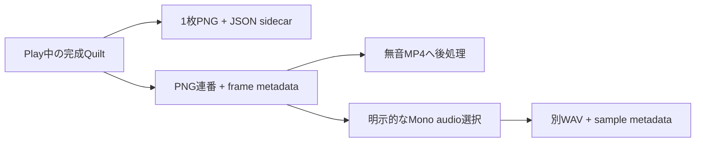

[English](../quilt-capture.md)

# Quilt の保存と連番録画

[ユーザーガイド](user-guide.md) · [技術者向けガイド](technical-guide.md)

## ユーザー向けの操作

Play中に**Window > ViewWeave > Quilt Capture**を開くと、Auto Render Rigが最後に描画したQuiltを保存するか、PNG連番を録画できます。WAVを別途作成する場合は[Quilt PNGと音声の録音](quilt-recording-audio.md)を参照してください。encoderや試験の実装詳細は[技術者向けガイド](technical-guide.md)にあります。

ViewWeave Core には、完成した Quilt を静止画として保存する機能と、Play 中に Auto Render が出力した Quilt を PNG 連番として保存する機能があります。録画のために追加の視点を描画することはありません。

図はsilent PNG recordingと明示opt-inのMono audio recordingを示します。両方とも完成Quiltを共有しますが、音声は別WAVになりMP4 exporterへmuxされません。

静止画と連番は既存Auto Renderの出力を保存します。音声録音を選ばない通常連番はsilentです。

## 静止画を保存する

1. Unity のメニューから **Window > ViewWeave > Quilt Capture** を開きます。
2. 保存したい **Quilt Renderer** を指定します。
3. Bridge Rig を Play し、Auto Render による Looking Glass 表示を確認します。完成 Quilt が作られると、このウィンドウにも最新画像が表示されます。
4. 最新画像が古くないことを確認し、**Save Latest Quilt PNG...** を押して保存先を指定します。

PNG の隣に同名の `.json` sidecar が作成されます。sidecar には画像サイズ、行列、視点数、view render mode、実際に描画した視点数、使用領域、カメラと Quilt の幾何設定、UTC 時刻が入ります。メタデータは PNG 内には埋め込まず、別ファイルに保存します。PNG または sidecar が既にある場合は上書きしません。

**Save Central View PNG...** は、完成済み Quilt から中央に最も近い論理 view を1 tileだけ切り出して保存します。追加の Camera Render は発生しません。view 数が奇数なら中央 view、偶数なら index `(views - 1) / 2` の低い側の中央 view を使います。たとえば 48 views では index 23 です。偶数の場合、これは光学軸に厳密に重なる中央 view ではありません。Half / Quarter では、その論理 view の tile に複製された実描画 view の画像を保存します。

中央画像の sidecar には元の Quilt metadata に加え、`logicalViewIndex`、`renderedViewIndex`、view render mode、切り出した画像サイズが記録されます。`logicalViewIndex` は中央として選んだ出力 tile、`renderedViewIndex` は Half / Quarter でその tile に割り当てられた実際の描画元です。PNG は lower-left origin の tile 座標で読み出し、tile 内の向きを保ちます。Quilt と同じく既存 PNG や sidecar を上書きしません。

ファイル名は `name_qs{columns}x{rows}a{renderAspect}.png` です。`renderAspect` には tile のピクセル比ではなく、Quilt layout の aspect ratio を使います。たとえば 8 列、6 行、aspect ratio 0.75 の設定では `name_qs8x6a0.75.png` となります。小数点と数値書式は OS の地域設定に依存しません。

## PNG 連番を録画する

1. Quilt Capture ウィンドウで **Add Recorder Component** を押し、Undo 対応で Quilt Renderer と同じ GameObject に Recorder を追加します。
2. Play に入り、対象 Quilt Renderer の Auto Render を有効にします。renderer は有効なままにしてください。
3. **Frames per second**（1〜240）と **Frame count** を指定し、出力先フォルダーを選びます。
4. **Start PNG Sequence** を押します。開始ボタンを押した Unity frame は保存せず、その次の frame から指定 FPS の simulation timestep で保存します。
5. **Pause Recording** で保存を一時停止できます。pause 中も scene simulation は動き、capture timestep を開始前の値へ戻します。**Resume Recording** は同じ出力先と frame numbering のまま継続し、Resume を押した frame は保存しません。指定枚数に達すると自動終了します。途中で止める場合は **Stop Recording** を押します。

出力先には毎回新しい `ViewWeave_年月日_時分秒_一意ID` フォルダーを作ります。各完成 Quilt は `frame_000000_qs...png` のような PNG と JSON sidecar で保存されます。`manifest.json` には要求 FPS、指定枚数、実際の完了枚数、status、エラーが入り、`frames.jsonl` には各 Unity frame、simulation time、実測 delta time、UTC 時刻が1行ずつ記録されます。status は `recording`、`paused`、`complete`、`cancelled`、`error` です。録画中はpause中も含め `finishedAtUtc` を空のまま保ち、終了時に記録します。途中終了や失敗の場合も、それまでに完成して保存できたファイルを残します。

## 動作上の注意

- 録画は Unity Play mode の active Auto Render renderer 専用です。追加 render を発行せず、その frame に完成した Quilt を 1 枚だけ保存します。
- PNG 読み戻しと圧縮を同期実行するため、保存中は Unity の frame とシミュレーションが止まり、実時間より遅くなることがあります。指定 FPS は wall-clock 再生速度ではなく、`Time.captureDeltaTime` による simulation timestep です。
- 録画開始時と実行中は `Time.timeScale == 1` が必要です。別の capture が `Time.captureDeltaTime` を使用中の場合や、別の Recorder が録画中の場合は開始できません。停止・完了・失敗時には ViewWeave が設定した値のままなら開始前の値へ戻します。外部コードが値を変更していた場合はその値を上書きしません。
- pause 中は Recorder が同じ録画 session と排他所有権を保持します。別 Recorder は開始できません。再開時には Play mode、renderer、Auto Render、録画開始時の Quilt geometry、`timeScale`、外部 capture timestep を再確認します。確認に失敗すると録画は error で終了し、イベント購読と所有権を解放します。
- Quilt の寸法、行列、視点数、render density、FOV、focus distance、view cone、view aspect、source camera、near/far clip の変更、Auto Render の停止、renderer の無効化、アプリの pause は録画を止めて manifest に状態を残します。録画中のカメラ移動は許可され、各 PNG sidecar にその時点の位置と回転が記録されます。
- [Quilt Video Export](../quilt-video-export.md) は完成済みPNG連番を無音MP4へ後処理変換します。音声mux、Timeline/VideoPlayer同期、既存録画への追加録画は未対応です。
- 音声を含める場合は **Start PNG Sequence + Audio** を明示的に選びます。Windows Editor Play と事前設定済み Mono 出力が必要です。既存3引数APIは引き続き無音PNG連番を作ります。詳細と検証境界は[Quilt audio recording](quilt-recording-audio.md)を参照してください。
- PNG 保存は Bridge 転送完了を待たず、Quilt Renderer の描画完了を基準にします。通常の Bridge Rig で Looking Glass へ表示しながらそのまま使えます。

## 検証

Unity 6000.6.4f1 の自動 PlayMode テストで URP と HDRP の両方を実描画し、PNG 読み戻し、中央 tile の色と向き、3枚録画、pause/resume、frame count、timestep ownership、paused cleanup を確認します。録画は10fpsと25fpsで各3枚を確認し、URPでは1〜240fpsの全設定で同フレーム停止後に `Time.captureDeltaTime` が開始前の値へ戻ることも確認します。

## 2026-10-07 DX12 capture検証

現在のworking branchではDX12のCoreBuiltinCaptureSmokeと、URP/HDRPの`QuiltCapturePipelineTests`を各1 case通過しました。Unity 6000.6.4f1 EditorはRTX 3090 Tiで`-force-d3d12`を使い、`-nographics`は指定していません。試験対象は中央PNG/sidecar出力、Half/Quarterのsource-view mapping、capture時刻を復元するRecorder Pause/Resumeです。fake outputを使用し、BridgeやLooking Glass displayには接続していません。これはworking branchの証跡で、既存D3D11結果とは別です。mainまたは実機出力が通過したことを示すものではありません。

最初のtest fixtureはpath長272文字で、Unity URT/UXML import時にdirectory missing errorが発生しました。同じ420 source filesをhash一致でpath長218文字のfixtureへ準備し直すと、URT compute/ray-tracing shader assetsと両pipelineのGlobal Settingsがerror 0でimportされ、その後capture testが通過しました。この結果は試験したfixture layoutに限られます。2つのfolder `.meta` filesは当初staleな168-byte snapshotからcopyされ、YAML parse errorが2件発生しました。fixtureを169-byte source filesから再同期して同期importしました。最終確認ではC# errors 0、YAML/meta errors 0、両Folder GUIDを確認しました。最初のcopy失敗と修正の履歴は残しています。最終re-importの確認はこのfixtureに限られます。
