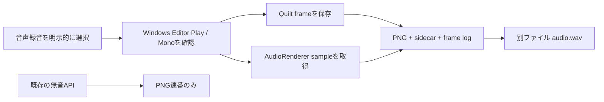

[English](../quilt-recording-audio.md)

# Quilt PNGと音声の録音

ViewWeaveはQuiltのPNG連番とともに、Unityのaudio mixを任意で録音できます。音声captureは明示的なopt-inです。既存の`StartRecording(outputRoot, fps, frameCount)` APIは引き続き無音のPNG連番を作成します。音声を要求するには`StartRecordingWithAudio(...)`を呼ぶか、`Window > ViewWeave > Quilt Capture`で**Start PNG Sequence + Audio**を選択します。

図は任意の音声経路と出力ファイルの関係を示します。音声を選ばない既存APIはPNG連番だけを作り、音声を選ぶとQuilt frameごとにMono WAV sampleを対応付けて別ファイルに保存します。

Mono設定はUnity project全体に影響します。SDKは音声設定を変更しないため、Monoへ変更しない場合は通常の無音録画を使ってください。

音声captureはWindows Editor Play modeと、すでに有効なMono speaker configurationに限られます。ViewWeaveは現在のconfigurationを確認し、未対応なら開始前に拒否します。`AudioSettings.Reset`を呼んだり、OSまたはprojectの音声設定を変更したりしません。

音声を録音するにはPlay modeを停止し、**Edit > Project Settings > Audio**を開きます。**Default Speaker Mode**を**Mono**に変更してから再度Play modeに入り、capture開始前に現在の出力configurationがMonoであることを確認します。Monoは1 channelのspeaker modeです（[Unity Audio Manager settings](https://docs.unity3d.com/6000.6/Documentation/Manual/class-AudioManager.html)、[AudioSpeakerMode.Mono](https://docs.unity3d.com/6000.6/Documentation/ScriptReference/AudioSpeakerMode.html)）。このproject settingはproject全体の音声に影響し、音声録音を選ぶ場合にだけ必要です。既存設定を維持する場合は通常の無音PNG録画を使ってください。

`AudioRenderer`が動作中は通常の音声出力がmuteされることがあります。再生中またはscheduled状態の`AudioSource`を含む、現在のUnity mixをcaptureします。ViewWeaveは`AudioSource`、`AudioListener`、listener pause/volume設定を変更しません。録音前に意図したmixを確認してください。書き出されるWAVはcaptureされたmixです。

各完成frameには、Quilt Renderer scheduler直後の最終`PostLateUpdate`境界で得た1回の`AudioRenderer.Render`結果を対応付けます。Recorderはこのhookと、録画中およびpause中に直前のUnity frameがhookまで到達したことを確認します。PNGとsidecar、PCM sample、frame-log行をすべて書き終えてからframeを追加します。frameまたはfile commitに失敗した場合、一時画像と未commitのPCMは破棄します。Pause/Resumeでは完成済みの組を保持します。pause中のsampleは破棄し、resume frameは両streamともskipします。未完成frameがある状態で停止またはPlay modeを抜けると録音はincompleteになります。

ViewWeaveは自身の`Start`が成功した後に限り`AudioRenderer.Stop`を呼びます。Stopがfalseを返すか例外を投げた場合、incomplete WAVを記録し、shutdown未確認を報告し、Unity Editorを再起動するまで次の音声録音を拒否します。`Stop`を再試行せず、音声設定のresetやaudio backendのunloadもしません。Startに失敗した場合は他ownerのrendererを停止しません。

録画folderには次のfileが含まれます。

- 完成Quilt用の`frame_*.png`と対応するJSON sidecar。
- `frames.jsonl`: 対応する各frameのUnity frame、最初のsample、sample数、exclusiveな最終sample index。
- 完全な録音では`audio.wav`、中断した録音では`audio.incomplete.wav`。WAV dataは現在のoutput sample rateでmono IEEE float32です。
- `audio.json`と`manifest.json`: sample数、sample rate、音声・simulation duration、duration residual、完了status。

UnityのDSP sample割当てにより、小さなduration residualが生じることがあります。30 FPS、150 frameのMono probeでは、simulation videoが5秒に対してaudioは4.992秒で、およそ-8 msのresidualを測定しました。これは総durationのみを測り、各frameでsample単位のalignmentを証明するものではありません。ViewWeaveはUnityが実際に返したsampleを書き込み、stretch、padding、duplicate、その他の補正を行いません。RIFFの32-bit size上限は実際に書き込んだbyte数で確認し、推定durationを理由に録音を拒否しません。video muxと音声encodingは本機能の対象外です。

pipeline integration testの`UrpMonoAudioRecordingPairsPngFramesAndPauseResumeSamples`と`HdrpMonoAudioRecordingPairsPngFramesAndPauseResumeSamples`は、Windows Editor Play modeのMono audio outputで実Quilt、pause/resume、WAV format、frame/sample範囲、自然完了を試験します。`UrpMonoAudioPauseThenStopRestoresFilesAndCaptureTime`、`UrpMonoAudioPauseThenDisableRestoresFilesAndCaptureTime`、`UrpAudioStartStopPreservesPlayingAndScheduledSources`はcancel時のcleanupと既存source状態を確認します。fake-backend testではUnity native audio rendererを起動せず、stop未確認、hook喪失、WAV header初期化失敗、frame commit I/O失敗、nominal frame推定を超えるDSP sample数、重複境界を注入します。これらのtestは実projectで意図したaudio mixを確認する代わりにはなりません。
