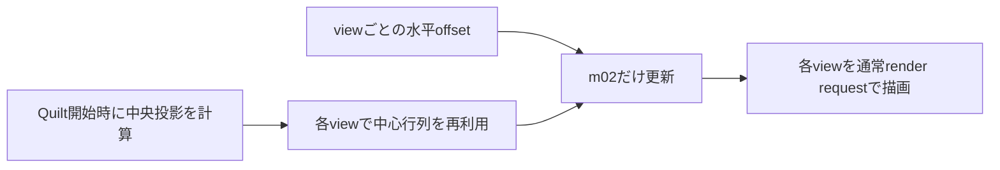

# 旧Looking Glass専用Render Pipelineの調査

対象は[wotakuro/LookingGlassRenderPipeline](https://github.com/wotakuro/LookingGlassRenderPipeline)です。公開されている古いUnity向け実装で、現在はpublic archiveです。作者から利用許可を得ているとの情報がありますが、このリポジトリにはその実装コードやライセンス文書を取り込んでいません。以下は公開コードの構造を調べた記録と、ViewWeave側で独自に実装した内容です。

## 高い描画速度につながり得る構造

当時の実装は、通常のCameraを視点数分動かす方式だけでなく、複数視点に共通するculling、light/shadow準備をまとめ、専用shaderで複数視点をsingle-pass描画する経路を持っていました。視点ごとにCPUとRender Pipelineを起動する仕事を共有できるため、高いFPSを説明できる構造です。ただし、ここでは旧実装やViewWeaveのFPSを測定しておらず、速度差や向上率を主張するものではありません。

旧実装には、shaderへ渡す視点データやclip位置を加工し、専用の描画経路でまとめて出力する処理があります。この方式には専用shaderおよび対応する描画準備が必要です。通常のURP/HDRP Camera描画へ部分的に移すだけでは同じ効果になりません。

主な実装箇所は[DefaultRendererSetup](https://github.com/wotakuro/LookingGlassRenderPipeline/blob/master/Assets/RenderPipeline/render-pipelines.looking/Runtime/DefaultRendererSetup.cs)、[LookingGlassInstancingRenderPass](https://github.com/wotakuro/LookingGlassRenderPipeline/blob/master/Assets/RenderPipeline/render-pipelines.looking/Runtime/Passes/LookingGlassInstancingRenderPass.cs)、[LookingGlassMultiTextureRenderer](https://github.com/wotakuro/LookingGlassRenderPipeline/blob/master/Assets/RenderPipeline/render-pipelines.looking/Runtime/Passes/LookingGlassMultiTextureRenderer.cs)、[LookingGlassUtil](https://github.com/wotakuro/LookingGlassRenderPipeline/blob/master/Assets/RenderPipeline/render-pipelines.looking/Runtime/Passes/Util/LookingGlassUtil.cs)、および[LitForwardPass.hlsl](https://github.com/wotakuro/LookingGlassRenderPipeline/blob/master/Assets/RenderPipeline/render-pipelines.looking/Shaders/LitForwardPass.hlsl)です。

## 汎用SDKへそのまま持ち込めない理由

カメラ位置が固定されるのはsingle-pass方式そのものの必須条件ではなく、旧実装のSetupCameraInfoがカメラ情報を上書きする選択をしているためです。さらにinstancing passはmeshのsubmesh 0とmaterial 0を使う制約があり、tile clippingもclip位置のclampとfragment discardで近似します。専用shaderや共有cullingを汎用SDKへ適用するには、Unity標準material、transparent objectのsorting、skinning、VFX、Sky、post-processingなどをどこまで扱うか定義し、各描画経路で整合性を保つ必要があります。共有cullingでは全視点を覆う範囲の構築も必要です。機能差を確認せず適用すると、物体の欠落や描画順序、効果の違いが生じる可能性があります。

旧方式の高速化要素をすべて採用するのではなく、ViewWeaveでは標準Cameraと既存pipelineの動作を維持したまま、投影行列のCPU計算だけを軽くしました。

## ViewWeaveで取り入れた投影行列の計算

この図の範囲はCoreのCPU投影計算です。カメラ視点の描画要求数やGPU側の処理は変えません。



基準行列を再利用して各viewで水平オフ軸成分を更新します。Full設定48 viewsでは引き続き48回の描画要求を行います。

平行移動した各視点で毎回Frustumの上下左右と行列全体を作り直す代わりに、Quiltの中央視点で基準投影行列を一度計算します。そこから視点の水平offsetに応じて、行列の水平オフ軸成分だけを更新します。中心投影を`P`、視点の水平offsetを`eyeOffset`、焦点距離を`distance`とすると、更新式は次のとおりです。

```text
Pview.m02 = Pcenter.m02 + (-eyeOffset / distance) * Pcenter.m00
```

これにより各viewでの三角関数計算とFrustum行列生成を省きます。視点ごとのCamera位置と回転はQuilt開始時に取得したsource Camera transformから毎回設定するため、Cameraの移動や回転を反映します。既存のFull/Half/Quarter sampling、SRP render request、Camera状態の復元も維持します。

旧実装のview samplingは等間隔角度からoffsetを計算します。ViewWeaveは既存のsampling結果を保ち、等間隔eye offsetを使います。sampling方式を変更すると視点配置が変わるため、今回の変更では合わせていません。

この最適化はCPU上の投影計算に限られ、描画要求数は削減しません。Full設定の48視点では、引き続き48回のrender requestが必要です。GPU描画コストや高FPSを改善すると断定できず、実際の速度はscene、render pipeline、GPUの条件に依存します。

## 検証

投影変更時の記録として、Unity Core batch testはFOV、aspect、near/far clip、distance、coneと1、2、奇数、48視点で、中央投影から作る行列と従来のFrustum式を比較し、平行移動・回転した焦点面の投影位置も検証する構成です。投影変更後にはURP/HDRP distribution checkとリポジトリ検証を実行し、配布物の一致と検証エラーなしを確認した記録があります。

### 2026-10-08 統合後の確認

静的な式の確認では、中心投影の水平成分`m00`とview offsetから更新する`m02`が、従来のFrustum水平shift式と一致することを確認しました。Core、URP、HDRPのソースにも同じ計算が反映されています。`python tools/build_upm_distribution.py all --check`はURP/HDRP両方で成功し、`python tools/validate_repository.py`は0 errors、0 warnings、Python validator suiteは5/5で成功しました。これらは静的・配布・Python検証であり、Unity実行結果とは別です。

前回のsandbox内Unity Core batch試行では、Unity CLIがLicenseClient IPCへ接続できず、初期化の60秒timeoutと接続喪失の後、Editorがcode `-536870911`で終了しました。独立Core projectのEditor logに`QuiltCoreBatchTests.Run`のpass markerはなく、その試行ではテストmethodは実行されていません。

2026-10-08のsandbox外再試行では、同じUnity `6000.6.4f1`、独立Core project、`QuiltCoreBatchTests.Run`をUnity CLI `run`で実行しました。LicenseClient IPCへの接続、テストmethodのpass marker、Editor/CLIの終了コード0を確認しました。結果ログは`.local/core-validation/Logs/Editor-unsandboxed.log`と`.local/core-validation/result-unsandboxed.txt`に保存しています。この結果はCore batchの今回の対象チェックに限り、過去のNative playback AV、録音同期、Metal連続表示、全48視点品質やFPSを検証したものではありません。
