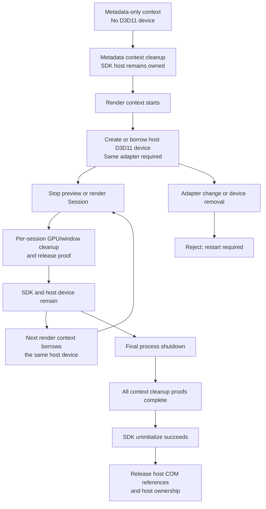

# Native shutdown trace

> Audience: Unity and rendering developers. This is a dated research or validation record limited to the revision, platform, and conditions stated here; it does not establish support for other configurations. For current support and setup, see [Compatibility](compatibility.md) and [Getting started](getting-started.md). Browse the [Technical guide](technical-guide.md) or [User guide](user-guide.md).

The Windows native bridge shim and worker transport have opt-in shutdown tracing for teardown investigations. Set `LKG_NATIVE_TRACE` to a new absolute file path before starting the Unity Editor process. The native code does not enable or change the setting at runtime. With the variable unset or empty, shutdown trace writes are skipped.

The shim records process and thread IDs, `GetTickCount64` time, session ID, and begin/end or skipped records around vendor `unregister_texture_dx`, `release_texture_dx`, `release_device_dx`, and `uninitialize_bridge` calls. A skipped record includes the state or missing-symbol flags that selected the branch. A vendor end `result` is the returned value; it does not by itself prove that a resource was released. The current shim has no separate window-close API call to trace.

The worker records cleanup begin/end, D3D12 slot clearing begin/end, and a snapshot of pending tokens, queued jobs, the in-flight job, and each slot's in-use, consumer-copy-pending, and quarantined flags. It copies that snapshot while holding the existing locks and writes it after releasing them. The shim appends its vendor-call records while `g_mutex` is held, so file I/O can lengthen lock hold and teardown time. Tracing is limited to diagnostic paths and can affect observed shutdown timing.

With tracing enabled, immediately after the existing `get_display_count` call the worker also records its return code, the reported display count, and the selected display ordinal. The existing range check and vendor-call sequence remain unchanged; this record adds no vendor call.

## One-shot fixture result

The one-shot used Unity 6000.6.4f1 with Direct3D12, an isolated package copy of the diagnostic shim, and the installed Looking Glass Bridge 2.6.3 runtime at `C:\Program Files\Looking Glass\Looking Glass Bridge 2.6.3\bridge_inproc.dll` (SHA-256 `3BE0EBA96844688C2EB2E70FC512A5ADA3D53E3ED9C8810454AB0370B8241386`). At test time, the three repository SDK DLLs still had their original binary. After the successful run and audit, the same tested binary was copied to those three repository paths. The user's pinned package cache was not replaced.

The first launch did not reach the native bridge: Unity rejected the fixture manifest's UTF-8 BOM and failed package resolution. The attempt timed out, was terminated by its own launcher, and is retained separately as `30cb0c663dbe4b1398fbe8452165116c`; it has no runner or native trace log.

After fixing the disposable fixture manifest to ASCII JSON with absolute local package paths, the second attempt loaded the shim and initialized the bridge. It used a provisional ordinal of `2`; `TryBegin` returned true, but the worker faulted before Ready because `bridge_display_profile` returned `rc=-4`. There were no fresh completions. The runner called `Dispose` once and exited naturally with code 1. The trace contains cleanup begin/end and an `uninitialize_bridge` end record with `result=1`; it also records that the later unload branch skipped a second uninitialize call. No unregister-texture, release-texture, or release-device records appeared. Do not infer from this run that those resources were released or that the returned value means success. The full one-shot contract did not pass. A later read-only CLI probe of the existing user session showed that the configured ordinal was `0`; this is distinct from the profile's display index of `2`.

The retained run evidence is under `.local/continued-20261007/runs/fc9754e7c96441c9b09b3b7a1ea6c3c5/` (`result.json`, `runner.log`, `native-trace.log`, `unity-editor.log`, and `fixture-after.json`). Unity changed only the disposable fixture's `ProjectAuditorSettings.asset`; the launcher recorded before/after hashes and kept the fixture snapshot. No automatic retry followed this failure.

The runner reported `ShutdownPendingCount == 0`, and the worker cleanup snapshot contained zero pending tokens and jobs. These counters describe the failed pre-Ready session; they do not show that a render completed or that vendor resources were released. Unity exited without a crash marker, but the nonzero exit and lack of Ready mean this is not a successful initialization or shutdown validation.

After the display-count record was added, the native sources were rebuilt and the related tests were rerun: `lookingglass_bridge_loader_lifecycle_test` passed 1/1 and `lookingglass_worker_transport_test` passed 1/1 in 6.90 seconds (60-second test timeout). The rebuilt shim's 33 exports matched the existing package shim's 33 exports. After the final trace run and audit, the same verified binary (SHA-256 `4C6513F73719C6C83B3A41B5BF44CB21A360968C830BB1105759EDF8D13A3AA5`) was copied to the SDK Bridge package and URP/HDRP distribution plugin paths. Importer metadata was unchanged. The user's pinned package cache was not modified and still needs a package update before it uses this binary.

After the existing user session's display selector was checked through a read-only CLI probe, a third, separately authorized one-shot run used display ordinal `0` (the Bridge profile reports the distinct display index `2`). The trace recorded `countResult=0`, `count=1`, and `displayOrdinal=0`; the worker reached Ready with a 3840x2160 display and a 7680x4320, 8x6 device profile. The fixture submitted five 512x256 source textures as complete 4x2, 8-view quilts; it did not render the user's HDRP/VFX scene or a full-resolution 48-view quilt. Five fresh completions advanced from 1 through 5 with a zero worker drop count. The runner called Stop once, observed zero pending tokens, and the Editor exited naturally with code 0 within the deadline. The trace recorded `unregister_texture_dx`, `release_texture_dx`, `release_device_dx`, and `uninitialize_bridge`, each with `result=1`, followed by the existing `initialized=0` uninitialize skip branches. D3D12 slots 0 through 2 each had clear begin/end records; the cleanup-end snapshot had zero pending tokens, jobs, in-flight job, and slot flags. These return values and counters are diagnostic observations, not independent proof that a vendor resource was released. The launcher found no crash marker and marked this one-shot contract pass.

The successful run evidence is under `.local/continued-20261007/runs/dc1bdc614053430fae9a85a1994752ef/`. The package and distribution DLLs now contain that same tested trace build. The user's saved project files and pinned package cache were unchanged; the operator paused and restored runtime AutoRender for the diagnostic. This one isolated session validates the runner path and captures teardown behavior; it does not prove that the earlier HDRP VFX shutdown crash is fixed or cannot recur in that workload, and it demonstrates no full 48-view performance gain.

### Full-size explicit-batch run

A separate one-shot used Unity 6000.6.4f1 in batchmode with `-force-d3d12` and the public `ViewWeave.NativeTraceFixture.NativeTraceOneShotRunner.Execute` entry point. It did not use `-nographics` or `-quit`. The runner waited for compile/import activity to finish, requested Play, and logged the domain-reload callback rearm before the `EnteredPlayMode` callback started the worker. This confirmed the explicit bootstrap path for this fixture.

The test used a fixed 7680x4320 `R8G8B8A8_UNorm` RenderTexture with an 8x6, 48-view quilt layout at display ordinal 0. It filled the texture with `GL.Clear` color changes; it did not render 48 cameras or the HDRP/VFX scene. Five submissions were accepted and completed one at a time. The cumulative completion count advanced from 1 through 5, and the drop count remained 0. The runner called Stop once, observed `ShutdownPendingCount == 0`, released the RenderTexture, and exited naturally with code 0. The outer deadline did not expire and the launcher did not force-kill the Editor.

For run `8fd417d82c244c688e7f4b2c94890490`, the owned Editor PID was 39428 and the worker thread ID was 104352. In session 1, `unregister_texture_dx`, `release_texture_dx`, `release_device_dx`, and `uninitialize_bridge` each had one begin and one end record with `result=1`, on that same worker thread and in that order. The uninitialize call took 671 ms by the trace tick values. D3D12 slots 0, 1, and 2 each recorded clear begin/end after uninitialize; cleanup-end followed all slot clears with pending tokens, job count, in-flight job, and every slot flag at zero. The Editor process exited with code 0, no crash marker was found, and no new dump candidate was recorded. Astra's evidence audit passed.

The retained evidence is under `.local/continued-20261007-fullsize-explicit/runs/8fd417d82c244c688e7f4b2c94890490/` (`launch.json`, `runner.log`, `native-trace.log`, `unity-editor.log`, `result.json`, and `fixture-after.json`). Tracked fixture and isolated package-copy hashes were unchanged. Unity generated `Assets/Editor.meta`, the runner script's `.meta` file, and `Packages/packages-lock.json`; their paths and hashes are recorded in `fixture-after.json`.

An earlier autorun fixture attempt, `5ca6e091d5f34ccc8b1a7ea5672e9665`, timed out before the bootstrap runner or native trace started. It did not reach any Bridge API and is not a shutdown-failure reproduction; its separate logs remain under `.local/continued-20261007-fullsize/runs/5ca6e091d5f34ccc8b1a7ea5672e9665/`.

This successful run validates one fixed-size, one-process DX12 send/stop path and the observed shim/worker teardown ordering. It does not demonstrate 48-camera HDRP/VFX rendering, long-duration stability, a fix for the earlier `C0000005` crash, or vendor-internal GPU/window completion after API return. The `result=1` values and zeroed worker snapshot remain diagnostic observations, not proof of those vendor-internal conditions.

## Local native shutdown contract test

`lookingglass_bridge_shutdown_contract_test` loads the built `lookingglass_bridge_shim` and drives its real worker/session code with a minimal Unity PluginAPI interface table and a WARP D3D11 producer device. The interface declarations come from the installed Unity Editor PluginAPI selected through `UNITY_PLUGIN_API_DIR`. Its fake vendor DLL creates real D3D11 shared textures, records vendor calls with sequence, generation, pointer, and thread IDs, and can block or fail the draw call.

The test covers Ready/draw/close, duplicate close, same-process restart on the persistent worker, draw failure followed by completed cleanup, a draw token that was created but never issued to the render callback, and a vendor draw held in flight while close begins. It checks cleanup order and exactly-once fake-vendor release calls. It waits for `lkg_worker_release` to succeed before treating a FAULT session's cleanup as complete; FAULT publication alone is not a teardown-completion signal. COM reference-count totals are intentionally not asserted because the shim, worker, fake vendor, and D3D11 runtime each own references.

For the unissued-token case, the test observes no vendor release calls in the snapshot taken just after close, while `lkg_worker_release` still returns `-2`; it then cancels the unissued token and waits until release succeeds. There is no worker-thread acknowledgement proving that vendor teardown was attempted during that first snapshot. The in-flight case waits for the fake draw-entry event and verifies no vendor release call while the draw remains blocked, then releases the gate and checks successful draw exit precedes teardown.

Build and run locally on Windows with a Unity Editor installation and WARP support:

```powershell
cmake -S Native -B .local/native-shutdown-contract-build -G "Visual Studio 17 2022" -A x64 -DBUILD_TESTING=ON -DUNITY_PLUGIN_API_DIR="C:/Program Files/Unity/Hub/Editor/6000.3.25f1/Editor/Data/PluginAPI"
cmake --build .local/native-shutdown-contract-build --config Release --target lookingglass_bridge_shutdown_contract_test
ctest --test-dir .local/native-shutdown-contract-build -C Release -R lookingglass_bridge_shutdown_contract_test --output-on-failure
```

The test is registered only in the full Windows `BUILD_TESTING` configuration; `LKG_TRANSPORT_TESTS_ONLY` and the current transport-only CI job do not build or run it. This repository change records the local test implementation, not a CI result. WARP validates the shim/worker/vendor-call teardown contract and synchronization boundaries. It does not validate official Bridge internals, the vendor's completion of GPU/window work after its draw function returns, D3D12 teardown, or the earlier 2.6.3 HDRP/VFX crash workload.

Local validation on 2026-10-07 used MSVC 19.44 and the Unity Editor 6000.3.25f1 PluginAPI headers. The final full-build CTest run passed all 3 tests in 6.98 seconds: the shutdown contract in 0.24 seconds, the existing worker transport test in 6.69 seconds, and the Bridge loader lifecycle test in 0.02 seconds. The shutdown contract has a 60-second timeout. The retained final log is `.local/native-shutdown-contract-build/final-native-ctest.log`.

## Managed final shutdown gate (2026-10-08)

Normal Play Mode Stop and restart use the recoverable worker/session path; they do not set the process-wide final shutdown latch. Windows Editor and Windows Player process quit use a separate final gate: stop outputs, close worker admission, drain owned contexts, collect closed contexts, join the persistent native host, then release managed resources only after GPU proof. macOS and other unsupported platforms do not enter this Windows final drain.

Legacy D3D11 output uses a per-session close ledger. Managed code waits for `ClosedSafe`, acknowledges that record, then waits for GPU fence and readback proof before dropping transfer-texture references. Global SDK idle is not a per-session release proof. The Windows Editor quit callback has a monotonic 10-second polling budget and pumps only Bridge-owned worker/reaper/playback cleanup and issued GPU readbacks while the callback is active. Individual Unity/native calls are not preemptible, so this budget is not an absolute wall-clock completion guarantee. Unity cancels quit on timeout or an unproven resource and retains references with admission closed; a later explicit quit request rechecks status. It does not post `WM_CLOSE`, issue another menu command, or ask for a second close. The V6 Editor fixture below verified one actual GUI quit request while GPU proof was pending. If the user cancels save confirmation after the final latch, Bridge admission stays closed until the Editor is restarted. A bypassed quit callback has one separate 5-second native wait fallback; it reports success only with native completion and managed GPU proof.

The final local Windows Native full CTest run passed 6/6 tests in 17.71 seconds for DLL SHA-256 `81CBF29737B1D1A13FBB3C1EEAB6265F3B0B076F41AB8C23B6E9229B17F0AEA9`: common, transport (349 draws), cleanup-exception, loader lifecycle, shutdown contract, and shutdown-exception contract. The cleanup-exception retention case runs in a separate process after worker-host join. A second build against pinned NativeRenderingPlugin `522254181faf188efa8b50c3e3bf6fce720b26e4` headers passed 6/6 in 17.77 seconds. Managed semantic compilation against Unity 6000.6.4f1 references passed with zero errors and five warnings; shutdown policy tests passed 7/7.

Historical runtime evidence: the production PNG observer fixture `case01-probeobserver-ep-fix1` passed its functional body, observed native final completion, and exited naturally with code 0. Full Bridge Editor fixture `case02-native-close1` completed two Play/Stop/domain-reload cycles; native ABI v1 reported Complete, host joined and zero contexts, while managed proof showed zero reaper records, no unproven resources, zero owned handles, and final-ready true. PID 88016 exited naturally with code 0. The test harness issued its initial user-quit request through `File/Exit`; the frozen package contained the earlier automatic WM_CLOSE candidate. This is historical full-Bridge drain evidence for the earlier automatic-close candidate, not evidence for the current synchronous quit gate. The DX12 Player gate fixture `case03-quitgate2` observed native join and managed finalization proof, and both Editor and Player exited naturally with code 0. All these runs were limited to their fixture workloads; visual/performance tests, physical display validation, and fake consumer GPU acknowledgment were not proven. Three GUI checks did not complete: scene case 1 and window cases 1/2 ended as `OWNER_ABORT`; the prefab case was not run, and auto-review denied a retry. The historical access violations remain cause-unknown, and these successes do not prove they are fixed. See [shutdown validation](shutdown-validation-20261008.md) for detailed scope and limits.

The V6 one-shot Windows D3D12 Editor fixture left an owned, created transfer texture without GPU release proof, then used one actual GUI `File > Exit` request. The original `wantsToQuit` delegate ran once and returned allowed after one successful synchronous-gate flush; the Editor update counter stayed unchanged at 4374. The `editor-quitting-native-status` ABI v1 query reported Complete with host joined; managed reaper and owned handles reached zero, and `editor-quitting` was observed. This is validated final-status-query evidence, not a dedicated native trace final marker. Unity exited naturally with code 0. The fixture rendered 8 views at 512x256 using the installed Bridge runtime; it does not establish 48-view optical quality, performance, save-prompt cancellation, or a cause/fix for the historical access violations. V4's script-driven exit attempt ended in `0xC0000005` after its gate passed; V5 timed out before a GUI quit because its fixture stopped rendering after arming. Both failures remain distinct, preserved attempts, not product passes.

## Current Windows SDK ownership contract

The Windows Bridge Worker keeps one persistent owner host for a canonical runtime path and application name. The SDK is initialized once on that host. A Play, preview, or metadata context can close its per-context GPU slots, session/window association, and metadata resources while the SDK and owner ledger remain owned by the host. Render contexts borrow a host-owned D3D11 device and immediate context; metadata-only contexts create no D3D11 device. A successful metadata `end_metadata` is proof that the metadata context closed; it is not proof that SDK ownership ended. An idle metadata refresh therefore publishes its successful snapshot after per-context cleanup while retaining the process-wide SDK owner.

The first render context creates the host D3D11 device on the producer's DXGI adapter and records that adapter identity. Later render contexts reuse the same COM device and immediate context only when their producer uses that adapter. An adapter change or removed device is rejected with a restart-required error; the host does not silently create a replacement device. Per-context shared textures, fences, window/session cleanup, and release proofs remain separate from the host device lifetime.

While the host is idle, admission of legacy direct SDK calls and a duplicate shim is rejected. The same runtime path and application name can reuse the initialized SDK. A different runtime path or application name is rejected and requires an Editor restart. Non-Windows and legacy direct-SDK paths retain their prior lifecycle contract.

Final Windows Editor or Player process shutdown requests `uninitialize_bridge` exactly once on the owner host thread. Only successful SDK uninitialization releases the owner ledger, host-owned D3D11 context/device, and module pin. The host thread may still be joined after SDK finalization fails; a joined thread alone does not prove successful SDK release. If uninitialization fails or throws, SDK ownership, host COM resources, and admission guards remain retained. This is the current lifecycle contract; the historical fixture results above describe their own tested binaries and workloads and do not establish that a reported shutdown crash is fixed.


