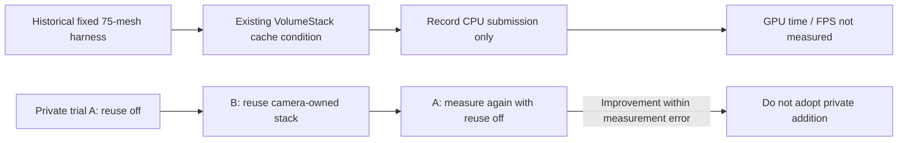

[Japanese](ja/performance.md)

# Performance Measurements and Reproduction Steps

> Audience: Unity and rendering developers. This is a dated research or validation record limited to the revision, platform, and conditions stated here; it does not establish support for other configurations. For current support and setup, see [Compatibility](compatibility.md) and [Getting started](getting-started.md). Browse the [Technical guide](technical-guide.md) or [User guide](user-guide.md).

The figures below come from a historical fixed harness. They do not represent current product FPS or the improvement from the recent projection-matrix calculation change. Conditions were a Windows Development Player without Bridge, Unity 6000.6.4f1, URP 17.6, Direct3D11, NVIDIA GeForce RTX 3090 Ti, graphics multithreading enabled, fixed 128x96 tiles, about 75 shared Lit meshes, 120-frame warmup, and 1000 frames over 3 runs. `QuiltRenderer.LastCpuSubmissionTicks` records CPU submission time; GPU frame time and present latency were not measured.

The diagram separates the fixed harness measurement with the existing VolumeStack cache from a separate private Garden A/B/A trial. The private trial found no improvement beyond measurement error and was not adopted.

The A/B/A in the diagram refers only to the additional reuse proposal in the private trial; it did not change the existing VolumeStack cache on main. The tables below are snapshots measured with the fixed harness.

| GRD | Views | p50 CPU submission (ms) | p95 (ms) | GRD Renderers | Visible Instances | GC bytes/frame |
| --- | ---: | ---: | ---: | ---: | ---: | ---: |
| Off | 1 | 0.3592 | 0.4584 | 0 | 0 | 312 |
| On | 1 | 0.3174 | 0.3920 | 75 | 75 | 312 |
| Off | 8 | 2.7992 | 3.1957 | 0 | 0 | 1,656 |
| On | 8 | 2.4638 | 2.8579 | 75 | 600 | 1,656 |
| Off | 48 | 17.3311 | 19.6056 | 0 | 0 | 9,336 |
| On | 48 | 15.0732 | 16.6753 | 75 | 3,600 | 9,336 |

All 6 condition summaries succeeded. Each condition used a 120-frame warmup followed by 1000 frames in 3 runs, for 3000 samples total, using build GUID `e3ae196fd1af4b6583ee9b27ee28b557`. At 48 views, GRD On had a CPU submission p50 of 15.0732 ms versus 17.3311 ms with Off. This is an observation from the fixed harness, not a comparison showing faster official SDK or GPU implementation. GPU timing and CPU render-thread timing are missing and must not be treated as measured zero. GPU Resident Drawer does not turn 48 views into one draw and does not fix Bridge thread shutdown.

The fixed-condition GRD comparison used the same 75 meshes, 128x96 tile size, 120-frame warmup, 1000 frames x 3 runs, and enabled Profiler instrumentation. It compares conditions before and after the existing VolumeStack cache change. This historical harness comparison is a separate experiment from the later private Garden A/B/A trial.

| GRD | Views | p50 before cache (ms) | p95 before cache (ms) | GC/frame before cache | p50 after cache (ms) | p95 after cache (ms) | GC/frame after cache |
| --- | ---: | ---: | ---: | ---: | ---: | ---: | ---: |
| Off | 1 | 0.5766 | 1.4776 | 32,620 | 0.3592 | 0.4584 | 312 |
| On | 1 | 0.5461 | 1.4107 | 32,620 | 0.3174 | 0.3920 | 312 |
| Off | 8 | 5.3800 | 6.1491 | 260,120 | 2.7992 | 3.1957 | 1,656 |
| On | 8 | 5.2666 | 6.0726 | 260,120 | 2.4638 | 2.8579 | 1,656 |
| Off | 48 | 31.7737 | 34.4383 | 1,560,120 | 17.3311 | 19.6056 | 9,336 |
| On | 48 | 30.5441 | 33.4241 | 1,560,120 | 15.0732 | 16.6753 | 9,336 |

In the post-cache measurements, 48-view GRD On had about 13.0% lower CPU submission p50 than Off. The difference between GRD On before the cache change and GRD On after it was about 50.7%. These observations distinguish the GRD difference from the VolumeStack cache change; they do not guarantee acceleration in the official SDK or GPU. The measurement Player did not connect to Bridge. A separate Direct Lit 48-view display Player ran concurrently as background load in both conditions.

For reproduction, hold the same device, scene, Quilt, native views, quality, post-processing, compiler, graphics mode, Bridge, VSync, GPU, Unity, and render pipeline constant. During performance measurements, disable PNG saving, tracing, and CPU readback; run image-quality checks and log capture separately. For GRD applicability and comparison conditions for custom multiview or reprojection, see [gpu-resident-drawer.md](gpu-resident-drawer.md) and [multiview-rendering.md](multiview-rendering.md).

The measured harness scene is a representative workload of about 75 meshes. The results cannot be generalized to other scenes, mesh counts, displays, or resolutions. Measurements after the cache change were taken under the same conditions with the VolumeStack cache applied. Comparisons with different Unity or official SDK versions are references only; state the condition differences and do not use them as direct speedup claims.

Core's Stopwatch timing method has since changed, but CPU, GPU, and GC benchmarks have not been rerun after that change. Do not claim an improvement from the timing-method change based on the existing performance figures.

As a resolution tradeoff example, demo scale 0.25 uses a 1920x1080 Quilt, 8x6 layout, and 240x180 tiles; profile 1.0 uses 7680x4320 and 960x720 tiles. Pixel count is 16x, and an RGBA32 7680x4320 Quilt is about 126.56 MiB. These are profile examples, not fixed values for every device or full-resolution measurement results.

Raw JSON and Player logs are maintained for internal validation. Table values are limited to the stated device, scene, settings, and harness conditions. They are not a guarantee of public API or product-wide performance, or an official speed comparison. No official speed comparison has been performed.

## Limited Benchmark of the Shared-Culling Prototype

The test used a fixed scene with 2 Lit Cubes, 8 views, a 4x2 layout, and 128x96 tiles in a Windows D3D11 Development Player with Unity 6000.6.4f1, URP 17.6, RTX 3090 Ti, MT enabled, and GRD disabled. The baseline used 8 `StandardRequest` calls; shared culling used 1 `StandardRequest` and 8 RendererLists. Conditions alternated baseline/feature over 3 runs. Each used a 120-frame warmup, then collected 1000 samples at 1 sample per frame with the same image quality. CPU submission elapsed time may include synchronization waits.

| Path | p50 CPU submission (ms) | p95 (ms) | Mean (ms) |
| --- | ---: | ---: | ---: |
| Baseline: 8 `StandardRequest` calls | 1.8023 | 2.0580 | 1.81632 |
| Shared culling: 1 request + 8 RendererLists | 0.3198 | 0.3987 | 0.330339 |

This is a microbenchmark with two Lit objects and eight views. GPU time, render-thread time, 48 views, shadows, transparency, post-processing, VFX, and comparison with the official implementation were not measured. These values do not show GPU FPS or general-use performance improvement, and shared culling has not been adopted for the production path. GC counters are not treated as valid measurements in this test.
