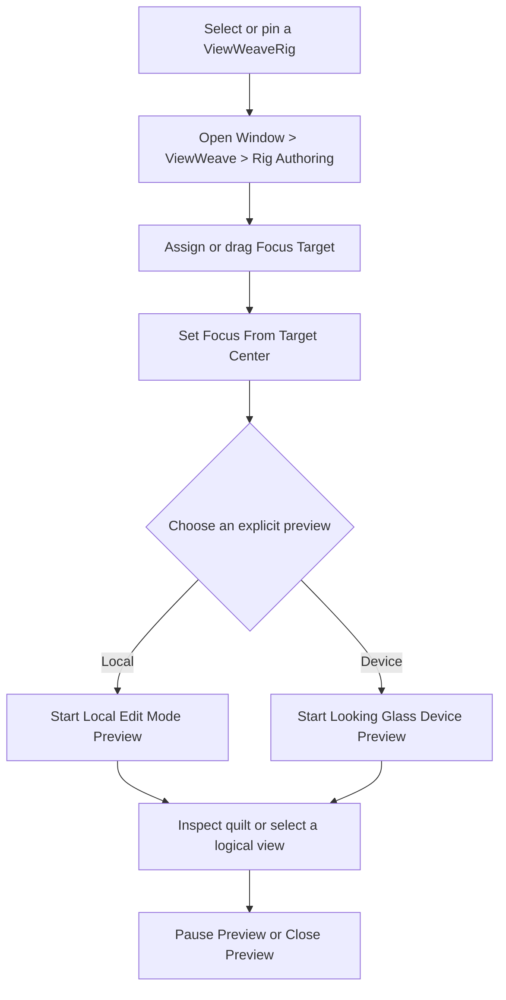
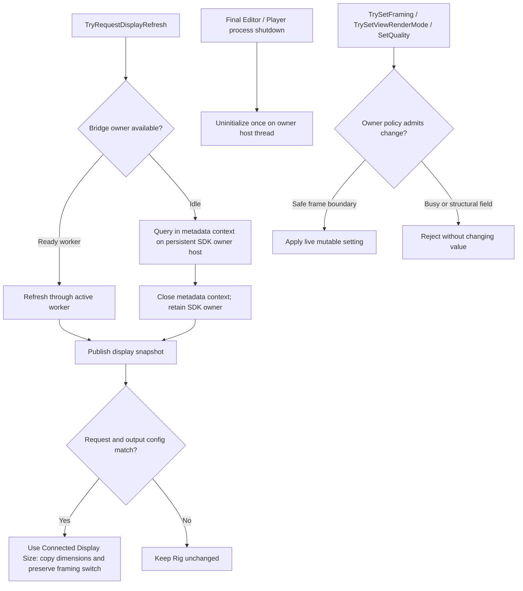
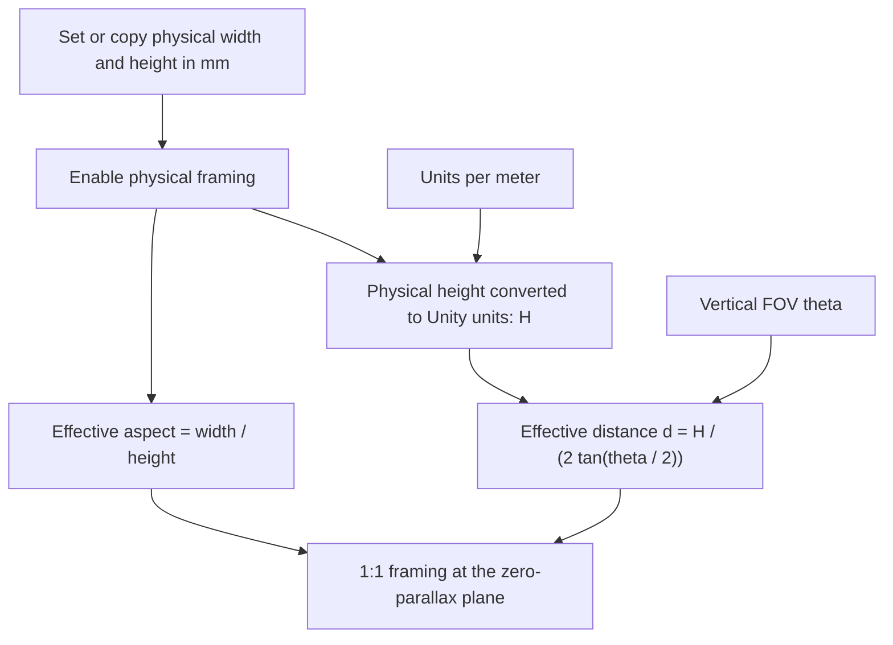
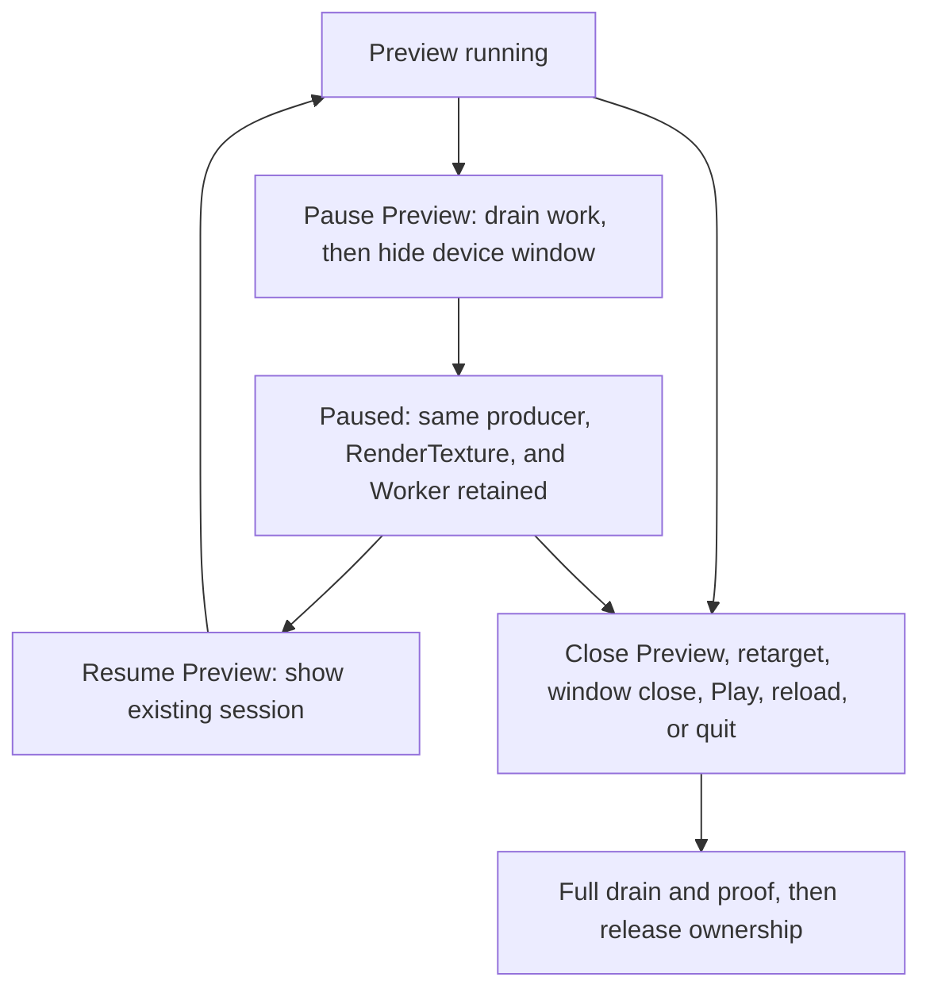

[日本語](ja/quilt-authoring.md)

# Adjust Quilt camera framing and focus

For a Rig, begin with the integrated `ViewWeaveRig` Inspector or its fixed-target authoring window. Select or pin a `ViewWeaveRig`, then open `Window > ViewWeave > Rig Authoring`. Assign a `Focus Target` directly or drag one into the field, then explicitly run `Set Focus From Target Center` to set focus. With physical framing off, this updates `Focus Distance`; with physical framing on, it solves the FOV while retaining the stored base focus distance. Use `Camera & Focus` for framing and `Preview` to explicitly start a local or device preview. The window keeps its Rig while the Unity selection changes.

The purple Scene View plane marks zero parallax, teal marks Near Clip, and orange marks Far Clip. To edit a standalone `QuiltRenderer`, select its GameObject and use the technical Inspector's `Camera Framing` controls for `Focus Distance`, FOV, `Near Clip`, and `Far Clip`; you can also drag the center handle of the purple plane forward or backward to adjust `Focus Distance`.

The zero-parallax plane is the reference plane where a subject at that distance aligns with the display surface. `Focus Distance` (`Quilt Settings > Camera Distance`) is measured in Unity units forward from the world position of the effective framing Camera. The purple plane is placed at that point, which is indicated by the gizmo line and distance label. Units follow the Unity scene scale; if the project does not use 1 unit per meter, the value does not represent actual meters. `Focus Distance` adjusts stereo parallax. It does not change depth of field, autofocus, or a Volume's focus distance.

For standalone `QuiltRenderer` controls, Near/Far bounds use the clip distances of the dedicated `sourceCamera`. If `Reference Camera` is set, its runtime position and rotation are applied to the dedicated Camera before Quilt rendering. When `Follow Reference Field Of View` is enabled, the technical Inspector's `Vertical Field Of View` value is synchronized from the reference Camera before each Quilt render, so that stored value is overwritten on the next render. In the integrated Rig authoring UI, `Reference Vertical Field Of View` edits the actual Reference Camera instead. Disable FOV following to edit the FOV stored in Quilt settings. Outside physical framing, `viewAspect`, `Camera Distance`, `viewCone`, and Near/Far are not synchronized automatically. Physical framing derives effective aspect and camera distance for the render without overwriting the base `viewAspect` or stored `Camera Distance`; clip distances and `viewCone` retain their existing settings. The original reference Camera settings and Transform are not changed by regular rendering.

The Bridge Rig creation menu assigns the resolved framing Camera to `Reference Camera`. With Cinemachine, reference the actual Camera driven by Cinemachine Brain rather than a Virtual Camera. Regular automatic Quilt rendering happens after scene rendering, so it normally reads Brain's output for that frame. Recording locks Quilt settings when it starts and stops if FOV or other Quilt settings change during recording. Keep FOV and Quilt geometry fixed while recording, including when the reference Camera moves.

## Edit Mode authoring preview

For a Rig, use the integrated `ViewWeaveRig` Inspector or open `Window > ViewWeave > Rig Authoring`. The window keeps its assigned Rig when the Unity selection changes. This avoids relying on Inspector lock while choosing a Focus Target. The Inspector and window organize common Rig operations into six sections: `Camera & Focus`, `Rendering`, `Preview`, `Capture & Playback`, `Bridge`, and `Advanced`. Lower-level components such as `QuiltRenderer`, the Bridge Session, and pipeline adapters remain available for compatibility and diagnostics.



`Camera & Focus` provides `Focus Target`, focus and fit actions, physical-framing switch, and horizontal/vertical orbit controls. Assign a target directly or drag it into the field. With physical framing off, `Set Focus From Target Center` sets stored `Focus Distance` to the target center's forward distance and keeps FOV unchanged. With physical framing on, the button is labeled `Set Physical Focus From Target Center`; it adjusts vertical FOV to place the target center on the zero-parallax plane while preserving aperture dimensions, units, and stored base distance. The nearby help explains the current mode, and the success status reports the before/after FOV and effective focus distance for physical framing.

`Fit View To Target` adjusts vertical FOV and focus distance so the enabled Renderer bounds (or, if absent, enabled Collider bounds) fit inside the current view with 10% margin. It keeps the camera pose and target scale unchanged, and is disabled while physical framing is on; turn off `Use Physical 1:1 Framing` first. The operation rejects empty bounds, invalid settings, and bounds with any corner outside the source Camera's near/far clip planes. Successful focus, fit, and physical-mode changes request an active preview refresh, including device preview. Assigning a target alone does not change Rig settings. Focus and camera operations require objects in the loaded Main Stage or the same Prefab Stage. Isolated Preview Scenes and persistent assets are rejected. Additive loaded scenes in the Main Stage are allowed. The `Scene View Controls` foldout exposes `Show Near / Far`, `Show Extreme Views`, and `Show 3D Focus Cursor`; these share the technical `QuiltRenderer` Inspector preferences. `Frame Focus Plane Center in Scene View` frames the zero-parallax plane center.

When a Bridge output is attached, use `Refresh Connected Displays` to refresh the cached display profile and physical calibration after a display change. This is an explicit refresh; the snapshot reflects the last successful request and does not report automatic vendor hotplug. A ready Session or device-preview worker handles the request; while Edit Mode is idle, the Windows SDK is queried through a metadata context on the persistent owner host. Closing that context releases its per-context metadata resources, not SDK ownership. The SDK and owner host remain alive until final Editor or Player process shutdown. If no ready worker can serve the request, another open context or cleanup can make refresh temporarily unavailable. The status may show `Closing metadata worker` and `Waiting for Bridge metadata worker release`; a cleanup timeout reports `Metadata cleanup timed out; waiting for native release proof`. Read the status and error beside the button. Unity loads native plugins into the Editor process, so updating the Bridge package's native DLL or adding its metadata-refresh exports requires restarting the Editor; see [Unity native plug-in Inspector](https://docs.unity3d.com/6000.0/Documentation/Manual/plug-in-inspector.html).

After a successful refresh, the device profile remains available for the same Rig across Play and Stop in the current Editor session and is restored when needed. This does not change the Rig's source aspect, framing, or profile, mark the scene dirty, save the scene, or fire the snapshot event a second time. A cloned Rig, output configuration change, reconnect, or Editor restart invalidates the cached profile; run `Refresh Connected Displays` again. Changing the Bridge runtime or application configuration also requires restarting the Unity Editor or Player process before reuse.

### Scripting API and live changes

Use the validated APIs for runtime changes instead of writing serialized fields directly while a renderer owner is active. `QuiltCameraFraming` is an atomic snapshot of FOV, stored base focus distance, and physical-aperture settings. `TrySetFraming`, `TrySetFocusDistance`, and `TrySetViewRenderMode` validate values and active-owner policy. Physical framing rejects a direct base-distance change; `TrySetFocusDistance` solves FOV to reach the requested effective distance. A rejected call returns `false` and leaves the setting unchanged.

```csharp
if (renderer.TryGetFraming(out QuiltCameraFraming framing))
{
    var updated = new QuiltCameraFraming(45f, framing.FocusDistance,
        framing.PhysicalFramingEnabled, framing.ApertureWidthMillimeters,
        framing.ApertureHeightMillimeters, framing.UnitsPerMeter);
    if (!renderer.TrySetFraming(updated, out string error)) Debug.LogError(error);
}

if (!renderer.TrySetFocusDistance(0.65f, out string focusError)) Debug.LogError(focusError);
if (!renderer.TrySetViewRenderMode(QuiltViewRenderMode.Half, out string modeError)) Debug.LogError(modeError);
if (session != null) session.SetQuality(QuiltQualityPreset.Balanced);
if (output != null && !output.TrySetZoom(1f, out string zoomError)) Debug.LogError(zoomError);
if (output != null && !output.TryRequestDisplayRefresh(out string refreshError)) Debug.LogError(refreshError);
BridgeDisplaySnapshot snapshot = output == null ? null : output.CurrentConfigurationDisplaySnapshot;
if (output != null) output.ConnectedDisplaySnapshotChanged += OnDisplaySnapshotChanged;
```

`CurrentConfigurationDisplaySnapshot` exposes the latest completed, read-only profile list and calibration only while it matches the output's runtime path, application name, and display ordinal and no reconnect is required. `ConnectedDisplaySnapshotChanged` fires on the main thread after a successful explicit refresh; it does not signal automatic vendor hotplug. Unsubscribe from the event when the consumer is disabled or destroyed. The Rig Inspector also checks the request token and current Rig/output configuration before applying calibration. `TrySetZoom` and Session `SetQuality` enforce the renderer-owner policy. Render mode and framing changes can apply at a frame boundary when admitted; transport/structural changes stay fixed while an owner is active. Rendering, recording/playback, metadata refresh, or cleanup can temporarily reject otherwise mutable calls. Token/error completion details remain package-internal.



For a Bridge UPM update that changes the native DLL or its exports, use `Close Preview` and stop regular Sessions, update the package through Package Manager, and restart the Unity Editor before using Bridge again. Unity keeps a loaded native image for the Editor process; the native-image guard can reject calls when that image is stale, duplicated, or cannot be verified, but it cannot unload or reload the DLL. Updating the package while the Editor is closed is also an option, but a restart is still required before using Bridge again.

The `Physical Display Framing` foldout is collapsed by default and contains the aperture dimensions, units, geometry status, and `Use Connected Display Size`. The `Use Physical 1:1 Framing` switch is visible in `Camera & Focus`, outside the foldout, and is off by default. Enter `Visible Aperture Width (mm)`, `Visible Aperture Height (mm)`, and the project's `Unity Units per Meter` (default `1`) before explicitly turning it on; unset or invalid dimensions cannot be used. `Use Connected Display Size` reads valid calibration from Bridge and copies its physical dimensions without changing the switch state. When enabled, physical framing derives an effective view aspect of width divided by height and an effective camera distance from vertical FOV so the zero-parallax plane spans the display's physical height at 1:1 scene scale. The source/base quality profile and stored `Focus Distance` are unchanged; the stored distance field is hidden while enabled, and the UI shows a read-only `Effective Focus Distance` when inputs are valid. The derived aspect and distance override base values for the effective Scene View gizmo, preview, and runtime render. The FOV field edits the followed Reference Camera or stored Quilt FOV according to the existing FOV-follow setting; changing it recomputes the derived distance. The physical focus action requests a distance by solving FOV and leaves the stored base focus distance unchanged. The status below the fields reports the geometry source, effective aspect, aperture dimensions, and diagonal size.

The distance calculation uses physical height converted to Unity units, `H = height_mm / 1000 * units_per_meter`, and vertical FOV `theta`: `d = H / (2 * tan(theta / 2))`. The aspect comes from the entered width and height. A 1:1 zero-parallax scale means scene geometry at the zero-parallax plane is framed to the configured physical display dimensions; it does not prove optical calibration, lens correction, or perceived image quality.

`Use Connected Display Size` copies a valid connected calibration's physical width and height into the aperture fields as one Undoable action and preserves the current `Use Physical 1:1 Framing` switch state. Turning 1:1 framing on is a separate explicit action. If there is no cached valid calibration, the button can request `Refresh Connected Displays`; it copies only after the refreshed data is valid and the Rig/output settings still match the request. A failed or stale request leaves the Rig unchanged and reports the reason. The operation does not change `Unity Units per Meter`. Bridge's `get_calibration_for_display` returns pixel width/height and a DPI value; the conversion to millimeters uses those calibration values, not the operating system's desktop scaling or the Quilt tile dimensions. See the [official Bridge native function reference](https://lfdocs.lookingglassfactory.com/software/looking-glass-bridge-sdk/native-function-reference#get_calibration_for_display). Manual dimensions remain available when no valid device profile is active. Compare the displayed aperture dimensions with the display's visible area before using them. For device preview, the physical aspect must match the connected device aspect and zoom must be `1`; incompatible settings are rejected. Starting or stopping a preview does not write scene values.

The effective Scene View gizmo uses the connected device profile's aspect and view cone while a device preview or runtime Session is active. When neither is active, it uses local framing geometry; if physical framing is enabled, its aspect comes from the entered physical dimensions, not from the local profile. The gizmo also identifies whether it is showing connected-device or local geometry. This does not make local preview a device optical simulation.



When `Follow Reference Camera FOV` is enabled, the `Reference Vertical Field Of View` field edits the actual Reference Camera. It is not a second copy on `QuiltRenderer`; Cinemachine or animation may overwrite the camera value later. When following is disabled, the UI edits `QuiltRenderer`'s stored FOV. `Source Near Clip`, `Source Far Clip`, and `Source Culling Mask` edit the Rig's dedicated source Camera. Orbit controls change the effective framing Camera's Transform and record Undo. Unsafe Reference Camera objects are explained and cannot be edited through the integrated UI.

The `Rendering` foldout is open by default. It exposes the `Quilt View Render Mode` and Local Quilt Profile for local preview and the source Rig. `Output Quality` edits the attached display output; it defaults to `Balanced`. Metal output requires stopping and waiting for GPU retirement before changing quality. Windows Bridge Sessions retain live quality reconfiguration. If no Session is attached, device preview uses `Balanced` with the connected device profile. Local preview uses the Rig profile. The Local Quilt Profile and structural layout settings are locked while a preview or Session owns the Rig; stop it before changing them. For a live Windows Session, use `Output Quality`, which follows the existing quality reconfiguration path without reconnecting the Session. `Full`, `Half`, and `Quarter` render density change which logical views are rendered at the next frame boundary; the quilt grid and logical view count remain unchanged. These operations remain subject to the active renderer-owner policy; an in-flight render/completion notification, recording/playback lease, metadata refresh, or pending cleanup may reject a change and report why.

`Preview` has two explicit choices: `Start Local Edit Mode Preview` displays the Quilt in the Editor; `Start Looking Glass Device Preview` sends it through the Windows D3D11/D3D12 Bridge Worker to a connected display. Device preview requires the official Bridge runtime. Both use a separate Editor-owned producer and render outside normal SRP render callbacks; they do not start Play Mode or the selected Rig's regular Bridge Session. Stop an active regular Session first. Preview uses a separate producer copy and does not write preview state back to the saved Scene. `Pause Preview` stops new submissions, drains in-flight work, and hides the device window while retaining the same producer, RenderTexture, Worker session, and ownership locks.


The local preview retains its last displayed image. `Resume Preview` shows and reuses the same preview session. Use `Close Preview` for a full proof-based drain and release; this unlocks structural settings and releases preview ownership. The process-wide SDK owner and loaded native image remain until Editor shutdown. Switching the Authoring window to another Rig, closing the window that displays the preview target, entering Play, reloading, or shutting down the Editor also requests full close rather than pause. While paused, structural settings remain locked and display refresh continues through the retained Worker.

The lifecycle above distinguishes reusable pause from full close. A full close waits for producer and GPU/Worker ownership proofs before releasing resources. The Native Release pause protocol passed 10/10 CTests, including drain-before-hide, acknowledged pause/resume, retained session resources, and close-from-paused. This validates the Native worker contract with fake Bridge runtimes and test adapters. Isolated URP/HDRP local-preview managed tests passed 2/2 for pause/resume, an FOV change while paused, and full Close. On 2026-10-09, a user confirmed one live Pause/Resume cycle on the URP `test.unity` scene with Unity 6000.6.4f1 on Windows D3D12 and package revision `6a297a8fddc685b51e0da3136ca6cdb5331e8c6f`: after a native pause acknowledgement, Resume restored the visible scene, and moving the displayed object and Undo were reflected. The worker handle and generation were preserved through the pause; submissions and completions advanced after resume with no reported drops or errors. This is one scene and one cycle; repeated operation and HDRP device behavior remain unverified. Optical scale, image quality, and performance are not established by this observation.

Check the Preview status and error shown in the `Preview` section when starting, pausing, resuming, or closing a preview. Local preview displays in Unity; device preview submits through Bridge. A running state or successful submission confirms software-side progress only, not that the image is visible on the display or has the expected optical appearance. Inspect the Looking Glass directly when validating device output. For a Native DLL or export change, use `Close Preview` and stop regular Sessions, then update the package through Package Manager. The SDK owner and native image remain process-scoped; if the loaded DLL prevents replacement, exit the Editor to complete the update. Restart Unity before using Bridge again. The native-image guard can reject stale, duplicated, or unverifiable loaded images, but cannot unload or reload a DLL.

Automatic Editor preview refresh targets a 0.2-second cadence (5 Hz); explicit refresh and parameter edits can request an earlier render. Actual cadence and performance are not measured. Isolated Unity 6000.6.4f1 Core authoring/playback tests and the Quilt Capture GPU smoke passed. URP/HDRP software preview tests confirmed matching producer, gizmo, and render-snapshot geometry for an 800 x 450 mm aperture at 1 Unity unit per meter; the derived focus distance followed a FOV change from 60 to 45 degrees while base settings stayed unchanged. Using the URP fixture, Windows device-preview-to-Play lifecycle tests passed on D3D11 and D3D12 with both domain and scene reload enabled; D3D12 also passed with both domain and scene reload disabled. The Editor producer stopped before the runtime Session rendered, stop completed with native and preview-retention pending counts at zero, and returning to Edit Mode did not restart the preview. These checks do not verify connected-device calibration or optical 1:1 appearance. Compare the reported aperture dimensions with the display's visible area and inspect scale directly on the hardware. See [Windows validation](windows-validation.md) and [Graphics backends](graphics-backends.md) for validation scope and limitations.

`Advanced` exposes the validated `Auto Render in Play Mode` operation and referenced output/guard components, including the HDRP guard's three fallback settings when present. The detailed renderer and Legacy Direct inspectors remain available as technical controls.

`Capture & Playback` opens the existing Capture, Playback, and Video Export windows for this Rig. An active recording, playback lease, or export is not silently replaced.

Use `Show Near / Far` in the Inspector to show or hide the clip planes. Toggle it when a large clip range makes the nearby bounds hard to see. Enable `Show Extreme Views` to show Near/Far planes for the leftmost and rightmost views. These mark the configured view range. The gizmo continues to show the configured extremes when Half or Quarter render density is selected.

## Explicit camera authoring controls

`Camera Authoring` shows the target `Effective Camera` and `Effective Camera Transform`. If `Reference Camera` is set, it is the target; otherwise, `Source Camera` is used. The reference Camera's Transform is copied to the Source Camera before Quilt rendering, so manual controls also operate on the effective framing Camera.

For a standalone `QuiltRenderer`, the technical `Set Focus From Selected Object Center` workflow remains available: lock the QuiltRenderer Inspector, then select one GameObject in the scene. Click the button in the locked Inspector to project the center of the Renderer bounds onto the Camera's forward axis and set that distance as the zero-parallax `Focus Distance`. If there is no Renderer, the Collider bounds center is used; if neither bounds exists, the Transform position is used. Objects behind the Camera and invalid values are rejected. This only changes the setting and does not move or rotate the Camera. This is not depth-of-field focus. For a `ViewWeaveRig`, use `Focus Target` and the explicit `Set Focus From Target Center` action described above; it does not require Inspector lock.

`Frame Focus Plane Center in Scene View` moves the Scene View to the center of the zero-parallax plane. Enter an angle for `Horizontal Orbit` or `Vertical Orbit` and press the corresponding Apply button to rotate the Effective Camera's position and orientation together around the zero-parallax point. The pivot stays fixed; horizontal rotation is limited to ±180 degrees and vertical rotation to ±89 degrees. These manual operations are recorded in Undo, including changes on Prefab instances.

`Show 3D Focus Cursor` is disabled by default. When enabled, it displays a Position Handle at the center of the focus plane instead of the existing forward/back slider. The dragged position is projected onto the Camera's forward axis to update distance only, so lateral movement is discarded and the handle returns to the center of the focus plane. The Camera Transform is not changed.

Rig framing, physical-aperture, view-density, and Output Quality edits are not categorically disabled in Play Mode. Each edit checks the active renderer-owner policy and may be rejected while rendering/completion notification, recording/playback, display metadata refresh, or cleanup is active; rejected edits keep their saved value and show the reason. Reference Camera assignment remains a structural edit. Focus-target, Scene View framing, and orbit actions are disabled while Unity transitions into or out of Play, and require a Camera/target in the loaded Main Stage or the same Prefab Stage. If Cinemachine or Animation drives the Reference Camera, later updates may overwrite manual Transform or FOV changes. Standalone `QuiltRenderer` technical Inspector behavior remains separate. These Rig controls are hidden for multiple selection.

Gizmos are Scene View adjustment aids. When a reference Camera is assigned, planes use its current world pose and followed FOV. Edit Mode display updates do not write to the Camera or settings. Gizmos do not preview display lens correction, view assignment, Volume effects, or the composite result. They are shown for a regular perspective Camera with valid finite settings. `QuiltRenderer` does not support Orthographic cameras.
