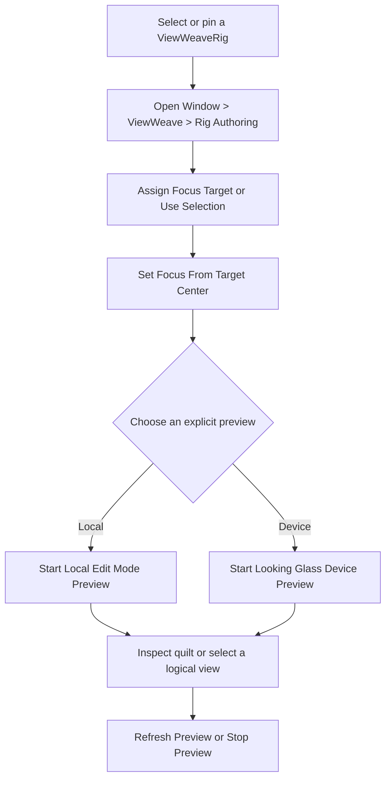

[日本語](ja/quilt-authoring.md)

# Adjust Quilt camera framing and focus

For a Rig, begin with the integrated `ViewWeaveRig` Inspector or its fixed-target authoring window. Select or pin a `ViewWeaveRig`, then open `Window > ViewWeave > Rig Authoring`. Assign a `Focus Target` or use the current selection, then explicitly run `Set Focus From Target Center` when you want to change focus distance. Use `Camera & Focus` for framing and `Preview` to explicitly start a local or device preview. The window keeps its Rig while the Unity selection changes.

The purple Scene View plane marks zero parallax, teal marks Near Clip, and orange marks Far Clip. To edit a standalone `QuiltRenderer`, select its GameObject and use the technical Inspector's `Camera Framing` controls for `Focus Distance`, FOV, `Near Clip`, and `Far Clip`; you can also drag the center handle of the purple plane forward or backward to adjust `Focus Distance`.

The zero-parallax plane is the reference plane where a subject at that distance aligns with the display surface. `Focus Distance` (`Quilt Settings > Camera Distance`) is measured in Unity units forward from the world position of the effective framing Camera. The purple plane is placed at that point, which is indicated by the gizmo line and distance label. Units follow the Unity scene scale; if the project does not use 1 unit per meter, the value does not represent actual meters. `Focus Distance` adjusts stereo parallax. It does not change depth of field, autofocus, or a Volume's focus distance.

For standalone `QuiltRenderer` controls, Near/Far bounds use the clip distances of the dedicated `sourceCamera`. If `Reference Camera` is set, its runtime position and rotation are applied to the dedicated Camera before Quilt rendering. When `Follow Reference Field Of View` is enabled, the technical Inspector's `Vertical Field Of View` value is synchronized from the reference Camera before each Quilt render, so that stored value is overwritten on the next render. In the integrated Rig authoring UI, `Reference Vertical Field Of View` edits the actual Reference Camera instead. Disable FOV following to edit the FOV stored in Quilt settings. `viewAspect`, `Camera Distance`, `viewCone`, and Near/Far are not synchronized automatically. The original reference Camera settings and Transform are not changed by regular rendering.

The Bridge Rig creation menu assigns the resolved framing Camera to `Reference Camera`. With Cinemachine, reference the actual Camera driven by Cinemachine Brain rather than a Virtual Camera. Regular automatic Quilt rendering happens after scene rendering, so it normally reads Brain's output for that frame. Recording locks Quilt settings when it starts and stops if FOV or other Quilt settings change during recording. Keep FOV and Quilt geometry fixed while recording, including when the reference Camera moves.

## Edit Mode authoring preview

For a Rig, use the integrated `ViewWeaveRig` Inspector or open `Window > ViewWeave > Rig Authoring`. The window keeps its assigned Rig when the Unity selection changes. This avoids relying on Inspector lock while choosing a Focus Target. The Inspector and window organize common Rig operations into six sections: `Camera & Focus`, `Rendering`, `Preview`, `Capture & Playback`, `Bridge`, and `Advanced`. Lower-level components such as `QuiltRenderer`, the Bridge Session, and pipeline adapters remain available for compatibility and diagnostics.

`Camera & Focus` provides `Focus Target`, `Use Selection`, `Set Focus From Target Center`, and horizontal/vertical orbit controls. The selected target may be dragged into the field. `Set Focus From Target Center` is the explicit operation that changes `Focus Distance`; selecting a target alone does not change Rig settings. Focus and camera operations require objects in the loaded Main Stage or the same Prefab Stage. Isolated Preview Scenes and persistent assets are rejected. Additive loaded scenes in the Main Stage are allowed. The `Scene View Controls` foldout exposes `Show Near / Far`, `Show Extreme Views`, and `Show 3D Focus Cursor`; these share the technical `QuiltRenderer` Inspector preferences. `Frame Focus Plane Center in Scene View` frames the zero-parallax plane center.

When `Follow Reference Camera FOV` is enabled, the `Reference Vertical Field Of View` field edits the actual Reference Camera. It is not a second copy on `QuiltRenderer`; Cinemachine or animation may overwrite the camera value later. When following is disabled, the UI edits `QuiltRenderer`'s stored FOV. `Source Near Clip`, `Source Far Clip`, and `Source Culling Mask` edit the Rig's dedicated source Camera. Orbit controls change the effective framing Camera's Transform and record Undo. Unsafe Reference Camera objects are explained and cannot be edited through the integrated UI.

`Rendering` exposes the Rig Quality Profile for local preview and, when a Bridge Session exists, `Session Quality` for runtime/device output. The local preview uses Rig profile geometry; device preview uses Session Quality and the connected device profile. Without a Session, device preview uses Preview quality. `Preview` has two explicit choices: `Start Local Edit Mode Preview` displays the Quilt in the Editor; `Start Looking Glass Device Preview` sends it through the Windows D3D11/D3D12 Bridge Worker to a connected display. Device preview requires the official Bridge runtime. Both use a separate Editor-owned producer and do not start Play Mode or the selected Rig's regular Bridge Session. Stop an active Session first. The preview uses a separate producer copy; starting or stopping it does not write preview state back to the saved scene. Use `Stop Preview`; switching the Authoring window to a different Rig requests preview stop, and closing a window that displays the preview target Rig also requests stop.

Automatic Editor preview refresh uses a 0.2-second interval as its target cadence (5 Hz); explicit refresh and parameter edits can request an earlier render. Actual cadence and performance are not measured. The Edit Mode UI regression suite passed 12/12, covering Rig pinning, focus and Undo, Focus Target retention across rebuild, FOV storage, Scene View preferences, Auto Render validation, and HDRP guard bindings. A focused Authoring window retarget/close lifecycle-helper fixture passed 1/1 with preview inactive and pending count zero after both retarget and close. Playback safety passed 13/13. URP/HDRP local GPU fixtures passed 2/2 for eight-view rendering, layout rebuild, proof-based texture retirement, and Stop/readback with zero pending retention. D3D11/D3D12 device fixtures passed URP/HDRP Start/Stop/Restart at a 3840x2160 display profile and 8x6/48-view Quilt with pending counters at zero. Manual optical appearance review remains unverified. Domain Reload cleanup and explicit restart passed in one targeted hidden-Editor fixture; see [Graphics backends](graphics-backends.md) for File > Exit results; normal Editor exit remains unverified. `Advanced` exposes the validated `Auto Render in Play Mode` operation and referenced output/guard components, including the HDRP guard's three fallback settings when present. `Capture & Playback` opens the existing Capture, Playback, and Video Export windows for this Rig. An active recording, playback lease, or export is not silently replaced. The detailed renderer and Legacy Direct inspectors remain available as technical controls.

Use `Show Near / Far` in the Inspector to show or hide the clip planes. Toggle it when a large clip range makes the nearby bounds hard to see. Enable `Show Extreme Views` to show Near/Far planes for the leftmost and rightmost views. These mark the configured view range. The gizmo continues to show the configured extremes when Half or Quarter render density is selected.

## Explicit camera authoring controls

`Camera Authoring` shows the target `Effective Camera` and `Effective Camera Transform`. If `Reference Camera` is set, it is the target; otherwise, `Source Camera` is used. The reference Camera's Transform is copied to the Source Camera before Quilt rendering, so manual controls also operate on the effective framing Camera.

For a standalone `QuiltRenderer`, the technical `Set Focus From Selected Object Center` workflow remains available: lock the QuiltRenderer Inspector, then select one GameObject in the scene. Click the button in the locked Inspector to project the center of the Renderer bounds onto the Camera's forward axis and set that distance as the zero-parallax `Focus Distance`. If there is no Renderer, the Collider bounds center is used; if neither bounds exists, the Transform position is used. Objects behind the Camera and invalid values are rejected. This only changes the setting and does not move or rotate the Camera. This is not depth-of-field focus. For a `ViewWeaveRig`, use `Focus Target` and the explicit `Set Focus From Target Center` action described above; it does not require Inspector lock.

`Frame Focus Plane Center in Scene View` moves the Scene View to the center of the zero-parallax plane. Enter an angle for `Horizontal Orbit` or `Vertical Orbit` and press the corresponding Apply button to rotate the Effective Camera's position and orientation together around the zero-parallax point. The pivot stays fixed; horizontal rotation is limited to ±180 degrees and vertical rotation to ±89 degrees. These manual operations are recorded in Undo, including changes on Prefab instances.

`Show 3D Focus Cursor` is disabled by default. When enabled, it displays a Position Handle at the center of the focus plane instead of the existing forward/back slider. The dragged position is projected onto the Camera's forward axis to update distance only, so lateral movement is discarded and the handle returns to the center of the focus plane. The Camera Transform is not changed.

Camera authoring controls are disabled in Play Mode and during the transition into Play. If Cinemachine or Animation preview drives the reference Camera, a later update may overwrite a manual Transform change; edit while stopped. These controls are hidden and disabled when multiple `QuiltRenderer` objects are selected.

Gizmos are Scene View adjustment aids. When a reference Camera is assigned, planes use its current world pose and followed FOV. Edit Mode display updates do not write to the Camera or settings. Gizmos do not preview display lens correction, view assignment, Volume effects, or the composite result. They are shown for a regular perspective Camera with valid finite settings. `QuiltRenderer` does not support Orthographic cameras.
