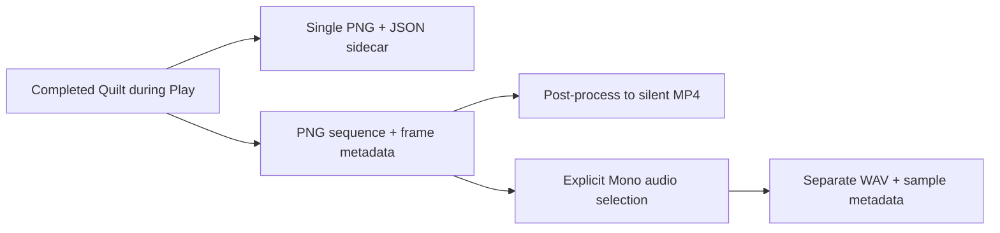

[日本語](ja/quilt-capture.md)

# Save and record Quilts

ViewWeave Core can save a completed Quilt as a still image and save Quilts emitted by Auto Render during Play as a PNG sequence. Recording does not render additional views.

The diagram shows silent PNG recording and the explicit opt-in path for Mono audio recording. Both use the completed Quilt, but audio is saved to a separate WAV and is not muxed by the MP4 exporter.

Still capture and sequence recording save the output of the existing Auto Render. A regular sequence is silent unless audio recording is selected.

## Save a still image

1. In Unity, open **Window > ViewWeave > Quilt Capture**.
2. Select the **Quilt Renderer** to capture.
3. Enter Play with the Bridge Rig and confirm Looking Glass output from Auto Render. The latest completed Quilt appears in this window.
4. Confirm that the latest image is current, then choose **Save Latest Quilt PNG...** and select a destination.

A `.json` sidecar with the same basename is created next to the PNG. It records image dimensions, matrices, view count, view render mode, actual rendered-view count, used area, camera and Quilt geometry settings, and UTC time. Metadata is not embedded in the PNG. Existing PNG or sidecar files are not overwritten.

**Save Central View PNG...** crops one logical view nearest the center from a completed Quilt. It does not render another Camera view. For an odd view count it uses the center view; for an even count it uses the lower of the two center views, at index `(views - 1) / 2`. For example, with 48 views it uses index 23. For even counts this is not exactly the view on the optical axis. In Half/Quarter mode, it saves the image of the rendered view copied into that logical view's tile.

The central image sidecar adds `logicalViewIndex`, `renderedViewIndex`, the view render mode, and cropped image dimensions to the original Quilt metadata. `logicalViewIndex` is the selected center output tile; `renderedViewIndex` is its actual rendered source in Half/Quarter mode. The PNG is read in lower-left-origin tile coordinates while preserving tile orientation. As with the Quilt, existing PNG or sidecar files are not overwritten.

The filename format is `name_qs{columns}x{rows}a{renderAspect}.png`. `renderAspect` uses the Quilt layout aspect ratio, not the tile pixel ratio. For example, 8 columns, 6 rows, and aspect ratio 0.75 produce `name_qs8x6a0.75.png`. Decimal formatting is independent of the operating system locale.

## Record a PNG sequence

1. In Quilt Capture, choose **Add Recorder Component**. An Undo-capable Recorder is added to the same GameObject as Quilt Renderer.
2. Enter Play and enable Auto Render on the target Quilt Renderer. Keep the renderer enabled.
3. Set **Frames per second** (1–240) and **Frame count**, then choose an output folder.
4. Choose **Start PNG Sequence**. The Unity frame in which the button is pressed is not saved. Saving starts on the next frame using the selected FPS as the simulation timestep.
5. Use **Pause Recording** to pause saving. Scene simulation continues during the pause, and the capture timestep is restored to its pre-recording value. **Resume Recording** continues in the same destination with the same frame numbering; the frame in which Resume is pressed is not saved. Recording ends automatically when the requested frame count is reached. Choose **Stop Recording** to stop early.

Each run creates a new `ViewWeave_YYYYMMDD_HHMMSS_uniqueID` folder under the output location. Each completed Quilt is saved as a PNG such as `frame_000000_qs...png` with a JSON sidecar. `manifest.json` records requested FPS, requested frame count, actual completed count, status, and errors. `frames.jsonl` records each Unity frame, simulation time, measured delta time, and UTC timestamp on one line. Status is `recording`, `paused`, `complete`, `cancelled`, or `error`. `finishedAtUtc` stays empty while recording, including while paused, and is written when recording ends. On early stop or failure, completed files remain available.

## Operational notes

- Recording is limited to an active Auto Render renderer in Unity Play mode. It does not issue another render and saves one completed Quilt from that frame.
- PNG readback and compression run synchronously. Unity frames and simulation can stall while saving, so wall-clock recording may run slower. The selected FPS is a simulation timestep through `Time.captureDeltaTime`, not a wall-clock playback rate.
- `Time.timeScale == 1` is required when recording starts and while it runs. Recording cannot start while another capture uses `Time.captureDeltaTime` or another Recorder is recording. On stop, completion, or error, ViewWeave restores the prior value only if the current value is still the one ViewWeave set. It does not overwrite a value changed by external code.
- While paused, the Recorder retains exclusive ownership of the same recording session. Another Recorder cannot start. Resume rechecks Play mode, renderer, Auto Render, Quilt geometry from recording start, `timeScale`, and external capture timestep. If a check fails, recording ends with error and releases event subscriptions and ownership.
- Changes to Quilt dimensions, matrices, view count, render density, FOV, focus distance, view cone, view aspect, source Camera, or near/far clip; stopping Auto Render; disabling the renderer; or pausing the application stops recording and records the status in the manifest. Camera movement during recording is allowed, and each PNG sidecar records the position and rotation at that time.
- [Quilt Video Export](quilt-video-export.md) post-processes a completed PNG sequence into a silent MP4. Audio muxing, Timeline/VideoPlayer synchronization, and appending to an existing recording are unsupported.
- To include audio, explicitly select **Start PNG Sequence + Audio**. Windows Editor Play and a preconfigured Mono output are required. The existing three-argument API still creates a silent PNG sequence. See [Quilt audio recording](quilt-recording-audio.md) for requirements and validation boundaries.
- PNG saving uses completion of Quilt Renderer drawing and does not wait for Bridge transfer completion. It can be used while a regular Bridge Rig displays on a Looking Glass.

## Validation

Automated PlayMode tests on Unity 6000.6.4f1 rendered in both URP and HDRP and checked PNG readback, central-tile color and orientation, three-frame recording, pause/resume, frame count, timestep ownership, and cleanup while paused. Three frames were checked at 10 fps and 25 fps. In URP, all settings from 1–240 fps were also checked for same-frame stop and restoration of the original `Time.captureDeltaTime`.

## DX12 capture validation (2026-10-07)

The current working branch passed CoreBuiltinCaptureSmoke on DX12 and one URP plus one HDRP `QuiltCapturePipelineTests` case. The Unity 6000.6.4f1 Editor used `-force-d3d12` on an RTX 3090 Ti without `-nographics`; tests covered central PNG/sidecar output, Half/Quarter source-view mapping, and Recorder Pause/Resume with capture-time restoration. They used fake output and did not connect to Bridge or a Looking Glass display. This is working-branch evidence, separate from existing D3D11 results, and does not mean main or physical output passed.

The first test fixture under a 272-character path failed during Unity URT/UXML import with a missing-directory error. The same 420 source files, with matching hashes, were prepared under a 218-character fixture path; URT compute/ray-tracing shader assets and both pipeline Global Settings then imported with zero errors before the capture tests passed. This result is limited to the tested fixture layout. Two folder `.meta` files were initially copied from stale 168-byte snapshots and generated two YAML parse errors. The fixture was re-synchronized from the 169-byte source files and imported synchronously. The final check found zero C# errors, zero YAML/meta errors, and both Folder GUIDs. The earlier failing copy and its correction remain part of the history; the final re-import is confirmed for this fixture only.
