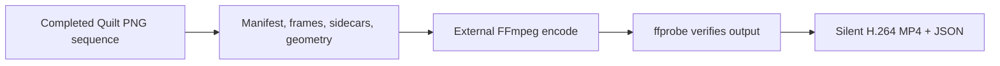

# Quilt Video Export

[User Guide](user-guide.md) · [Technical Guide](technical-guide.md)

## User workflow

`Window > ViewWeave > Quilt Video Export` converts an already completed quilt PNG recording into a silent H.264 MP4. It is a post-process: it does not render views, capture the screen, or change the source PNG sequence.

Complete a PNG sequence first, install FFmpeg and ffprobe separately, then open the export window, select the completed recording, and choose a new MP4 output path. The source PNGs remain available. Audio is not included in the MP4.

## Export validation and implementation details

The export flow validates a completed sequence before starting the external encoder. Its output contains video only; any audio WAV remains a separate file.

The validation step rejects incomplete or ambiguous input before encoding and preserves existing output files.

The input folder must contain a `manifest.json` marked `Complete`, a `frames.jsonl` with every requested consecutive frame, and each full quilt PNG with its matching JSON sidecar. The exporter checks PNG dimensions, a complete grid where views equals columns times rows, filename pattern, sidecar geometry, and frame count before starting FFmpeg. Non-divisible image dimensions are retained as encoded; the exporter does not alter the quilt used rectangle. Central-view PNG recordings are rejected because they are not quilts.

Choose a new MP4 output path. For Looking Glass Studio automatic quilt detection, the filename should use quilt_qs{columns}x{rows}a{viewAspect}.mp4; see the [official quilt naming tutorial](https://lookingglassfactory.com/tutorial/what-is-a-quilt). The exporter recommends this form using an invariant aspect string with at most six fractional digits. It verifies a matching tag against the source layout and rejects a conflicting quilt tag before encoding. Untagged names remain allowed, but the layout may need to be set manually in Studio. The exporter never renames your selection. Existing MP4 files and same-name JSON sidecars are left untouched.

The default encoder settings are H.264 (`libx264`), `medium`, CRF 18, `yuv420p`, and `faststart`, with no audio stream. Frame rate comes from the recording manifest. FFmpeg and ffprobe are not included, downloaded, or installed by the package. Set their executable names or full paths in the window; the defaults are `ffmpeg` and `ffprobe` on `PATH`. The tool was designed for FFmpeg 7.0.2.

H.264 `yuv420p` requires even quilt width and height. The exporter refuses odd dimensions and never scales or pads the image. Large quilts may exceed encoder or hardware limits; those errors are reported and the source PNGs remain available. H.264 is lossy, so the MP4 is not pixel-identical to the PNG frames. The accompanying JSON records the frame count, effective FPS, codec, pixel format, source manifest SHA-256, PNG dimensions, columns, rows, full view count, view aspect, render mode, last rendered view count, used rectangle, row-major order, and bottom-left origin for view 0, plus the compression caveat.

Export progress is polled without blocking the Editor. Cancel stops only the process started for this export. After the OS confirms process exit, asynchronous stdout/stderr drain has a 10-second deadline; a drain timeout is reported as a failure and temporary files are then cleaned up because the encoder is known to be gone. If process exit cannot be confirmed, the job remains tracked while the Editor is open and preserves the temporary file. Assembly reload, Editor shutdown, and closing the exporter window request cancellation. If shutdown cannot confirm process exit or output drain, the exporter writes a separate failure JSON and an ASCII warning containing the owned PID, stage, and temporary path; it preserves the temporary file. The failure JSON records stage, exit-code availability, owned PID, temporary path, and a sanitized reason without copying process output. Only one export can run at a time.

Use `Tools > ViewWeave > Run Quilt Video Export Validation` to run the Editor-side validation suite. It uses a fake process and temporary files; it does not require FFmpeg, a GPU, or a quilt render.

## Verified scope

This scope summary was updated on 2026-10-08 JST; individual run timestamps are recorded in the corresponding test evidence.

The fake-process validation suite passed after the exporter lifecycle fixes and received a passing code review. A separate real-tool smoke used FFmpeg and ffprobe 7.0.2 to encode three synthetic 64x48 quilt PNGs at 30 fps. The output used H.264/yuv420p, reported three frames and the expected 8x6/48-view geometry, preserved full layout metadata in the JSON sidecar, accepted a path with spaces and Unicode, and rejected an existing output. Evidence: `REPO_ROOT/.local/remaining-work-validation/mp4-final-20261007T195427/probe-result.txt`.

An additional Unity Editor end-to-end test used an actual URP DX12 `QuiltRecorder` recording as input and exported three 256x192 frames with a 4x2 grid (8 views) at 30 fps to H.264/yuv420p; it passed 1/1. The test did not start Native or the official Bridge and did not inspect a physical display. The synthetic smoke and this recorder-to-export test are separate evidence.

This smoke used synthetic input and did not render a quilt in Unity or send video to the official Bridge. It is not the Unity NUnit result and does not establish physical display quality. H.264 remains lossy.
