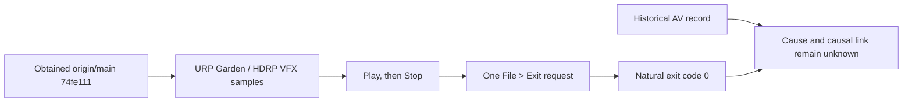

[Japanese](ja/remaining-work-plan.md)

# Remaining Work and Acceptance Plan

> Audience: Unity and rendering developers. This is a dated research or validation record limited to the revision, platform, and conditions stated here; it does not establish support for other configurations. For current support and setup, see [Compatibility](compatibility.md) and [Getting started](getting-started.md). Browse the [Technical guide](technical-guide.md) or [User guide](user-guide.md).

Baseline date: 2026-10-08 JST. For new test evidence, use the UTC timestamp in each Unity XML; do not treat a run-folder name as the execution time. Scope: Unity 6000.6.4f1, Windows, URP/HDRP, and the official Looking Glass Bridge path. Keep the validation baseline, current changes, limited fixtures, and physical-display results distinct. Work remains incomplete until evidence meets its completion criteria.

## Status as of 2026-10-08

The `origin/main` snapshot obtained on 2026-10-08 is `74fe111` (includes PR #9). This hash identifies the snapshot at that time and does not identify the future tip of `main`. Using its Windows shutdown fix, Play, Stop, and 1 original `File > Exit` operation were performed in the URP Garden and HDRP VFX Editors; both Unity processes exited naturally with code 0. This confirms the shutdown path in 2 sample fixtures. The old access violation did not reproduce, but this is not causal proof that its cause was fixed. Evaluate separate gates for live 48-view scene quality, performance improvement, canceling a save prompt, and successful Native playback shutdown using the criteria below.

The descriptions of source `1771af79`, baseline `4230c4c`, no shutdown, and an undetermined final commit in rows 2 and 6 below are from a historical snapshot saved on 2026-10-07. The 1 Garden soak recorded there did not perform Stop or exit at the time. It is a separate test record from the current state, which includes the 2-sample shutdown check from the following day.

The diagram shows the Windows shutdown path checked in 2 samples on 2026-10-08. It does not prove a normal Metal Session, the cause of the past access violation, or shutdown behavior in every Unity project.

## Execution Order

| Order | Work | Current status | Completion criteria |
| --- | --- | --- | --- |
| 1 | Independent DX12 capture validation and 48-view profile in a real scene | Validation baseline revision 4230c4c (PR #4, CI 37614129521 passed) included capture controls, silent MP4 export, and the Native image guard. In the current change set, a silent MP4 end-to-end test from the actual QuiltRecorder passed 1/1 on URP DX12 (256x192, 4x2/8 views, 3 frames, 30 fps, H.264/yuv420p, no Native/Bridge). This is separate evidence from the prior synthetic 64x48, 8x6/48-view PNG CPU smoke. Editor-window operation and official Bridge output remain unconfirmed. The user's HDRP Editor uses Graphics Jobs Split Threading. Separately, Garden Full48/D3D12 continued rendering during a 10-minute watch in the original URP project from Git UPM source 1771af79, but had 8 drops and did not meet the zero-drop condition. This is not proof of performance improvement; real-scene 48-view performance improvement remains unachieved. | On DX12, check pixels and sidecar for completed Quilts/sequences, and restoration of simulation time and Camera state; also check Bridge stop, pending work, and natural exit. For real-scene profiling, use multiple runs with the same pipeline, scene, image quality, view count, resolution, and Bridge state; separate CPU frame, GPU frame, submit, and drop measurements and demonstrate improvement while preserving image quality. Record the effective Graphics Threading Mode. |
| 2 | Bridge exit access violation and resource trends | URP Editor normal-stop (2026-10-07 09:31 UTC, `bridge_inproc.dll` 2.6.3.0, `0xC0000005`/RVA F8550) and a past HDRP exit incident are recorded; causality is undetermined. The Native image guard Unity suite passed 6/6 for preventing duplicate shim images only; it does not prove a vendor crash fix. A full-size shutdown contract that submitted a fixed RT 5 times exited naturally, but did not render 48 cameras/VFX. Separately, an OS/Bridge watch completed in the original URP GUI Editor from source 1771af79 for 600.002 seconds/61 samples. PID identity/alive/shim-loaded state stayed the same in all samples. Garden Full48/D3D12 remained Play/Rendering/Ready after the watch, with submit 8747/completed 8745/drop 8/errors 0. Continued rendering and no observed crash were confirmed, but the zero-drop gate was not met. These drops are cumulative worker rejects/drops, not playback skips; the cause is unknown. Increased OS resource endpoints do not determine whether there is a leak. Native completed increased by 5337 over 493.356 seconds, or 10.82 quilts/sec for that interval (not an average FPS over 600 seconds). Only 5 existing FrameTiming snapshots with different timestamps were available: CPU 66.7–141.5 ms/GPU 47.9–120.5 ms. `CaptureFrameTimings` was not called, so averages or a CPU bottleneck cannot be asserted. Stop/drain and natural exit of the GUI Editor were not performed. This is not a completed verification after a cold start of main. | Run 1 isolated real-scene test with tracing enabled. Record OS private bytes, working set, thread IDs, handles, warnings, and pending work on 1 timeline for rendering only, Bridge connected, Auto Render stopped, and Stop/drain. Distinguish persistent worker threads from cumulative thread creation. Do not retry automatically after a crash/timeout; preserve evidence. A short successful run does not establish leak-free operation or that vendor-side releases completed. |
| 3 | Measurable rendering improvement and narrowly scoped Native fixes | Full/Half/Quarter were measured in an HDRP static fixture. Seven PlayMode tests in private `codex/urp-volume-reuse` passed, but the Garden A/B/A improvement was within measurement error and was not adopted. The current GUI Editor uses Graphics Jobs Split Threading. The Natural Camera Batch prototype was slower and prevented Editor exit; do not retry it. | If the effective threading mode is already Split, close the threading-switch hypothesis. Consider A/B/A only if needed. Evaluate HDRP Spot/Point Shadow OnDemand and `RequestShadowMapRendering` in a separate minimal fixture. Adopt only if all 48 images meet requirements for moving occluders, view edges, light on/off, and multiple Cameras, the improvement exceeds measurement error, and drop criteria are met. Directional shadows are out of scope. Do not change Native source without a causal trace. |
| 4 | Transparency, depth, and temporal behavior for VFX/Particles | Existing DX12 VFX suite passed 6/7 and retains an `alive=0` failure for FOV50 Simple Burst. An additional memory diagnostic without synchronous I/O passed 7/7 and observed 128 alive at both FOV50/FOV90. A separate filtered run including the original driver case passed 3/3, but the original cold-suite failure remains historical; this does not establish a permanent fix or general cold/warm success. URP Particle 3/3 and HDRP Particle 2/2 passed in limited fixtures. General transparent ordering, soft depth, sorting/culling, and HDRP VFX remain incomplete. Retain the 15 failures and HDRP priming failure from the old D3D11 snapshot as history. | For URP/HDRP, verify effect suppression and restoration, transparent ordering, soft depth, particle billboard/sorting/culling, and all 48 tiles and image quality. Do not reuse old failures as current pass/fail results. |
| 5 | Optical checks, camera authoring, and new features | Earlier manual checks found depth and image quality good, but review of edges/seams across all 48 views is incomplete. Camera authoring with Scene View gizmos is implemented and its DX12 test/static review passed, but interactive Scene GUI dragging was not measured. All 12 Playback safety cases passed individually, as did the Core CPU smoke. A limited Editor assembly-reload probe passed and confirmed a serialized playback recovery record, its RenderTexture reference, a post-reload fence/readback, and test-only handoff. No Native Begin/Stop occurred in that probe. A separate initial Native playback integration using the old auto-bootstrap stalled Editor startup for over 300 seconds and failed. No probe log or Native trace was produced; whether Native Begin ran is unknown, and natural exit was not tested. After collecting a private dump, fixture identity was rechecked and one owned force cleanup was performed; it exited 0 and confirmed the root/recorded children were absent. Vendor cause is unknown. Subsequent GO preparation failed before Unity started because source staging used an invalid `File.Replace` backup path; there was no Editor PID. The claimed run root is preserved and must not be reused; the launcher has been fixed. In a later official Native playback attempt, corrected explicit-start fixture source (SHA-256 `D48B9B982CD61FBED9E10CE7FF85F319B5A10A9E776AC465D342A6BB7BE5A113`) ran from fresh root `E:/LookingGlassSDK/.local/remaining-work-validation/cdx12/wvk6-results/bridge-playback-integration-explicit-20261007T164753Z-78174c5a5ad441eaa99add7415f8e496`. After four Native draws total (one static PNG and a three-frame sequence), Begin/Stop once each, and pending 0, the Editor exited naturally with code 1 and the fixture failed. Astra concluded that during the one frame between EOF observation and cleanup, restored Auto Render made an unsupported `StandardRequest` in the fixture's no-render pipeline, `LastAutoRenderError` faulted the session, and the Ready assertion then failed. A fixture-only same-call-EOF fix was used on the next run, described below as passing the functional body. Ready/generation/Auto Render restoration/texture/lease/Stop assertions were retained; product source was unchanged. The next fixture-only same-call-EOF run used fresh root `E:/LookingGlassSDK/.local/remaining-work-validation/cdx12/wvk6-results/bridge-playback-integration-explicit-20261007T165843Z-a4735f9101ce4b39b89cd1958e4f5215`. The functional body passed: 1.25-second static PNG hold, Pause/Resume, sequence 3 submit/skip 0/natural EOF, same-generation Ready, lease and RenderTexture release, Auto Render restoration, Start/Stop once each, pending 0, Idle, pipeline restoration, and `INTEGRATION_PROBE_PASS`. The Editor process then exited with `-1073741819` (`0xC0000005`), so the normal-exit code 0 gate failed despite the functional pass. WER/Event 1000 metadata recorded Unity.dll offset `0x44383df`, exception `0xC0000005`, `2026-10-07T16:59:07.5552601Z`, PID 56240 (process start `2026-10-07T16:58:43.7758213Z`), ReportId `ad083598-f93d-4d81-b6fb-8631cd9c5967`. Thread and dump archive were unavailable. Cause is unknown. This is separate from the prior `bridge_inproc.dll` RVA F8550 incident and does not establish a vendor cause. Evidence: `E:/LookingGlassSDK/.local/remaining-work-validation/cdx12/wvk6-results/bridge-playback-integration-explicit-20261007T165843Z-a4735f9101ce4b39b89cd1958e4f5215/shutdown-crash-metadata.json`. `actualLiveRender=unmeasured`. No product code was changed. Evidence: `E:/LookingGlassSDK/.local/remaining-work-validation/cdx12/wvk6-results/bridge-playback-integration-20261008/run/startup-stall-preserved.json`. Native playback body passed in a limited fixture; production shutdown ordering and normal exit code 0 remain unproven. Audio fake suite 6/6 and actual audio/legacy silent cases 8/8 passed individually after focused rerun (14 cases total). Confirmed Mono URP/HDRP integration, Pause/Resume, stop/disable, and AudioSource/scheduled-clip preservation. Head tracking remains OFF because device capability is unknown. | When hardware is available, record left/right edges, depth, color, and seams for numbered 48 views. Pass Quilt playback, authoring input, tracking, and audio through their separate milestones below. |
| 6 | Documentation synchronization and distribution state | Historical snapshot from 2026-10-07: validation baseline revision was 4230c4c (PR #4, CI run 37614129521 passed). The current change added and validated authoring/playback/audio features. Native playback body passed in a limited fixture, but normal exit code 0 did not. Separately, Garden Full48/D3D12 kept rendering for ten minutes in the original URP GUI Editor from source 1771af79, with no observed crash, but had 8 drops and did not meet the zero-drop condition. This was not a live-render measurement of the Native playback fixture. Native audio, production reload/shutdown ordering, natural exit after GUI Editor Stop/drain, optical validation, and performance improvement remain incomplete; evidence meeting the integration/release gate is incomplete. This is not awaiting approval; validation is incomplete. Frozen validation source was 1771af79, observed documentation branch head was 7dd961fe, and main was 4230c4c9; these are distinct revision identities. The original URP project cold start and 600-second watch completed, but the Native normal-exit gate was not met. Do not state a final commit revision; it is undetermined. | Align README, Compatibility, feature coverage, SDK comparison, capture/video procedures, and validation reports on status, pipeline, and execution conditions. Preserve unrun work and historical failures. |

## Remaining Validation and Dependencies

| Item | What is currently known | Next validation and completion criteria |
| --- | --- | --- |
| macOS Metal ABI and lifetime contract | `BridgeMetalExperimentalOutput`, which connects to official Bridge 2.6.3 API, is a process one-shot experiment that accepts up to three Quilts with explicit Context Menu opt-in. Unity command-buffer completion means producer copy complete, not consumer acknowledgement. Consumer release/reuse, thread, and normal-shutdown contracts are unknown. Final CI passed 5/5 jobs in both workflows and confirmed macOS ARM64 shim build/link and native contract tests 3/3. Unity/official SDK/hardware execution is unverified. | Establish the Bridge consumer-completion/release contract from official material or a verifiable API. The limited Play procedure with a manually placed CI artifact is in [Graphics Backends](graphics-backends.md). CI build/link artifacts are manual-only and are not included in UPM. Keep normal Session Metal readiness false until Unity/official SDK loading on Apple Silicon, display, in-process restart, threading, and shutdown are validated. Keep this separate from the Windows access-violation release gate. |
| DX12 capture and Camera/texture lifetime | CoreBuiltinCaptureSmoke and one URP/HDRP capture test each passed on Unity 6000.6.4f1, DX12, RTX 3090 Ti. This included center PNG/sidecar, half/quarter mapping, and Pause/Resume/time restoration. Pipeline tests used fake output, not Bridge. The initial 272-character path failed URT/UXML import; the same 420 source files imported with zero errors under a hash-matching 218-character path. Two folder metadata files were traced to an omitted copy of a 168-byte fixture; after recopying the 169-byte source and synchronous import, checks passed with 0 CS errors, 0 YAML/meta errors, and confirmed folder GUIDs. | Distinguish fake-output tests from official Bridge output. Verify capture saving, stop/pending/natural exit, and physical display in an isolated run with Bridge connected. |
| URP/HDRP Bridge exit crash | URP Editor normal-stop recorded 2026-10-07 09:31:42 UTC, `bridge_inproc.dll` 2.6.3.0, `0xC0000005`, RVA F8550, thread 71648. Vendor SHA prefix `3BE0...`. A past HDRP exit incident also exists. Causality is undetermined. | In one isolated URP/HDRP run including the user scene, collect OS resources and trace on the same timeline and capture one natural exit or crash. Do not retry. Treat the Native guard only as prevention of duplicate shim images, not evidence of a vendor fix. |
| Long-term memory/thread/handle/warning trends | A 600-second Player run with an SDK fixed fixture completed, but bytes/threads/handles increased in HDRP Development. This does not prove a real scene is leak-free. The measured GUI Editor used Graphics Jobs Split Threading, `graphicsJobs true`, and `MTRendering true`; this differs from a separate SingleThreaded batch. | Collect phase-based OS counters in the isolated run above. A short run is only an initial trend check. Separately run a real-scene soak of at least 600 seconds and repeated Stop/Start. |
| 48-view performance | HDRP VFX Learning Templates measured about 126.6 ms/frame and `Camera.CustomRender` about 116.6 ms/48 calls. This is a short Editor measurement, not a no-Bridge comparison or proof of performance improvement. Garden VolumeStack A/B/A in the private trial had no improvement. | If effective threading is Split, stop changing thread mode. Run candidate-by-candidate A/B/A only when needed; require improvement beyond measurement error in wall/CPU/GPU time, no drops, and preserved 48-view image quality. Evaluate Spot/Point shadows in a dedicated fixture; do not retry the two previous URP shared-culling prototypes. |
| VFX / Particle / Volume | VFX Graph requires Linear. Keep the old 15 D3D11 failures separate from current DX12 status. The private VolumeStack trial passed 7/7 tests but showed no A/B/A performance improvement. | Verify transparency, depth, inter-view history, suppression/restoration, and Volume state across all views per pipeline. |
| Physical display / optical quality | Some earlier physical-device images were manually judged good, but review of all 48 views is incomplete. | When the user can check the hardware, record tile indices, left/right edges, depth, color, and seams, and clearly state anything not inspected. |
| MP4 / audio | Silent exporter used FFmpeg/ffprobe 7.0.2. An actual URP DX12 QuiltRecorder export passed 1/1 for three 256x192 4x2/8-view frames at 30 fps H.264/yuv420p. This was actual recording-to-export E2E without official Bridge, physical output, or Editor-window operation; distinguish it from the earlier synthetic 64x48 8x6/48-view smoke. Mono AudioRenderer integration passed for actual URP/HDRP Quilts; six audio integration cases and two legacy silent cases all passed after focused rerun. Fake backend passed 6/6. Confirmed existing render continued and test-owned Stop succeeded when a start was rejected due to a foreign owner. Retain the channel-separation failures for Stereo declaration/Mono driver and normal GUI 48 kHz Stereo / DSP 1024x4 with Mono capture; support remains Mono-only. The 150@30 fps probe measured 4.992 seconds/5 seconds (about -8 ms); this does not prove alignment for every frame. | Check Editor-window operation and sidecar. Mono audio integration has passed for actual URP/HDRP Quilts, pause/resume, stop/disable cleanup, and preservation of source/scheduled clips. Remaining: Native Bridge delivery, long recording, sample alignment, and physical mix. |
| Shadow OnDemand | In the HDRP EV12 fixture, an EveryFrame baseline self-comparison differed at 170 pixels (maximum channel delta 1) across 47 of 48 tiles, failing the strict equality gate. OnDemand comparison and performance measurement were not reached; it was not adopted. | Recheck the conditions for a baseline that meets the strict gate, then compare Spot/Point OnDemand individually. Record image differences and performance separately; do not adopt unless both the gate and image-quality requirements are met. |
| Documentation and distribution | Preserve the 15 failures from the earlier D3D11 108/123 run as history. Validation baseline revision was 4230c4c (PR #4, CI 37614129521 passed). Current authoring, playback, and Mono audio validations apply only to their stated scope; Native Bridge and physical display remain separate incomplete checks. | Always state the pipeline, API, fixture, and fake/real output in docs. Preserve historical and incomplete work. |

## Feature Milestones

| Feature | Milestone | Completion criteria |
| --- | --- | --- |
| Central 2D capture | Save the center logical view of a completed Quilt to PNG and sidecar without an additional render. Checked in limited DX12 fake-output URP/HDRP tests. | Verify saving during Bridge output and on a physical display. |
| Pause/Resume | Implemented in PNG Recorder. Frame/time restoration confirmed in existing 10/25 fps sequence tests and limited DX12 fake-output URP/HDRP tests. | In a long real-scene run, verify frame number, scene/capture time, pause/resume/stop/error; inspect behavior during Bridge output. |
| Quilt file load/replay | Core playback was added in the current change. CPU boundary fix and DX12 RunPlaybackCpuSmoke passed. The 12 Playback safety scenarios passed individually after an initial 11/12 and focused 1/1 fixture correction; product code was unchanged. Functional body for Native still-image/sequence sending passed, but the Editor exit code 0 gate failed. `actualLiveRender` is unmeasured; Native audio, production reload/shutdown ordering, live rendering at 48 views, and live-render recovery after playback are unverified. A limited Editor reload probe confirmed the serialized playback recovery record and its RenderTexture reference, but graceful close failed with exit 6; after identity verification, the probe fixture was force-closed (cleanup command exit 0, `closed=true`). This does not prove natural exit or production/native shutdown ordering. A separate initial full-size Native playback integration failed after the old auto-bootstrap stalled startup for more than 300 seconds; no probe log/Native trace was produced, Native Begin is unknown, and natural exit is unverified. After collecting a private dump, one fixture-scoped force cleanup exited 0 and confirmed the root and recorded children were absent. The vendor cause of the old auto-bootstrap stall is unknown. In a later official Native playback attempt, corrected explicit-start fixture source (SHA-256 `D48B9B982CD61FBED9E10CE7FF85F319B5A10A9E776AC465D342A6BB7BE5A113`) ran from fresh root `E:/LookingGlassSDK/.local/remaining-work-validation/cdx12/wvk6-results/bridge-playback-integration-explicit-20261007T164753Z-78174c5a5ad441eaa99add7415f8e496`. It recorded four Native draws (one static PNG plus a three-frame sequence), Begin/Stop once each, and pending 0; the Editor then exited naturally with code 1 and the fixture failed. Astra concluded that during the one frame between EOF observation and cleanup, restored Auto Render issued an unsupported `StandardRequest` in the fixture's no-render pipeline; `LastAutoRenderError` faulted the session before the Ready assertion failed. A fixture-only same-call-EOF fix was applied for the following run, which passed the functional body. Ready/generation/Auto Render restoration/texture/lease/Stop assertions remained; product source was unchanged. In the same-call-EOF run, the functional Native send body passed, but process exit was `0xC0000005`, failing the normal exit code 0 gate. Unity.dll offset `0x44383df` was recorded in Event 1000; cause unknown. Native audio, production reload/shutdown ordering, live 48-view rendering, and live-render recovery after playback remain unverified; `actualLiveRender` is unmeasured. | Verify profile/layout, sequence playback, pause/resume, stop cleanup, and return to stable output through the actual Bridge/native path. Passing safety boundary tests does not guarantee end-to-end file playback or reload/shutdown. |
| Silent MP4 | Editor post-processing exporter. FFmpeg/ffprobe are external dependencies and no binary is bundled in the SDK. Fake suite, synthetic CPU smoke, and actual URP DX12 recording-to-export E2E passed 1/1. | Verify manual Editor-window operation. Keep it separate from successful Bridge capture or physical display. |
| Audio | Windows Editor Mono opt-in recording: fake suite 6/6, actual audio/legacy silent cases all passed individually after focused rerun (14 total). Confirmed actual URP/HDRP Quilt, pause/resume, stop/disable, and preservation of playing/scheduled AudioSources. For a foreign-owner start rejection, existing rendering continued and test-owned Stop succeeded. Stereo capture is unsupported; no audio muxing into MP4. | Verify Native Bridge output, long recordings, sustained frame/sample boundary synchronization, and physical mix. Mono integration passing does not guarantee sample-accurate alignment or Stereo capture. |
| Orbit / 3D cursor / authoring input | The current change implements Edit Mode focus/orbit using Scene View gizmos and a cursor that is OFF by default; static review and DX12 RunCameraAuthoring passed. | Verify interactive Scene GUI dragging and real Unity Undo/scene-save operations. Do not add Camera movement during Play or runtime input. |
| Head tracking | Decide whether to implement after capability-gated research. | Identify a supported source and validate coordinates, latency, and fallback after capability loss. Keep it off for devices with unknown capability. |

## Deferred Items and Decisions

XR Plugin, Plug & Play/hotplug, multiple devices/displays, other GPU vendors, and Gamma VFX are deferred. Gamma VFX is unsupported under Unity VFX Graph requirements. Optical validation for 48 views is unverified. Head-tracking capability is unknown, so it remains OFF.

Historical note for the 2026-10-07 snapshot: VolumeStack reuse's 7/7 tests and A/B/A belong to a private trial; improvement was within measurement error and was not adopted. Actual recording-to-MP4 E2E passed in a limited URP DX12 fixture, but does not mean Bridge output or physical display. Natural exit of the fixed-texture Bridge shutdown test does not prove shutdown with 48 cameras/VFX. Validation baseline was 4230c4c, PR #4, with CI passed. This baseline identifies a historical validation point distinct from the `origin/main` snapshot `74fe111` obtained on 2026-10-08.
