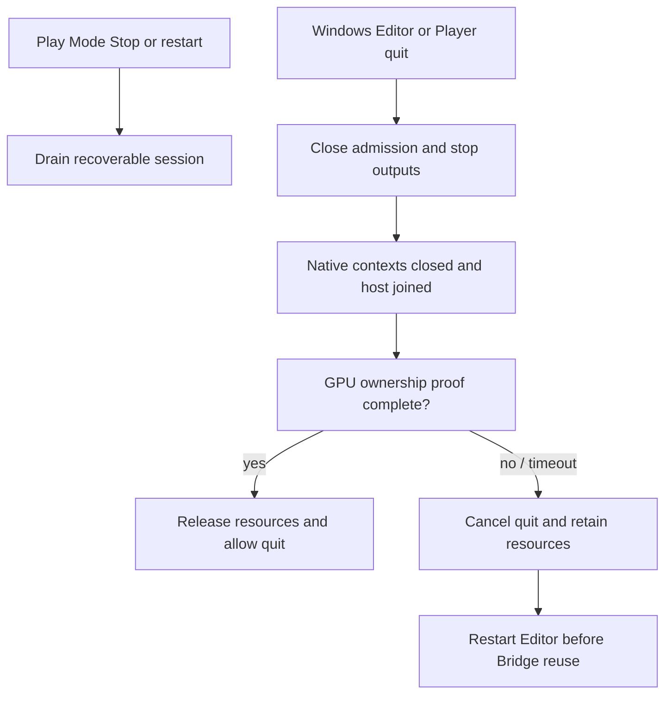

# Windows shutdown validation (2026-10-08)

> Audience: Unity and rendering developers. This is a dated research or validation record limited to the revision, platform, and conditions stated here; it does not establish support for other configurations. For current support and setup, see [Compatibility](compatibility.md) and [Getting started](getting-started.md). Browse the [Technical guide](technical-guide.md) or [User guide](user-guide.md).

This note records the Windows shutdown lifecycle changes and their current evidence. It does not attribute historical access violations to a particular component or claim they are fixed.

## Shutdown behavior

This diagram separates recoverable Play Mode Stop from the irreversible Windows process-quit gate. It summarizes the gate decision only; the gate uses bounded polling, native completion, and GPU ownership proofs described below.

At the 2026-10-08 snapshot, URP Garden and HDRP VFX Editor runs each completed Play, Stop, and one original `File > Exit` request, then exited naturally with code 0. This confirms those two tested fixtures. Historical access violations remain unresolved; the runs do not prove a causal fix.

Normal Play Mode Stop/restart uses the recoverable session path and does not set the process-wide final latch. Windows Editor and Player process quit use a separate final gate: close admission, stop active outputs, close and collect native contexts, join the persistent worker host, then release managed resources only after GPU proof. Legacy D3D11 textures additionally require a per-session `ClosedSafe` result, ACK, and GPU fence/readback proof; global SDK idle is insufficient. macOS Metal and unsupported platforms do not enter this Windows final drain.

The Windows Editor quit callback has a monotonic 10-second polling budget measured from before the initial shutdown request. Individual Unity or native API calls are not preemptible, so the polling budget is not an absolute wall-clock completion guarantee. While the callback is active, it pumps only Bridge-owned worker, reaper, playback, and issued GPU-readback state, sleeping 1 ms between checks; it does not re-enter Unity's general Editor update or UI loop. Quit is allowed only after native completion/host join and all managed GPU ownership proofs complete. Timeout or an exception cancels quit and retains resources with admission closed. There is no automatic retry; a later explicit quit request rechecks status. Once final shutdown starts, admission is irreversible. If Unity's save confirmation is canceled after final completion, Bridge cannot restart in that Editor process; restart the Editor before using Bridge again.

The regular quit path allows the original close/save confirmation to continue after proof; it does not send another window close, invoke a menu item, or force Editor exit. Asset import worker processes skip lifecycle hook registration. If `wantsToQuit` is bypassed, a separate one-shot fallback waits up to five seconds for native completion and performs synchronous GPU proof; an incomplete fallback is not successful shutdown. The V6 isolated Windows D3D12 Editor fixture exercised the original GUI `File > Exit` request once while an owned transfer texture had no GPU release proof. The callback issued and completed the readback/fence work, performed one successful `GL.Flush`, and allowed quit only after native host join and managed ownership reached zero without advancing Unity's Editor update counter. The Editor exited naturally with code 0. This validates that fixture path; it does not prove all Editor projects or save/cancel interactions.

After updating the ViewWeave package, fully close and restart the Unity Editor to load the matching managed assembly and native shim.

## Owned transfer texture lifetime fix

The one-close reproduction exposed an ownership-lifetime gap: Unity can destroy an output-owned transfer RenderTexture during Play Mode teardown while the reaper still needs that same texture to establish GPU-release proof. The fix applies `HideAndDontSave` when creating the owned transfer texture, so the object survives teardown and remains available to the reaper until its existing native and GPU proof predicates pass. Those predicates, timeout behavior, Native ABI, and packaged native DLL are unchanged.

The fix passed two real Unity 6000.6.4f1 sample runs against candidate `e495edae90f95bb47da5c92b0e97e00d0d5ab29f`. URP Garden completed 701 worker frames before Stop; transfer texture `60849:256` remained live through reaper handoff, was retired after proof, then the original GUI `File > Exit` completed with finalization ready, zero leases/records, and natural process exit code 0. HDRP VFX completed 114 worker frames; texture `40309:256` followed the same ownership and retirement path, with finalization ready, zero leases/records, and natural process exit code 0. Both original scenes and targeted project settings retained their baseline hashes. The URP used the existing HTTPS package URI; HDRP retained its SSH URI. Unity `Client.List` and loaded assembly/package evidence matched the candidate in both projects. These runs validate the reproduced integration path; they do not address the historical access violations below.

## Historical access violations

| Observation | Faulting location | What it establishes |
| --- | --- | --- |
| URP/HDRP Editor-stop observations, including URP stop on 2026-10-07 | Official `bridge_inproc.dll` 2.6.3.0, RVA `0xF8550`, access violation reading address 0 | Reported module and instruction location; cause unknown. |
| Isolated DX12 playback fixture, 2026-10-07 | `Unity.dll` offset `0x44383df`, exception `0xC0000005`, after the functional playback body passed | A separate faulting location from the Bridge DLL incident; cause unknown. |

Corrected baseline2 at revision `454ce38` exited naturally with code 0 and reproduced neither of the older access violations in the table. That is a non-reproduction, not proof either cause was eliminated. The initial pair of Play fixtures passed their functional bodies and observed native completion, but their Editors then exited with `0xC0000005` in batch, deferred, and interactive runs. A separate SDK-absent `File/Exit` composition also ended in an access violation. Their faulting locations and causes were not established here. These are distinct from the older `bridge_inproc.dll` RVA `0xF8550` and `Unity.dll` offset `0x44383df` observations above. Guard1/guard2 harness stalls and timeouts were invalid/incomplete runs, not access violations, and are not counted as AV evidence.

The earlier full Bridge fixture used a frozen package containing an automatic WM_CLOSE candidate and completed two Play/Stop/domain-reload cycles with native and managed shutdown proof. Its harness initiated the initial user-quit request through `File/Exit`; the successful automatic WM_CLOSE target/post was not directly instrumented. A later V4 script-driven File/Exit fixture completed the final gate but Unity then exited with `0xC0000005`; the dump fault address was outside loaded modules, and its cause is unknown. V5 failed before any GUI quit request because the fixture stopped normal auto-render after arming and the worker completion timed out; cleanup of that failed Editor is not a product pass. V6 removed that fixture-only rendering stop and used one actual GUI File > Exit request, then exited naturally after the gate passed. These fixture outcomes are distinct from the older `bridge_inproc.dll` and `Unity.dll` access violations in the table and do not establish a causal fix for those incidents.

## Current checks and limits

| Check | Result | Limit |
| --- | --- | --- |
| Local Windows Native full CTest, Unity 6000.6.4f1 PluginAPI | 6/6 passed in 17.71 s for DLL SHA-256 `81CBF29737B1D1A13FBB3C1EEAB6265F3B0B076F41AB8C23B6E9229B17F0AEA9`; transport reported 349 draws. | Local Native/fake-runtime contract tests; not the installed Bridge runtime. |
| Pinned NativeRenderingPlugin `522254181faf188efa8b50c3e3bf6fce720b26e4` header CTest | 6/6 passed in 17.77 s. | Independently validates the pinned v7 header build, separate from the packaged local Unity v8-preferred DLL. |
| Managed semantic compilation against Unity 6000.6.4f1 references | Passed with 0 errors and 5 warnings. | Compile harness only; it is not an Editor lifecycle test. |
| Shutdown policy tests | 7/7 passed before the current quit-gate change. | Policy-state coverage only. |
| Bounded quit-gate deterministic fake harness | 4/4 passed: success waits for native and GPU proof, deadline includes request time, timeout retains unproven resources, and pump exceptions fail closed with ASCII diagnostics. | Fake clock/native/GPU state only; it does not exercise Unity or a real GPU. |
| Focused playback pending-proof test compilation | Unity 6000.6.4f1 semantic harness compiled the added readback/fence-pending regression test with 0 errors. | The NUnit test itself has not been run in Unity. |
| Production PNG observer Editor fixture `case01-probeobserver-ep-fix1` | Functional body passed; native final status was complete at Editor quit; natural exit code 0. | Native trace corroboration was absent. Visual/performance checks and fake consumer GPU ACK were not proven. |
| Full Bridge Editor fixture `case02-native-close1` (historical automatic-close candidate) | Two Play/Stop/domain-reload cycles; native ABI v1 reported Complete, host joined, contexts zero; managed proof showed reaper 0, no unproven resources, owned handles 0, and final-ready true. PID 88016 exited naturally with code 0. | Eight views at 512x256. This earlier package snapshot is evidence for final drain and process exit, not for the current synchronous quit gate. Optical quality, performance, and fake consumer GPU ACK were not proven. |
| DX12 Player quit-gate fixture `case03-quitgate2` | Native final join and managed finalization proof passed; Editor and Player exited naturally with code 0. | Native trace corroboration, optical quality, performance, and fake consumer GPU ACK were not proven. |
| V6 one-shot Windows D3D12 Editor GUI-exit fixture | One ordinary GUI `File > Exit` request; pre-gate same owned transfer texture was created and unproven, with native context active. The original quit delegate ran once, the Editor update counter stayed at 4374, the synchronous gate recorded one successful flush, Native ABI v1 status reported Complete with host joined, managed reaper/handles/unproven counts reached zero, and `editor-quitting` was recorded. Unity exited naturally with code 0. | Single 8-view 512x256 fixture using the installed Bridge runtime. This proves this integration scenario, not general performance, optical output, or all Editor workloads. Save-prompt cancellation remains untested. |
| V5 pre-GUI fixture failure | The fixture reached armed-ready, stopped auto-render, then the worker completion timed out after 10 seconds. No GUI quit request was issued; a separate cleanup exit preserved the failed attempt. | Fixture preparation failure, not a product quit-gate result. |
| Previous GUI save/cancel checks | Incomplete. Scene case 1 and window cases 1/2 ended `OWNER_ABORT`; the prefab case was not run and auto-review denied a retry. | No pass is claimed for save-prompt cancellation or restarting a session after a canceled prompt. |
| Corrected baseline2 Editor run, revision `454ce38` | Natural exit, code 0; neither historical access violation reproduced. | Does not exercise the current shutdown path or establish a causal fix for either incident. |

The native contract tests use WARP/fake runtimes. The V6 Editor fixture proves one real Windows D3D12 Editor quit request completed its native and managed shutdown gate and exited naturally; it does not establish 48-view optical quality, performance, physical display output, save/cancel behavior, or resolution of the historical crash causes. Evidence and trace context are also summarized in [Native shutdown trace](native-shutdown-trace.md).
